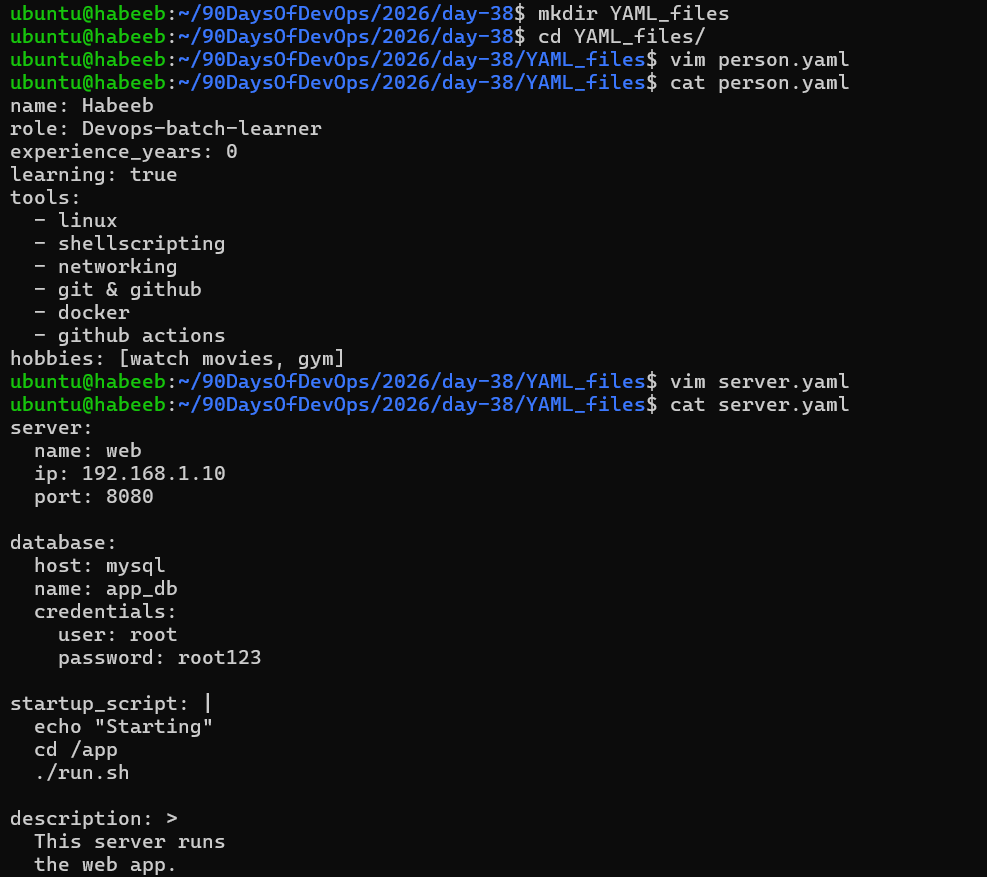
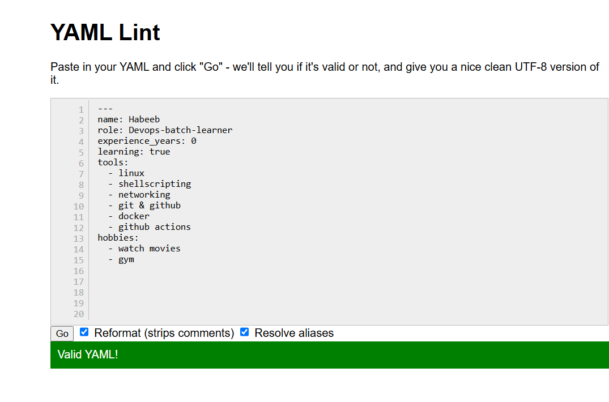
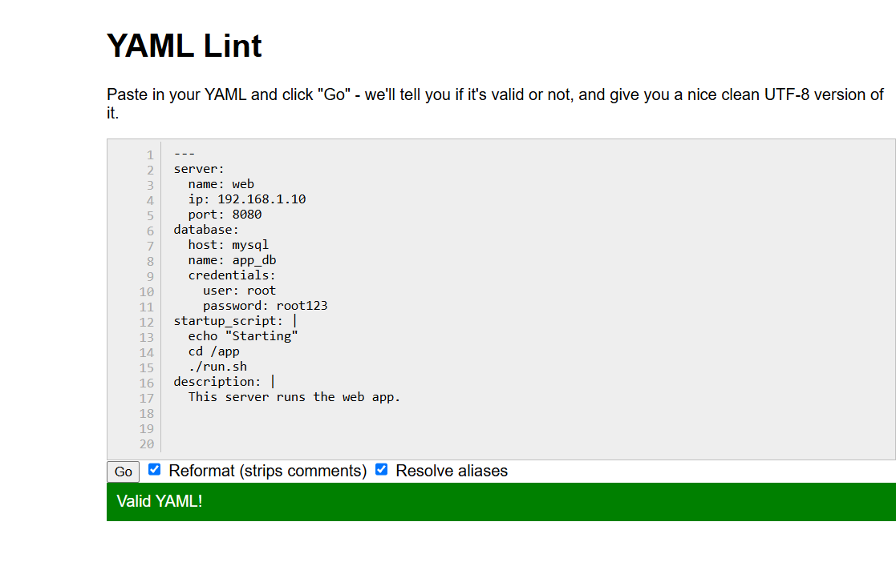
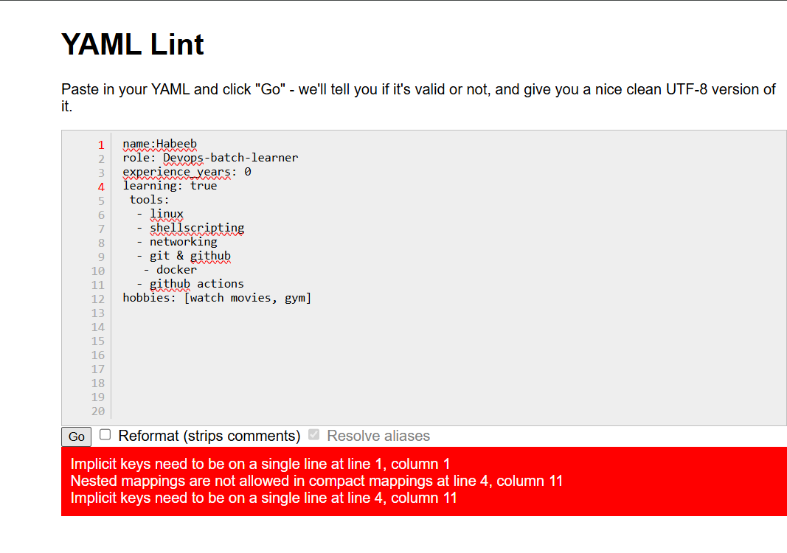

# Day 38 – YAML Basics

## Task 1: Key-Value Pairs
Create `person.yaml` that describes yourself with:
- `name`
- `role`
- `experience_years`
- `learning` (a boolean)

**Verify:** Run `cat person.yaml` — does it look clean? No tabs?

[Person.yml](YAML_files/person.yaml)

---

## Task 2: Lists
Add to `person.yaml`:
- `tools` — a list of 5 DevOps tools you know or are learning
- `hobbies` — a list using the inline format `[item1, item2]`

Write in your notes: What are the two ways to write a list in YAML?

1. Block style: (one item per line, starting with `-`)
```powershell
tools:
  - linux
  - shellscripting
  - networking
  - git & github
  - docker
  - github actions
```
2. Flow (inline) style: (square brackets, comma-separated)

```powershell
hobbies: [watch movies, gym]
```



## Task 3: Nested Objects
Create `server.yaml` that describes a server:
- `server` with nested keys: `name`, `ip`, `port`
- `database` with nested keys: `host`, `name`, `credentials` (nested further: `user`, `password`)

**Verify:** Try adding a tab instead of spaces — what happens when you validate it?

[Server.yml](YAML_files/server.yaml)

```powershell
server:
^name: web
  ip: 192.168.1.10
  port: 8080
```

Output:
```powershell
found character '\t' that cannot start any token
  in "server_tab.yaml", line 2, column 1
```

YAML does not allow tabs for indentation. It uses spaces to decide which keys are nested, 
so a `tab` makes the file invalid.

---

## Task 4: Multi-line Strings
In `server.yaml`, add a `startup_script` field using:
1. The `|` block style (preserves newlines)
2. The `>` fold style (folds into one line)

```powershell
startup_script: |
  echo "Starting"
  cd /app
  ./run.sh

description: >
  This server runs
  the web app.
```

Write in your notes: When would you use `|` vs `>`?

-> I'd use `|` when i want to preserve line breaks (scripts, commands).

-> I'd use `>` when long text should be folded into a single line (descriptions, paragraphs).

---

## Task 5: Validate Your YAML
1. Install `yamllint` or use an online validator
2. Validate both your YAML files
3. Intentionally break the indentation — what error do you get?
4. Fix it and validate again

Validation:

[Person.yml](YAML_files/person.yaml)



[Server.yml](YAML_files/server.yaml)



Breaking the Indentation:



---

### Task 6: Spot the Difference
Read both blocks and write what's wrong with the second one:

```yaml
# Block 1 - correct
name: devops
tools:
  - docker
  - kubernetes
```

```yaml
# Block 2 - broken
name: devops
tools:
- docker
  - kubernetes   # <-- wrong indentation
```
* Indentation is wrong in the second block.
---

### Key takeaways:

* YAML uses spaces for indentation, never tabs. A tab or wrong indentation breaks the file.

* YAML is built from key-value pairs, lists (block or [inline]) and nested objects.

* `|` keeps line breaks (scripts), `>` folds them into one line (descriptions).

### Tip: Validate with yamllint to catch errors early.


