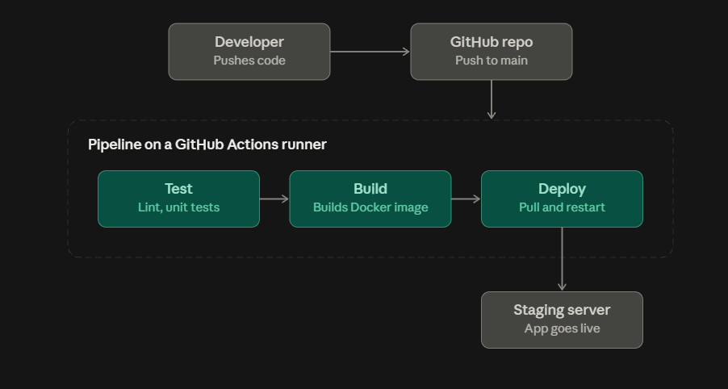

# Day 39 – What is CI/CD?

## Task 1: The Problem
Think about a team of 5 developers all pushing code to the same repo manually deploying to production.

1. What can go wrong?

```
- Code from different developers clashes if they push at the same time.

- Untested code reaches production because running tests is optional.

- Two people deploy at once and overwrite each other’s release.

- No record of who deployed what, so rollbacks are slow and risky.
```

2. What does "it works on my machine" mean and why is it a real problem?

```
`Defintion:` The app runs on a developer’s laptop but fails on the server or a teammate’s setup.

- The cause is `environment differences`: language versions, missing dependencies, or configs.

- It leads to wasted debugging time
```

3. How many times a day can a team safely deploy manually?

```
- 1–2 times per day at most (For safety)

Why?

- Manual deployments take time and increase the risk of human errors, downtime, and rollback difficulties.
```

---

## Task 2: CI vs CD
Research and write short definitions (2-3 lines each):

1. **Continuous Integration** — what happens, how often, what it catches

```
- Every time I push code (many times a day), the CI system automatically build, tests and validate code quality.

- It catches broken builds, failing tests, and merge conflicts within minutes instead of days.

- Example: I open a pull request, the pipeline runs unit tests, and a failure blocks the merge until I fix it.
```

2. **Continuous Delivery** — how it's different from CI, what "delivery" means
```
- It builds on CI: every change that passes is automatically packaged and kept ready to release.

- “Delivery” means the code is deployable at any moment, but a human still approves the final push to production.

- Example: A bank’s pipeline deploys to staging and runs checks, then a manager clicks “Approve” before production.
```

3. **Continuous Deployment** — how it differs from Delivery, when teams use it

```
- It goes one step beyond Delivery: there’s no manual approval, so every passing change goes live automatically.

- Teams use it when they have strong automated tests and monitoring, and want fast releases, like web apps and SaaS products.

- Example: I merge a small fix to main, and within minutes it’s live for users with no one clicking anything.
```

---

## Task 3: Pipeline Anatomy
A pipeline has these parts — write what each one does:

> `Trigger` - The event that starts the pipeline, like a push, a pull request, a schedule, or a manual click.

> `Stage` - A logical phase of the pipeline, such as build, test, or deploy. Stages usually run in order.

> `Job` - A unit of work inside a stage, like “run unit tests”.

> - Each job runs independently, can contain multiple steps.

> - Examples: Cloning code, running tests, building images.

> `Step` - A single command or action inside a job, like npm install or docker build .

> `Runner` - The machine that executes the job, it provides the environment where jobs run.

> `Artifact` - The output a job produces, like a compiled build, test report, or Docker image, 
which later jobs can use or I can download.

---

## Task 4: Draw a Pipeline
Draw a CI/CD pipeline for this scenario:
> A developer pushes code to GitHub. The app is tested, built into a Docker image, and deployed to a staging server.



Workflow:

> - `Stage 1 (Test):` checks that my code works before anything else happens.

> - `Stage 2 (Build):` packages the app into a Docker image, which is the artifact.

> - `Stage 3 (Deploy):` pulls that image onto the staging server and starts it.

- If any `stage fails`, the pipeline stops, so broken code never moves forward.

## Task 5: Explore in the Wild
1. Open any popular open-source repo on GitHub (Kubernetes, React, FastAPI — pick one you know)
2. Find their `.github/workflows/` folder
3. Open one workflow YAML file
4. Write in your notes:

[Kubernetes-Workflow](https://github.com/kubernetes/minikube/blob/master/.github/workflows/build.yml)

What triggers it?

> - A push to the `master` branch, but only when certain files change: go.mod, any .go file, or the Makefile.
> - Changes under deploy/kicbase/, deploy/iso/ and site/ are excluded, so docs-only or image-only changes don’t start it.
> - It can also be started manually `(workflow_dispatch)`.

How many jobs does it have?

> - It has 2 Jobs - `build_minikube` and `unit_test`.

What does it do (best guess)?

> - `build_minikube` checks out the code, sets up Go, downloads dependencies, and builds the minikube binaries 
for multiple platforms with make cross and make e2e-cross. 

> - It then uploads them as an artifact called `minikube_binaries`.

> - `unit_test` sets up Go, installs libvirt, downloads dependencies, and runs the unit tests with make test.

What I learned:

> Path filters let a pipeline run only when relevant code changes, which saves CI time.

> Jobs without dependencies run in parallel, and every step has a timeout-minutes so a stuck step can’t hang the pipeline.

> upload-artifact is a real example of the “artifact” concept from Task 3.
