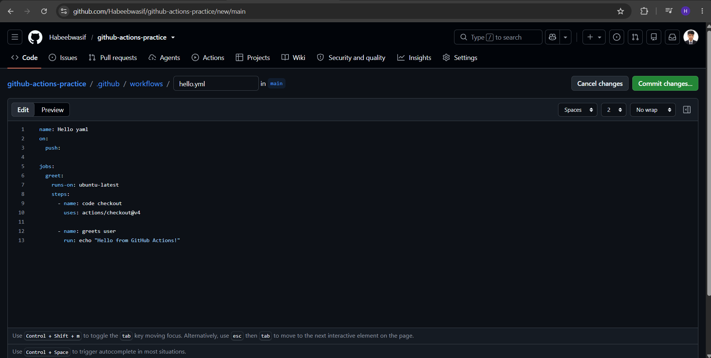
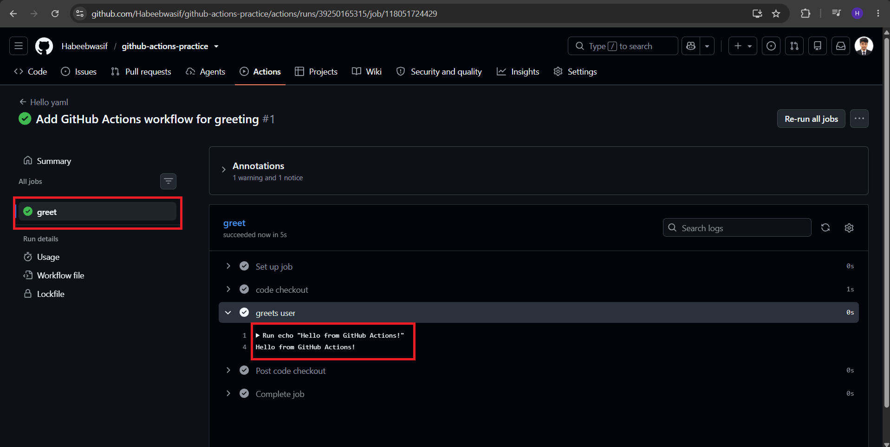
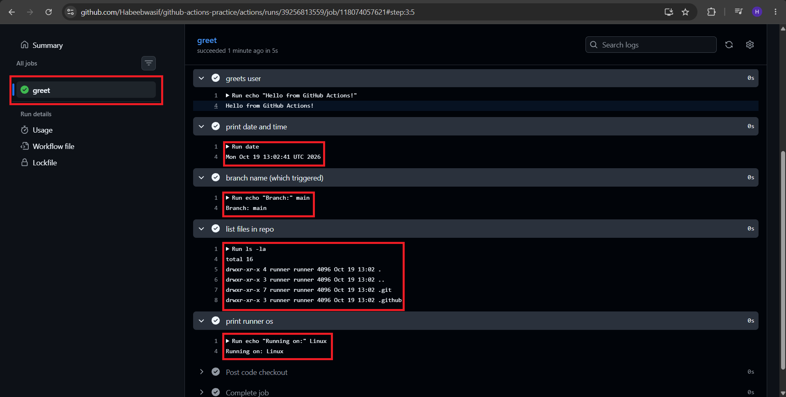
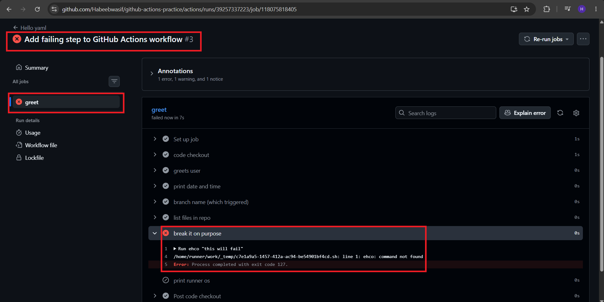
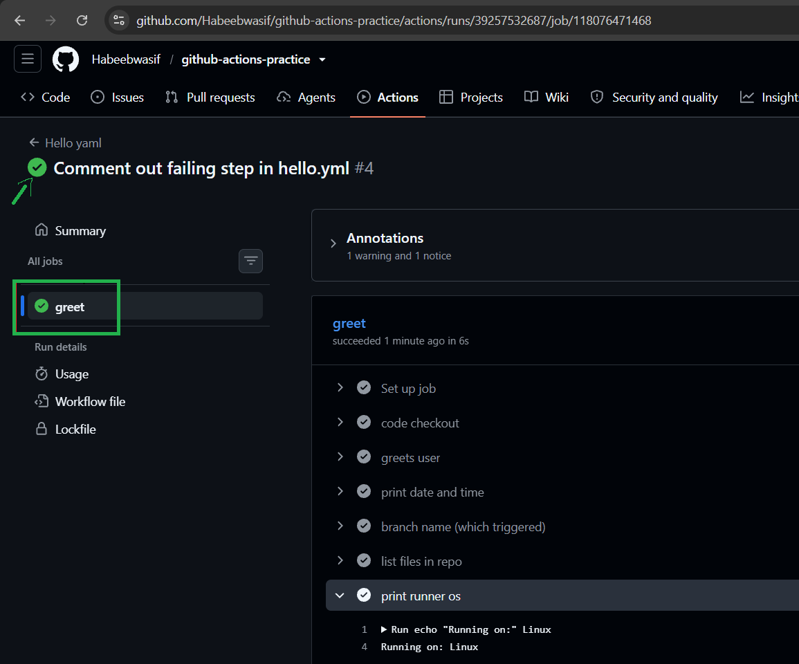

# Day 40 – Your First GitHub Actions Workflow

## Task 1: Set Up
1. Create a new **public** GitHub repository called `github-actions-practice`
2. Clone it locally
3. Create the folder structure: `.github/workflows/`

[GitHub-Actions-Repo](https://github.com/Habeebwasif/github-actions-practice/tree/main/.github/workflows)

---

## Task 2: Hello Workflow
Create `.github/workflows/hello.yml` with a workflow that:
1. Triggers on every `push`
2. Has one job called `greet`
3. Runs on `ubuntu-latest`
4. Has two steps:
   - Step 1: Check out the code using `actions/checkout`
   - Step 2: Print `Hello from GitHub Actions!`



Push it. Go to the **Actions** tab on GitHub and watch it run.

**Verify:** Is it green? Click into the job and read every step.

```text
Yes, It's green with no failing steps
```



---

## Task 3: Understand the Anatomy
Look at your workflow file and write in your notes what each key does:

`on: `	- Defines when the workflow triggers

`jobs: ` - The set of jobs to be executed by workflow

`runs-on:	` - Specifies the type of virtual machine on which the jobs gonna run

`steps: ` -	Sequence of actions that job will execute

`uses:	` - Use of a pre-built GitHub reusable action (e.g. actions/checkout@v4)

`run:	` - Executing of shell commands

`name: (step)`	A readable label for the step

---

## Task 4: Add More Steps
Update `hello.yml` to also:
1. Print the current date and time
2. Print the name of the branch that triggered the run (hint: GitHub provides this as a variable)
3. List the files in the repo
4. Print the runner's operating system



---

## Task 5: Break It On Purpose
1. Add a step that runs a command that will **fail** (e.g., `exit 1` or a misspelled command)
2. Push and observe what happens in the Actions tab
3. Fix it and push again

### Failed Workflow:



Q. What does a failed pipeline look like?

```text
When a workflow step fails:

- The step and job show a red X (Failure), and the workflow run is marked failed.
- The remaining steps in that job are skipped.
- The failed step is highlighted and expands in the Actions tab.
- The logs show the error message and exit code (e.g. command not found, exit code 127).
- Any non-zero exit code fails a step.
```

### Fixed Workflow:

- I opened the failed run, 
- expand the red step, 
- read the log, fixed the line, 
- and pushed it again.


