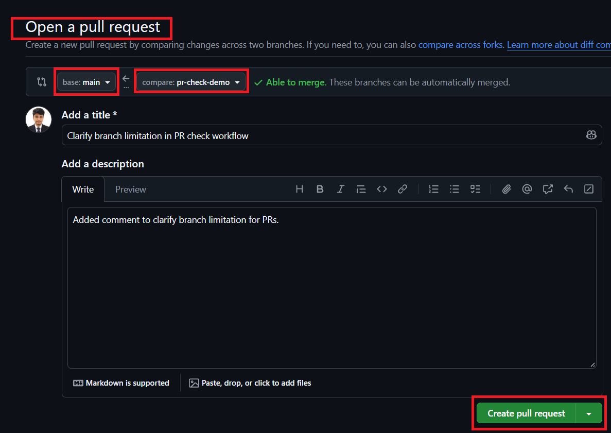
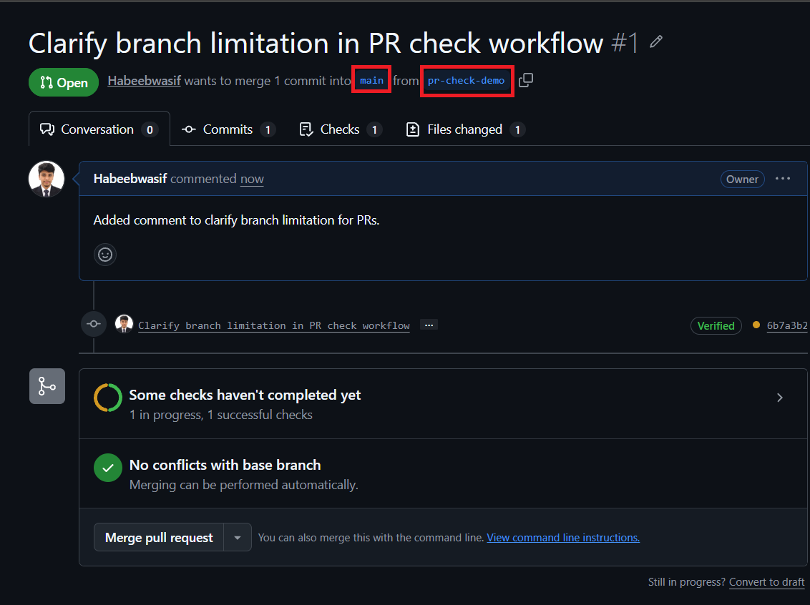
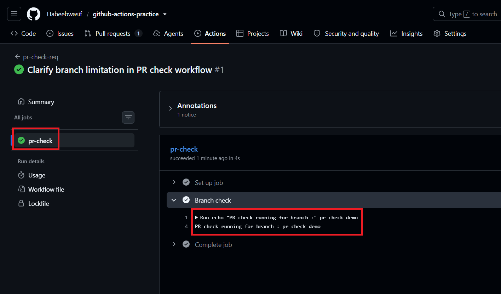
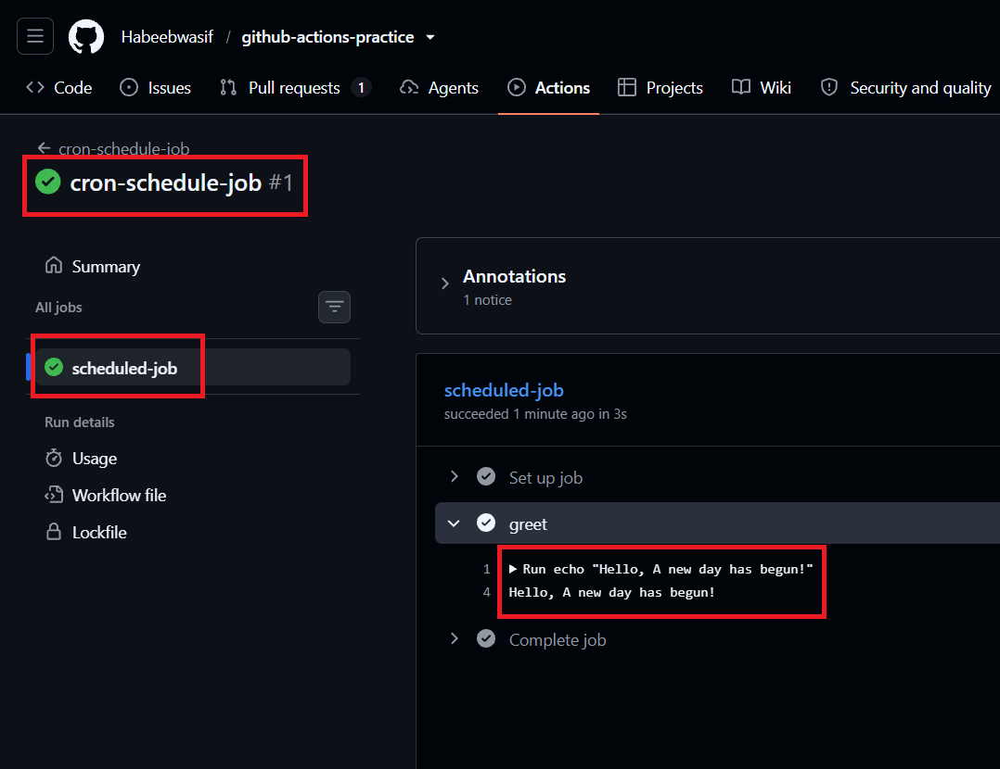
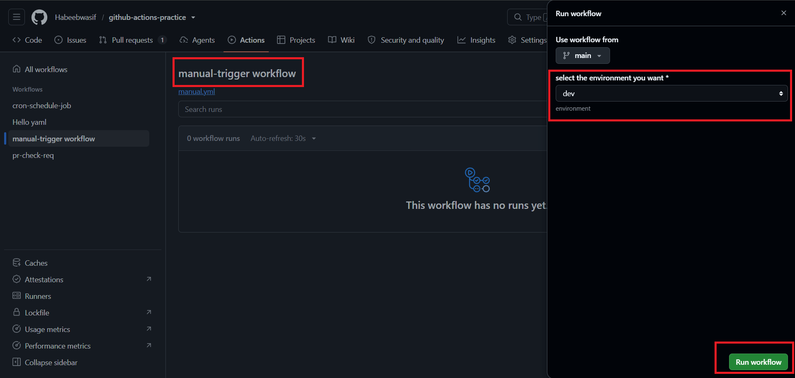
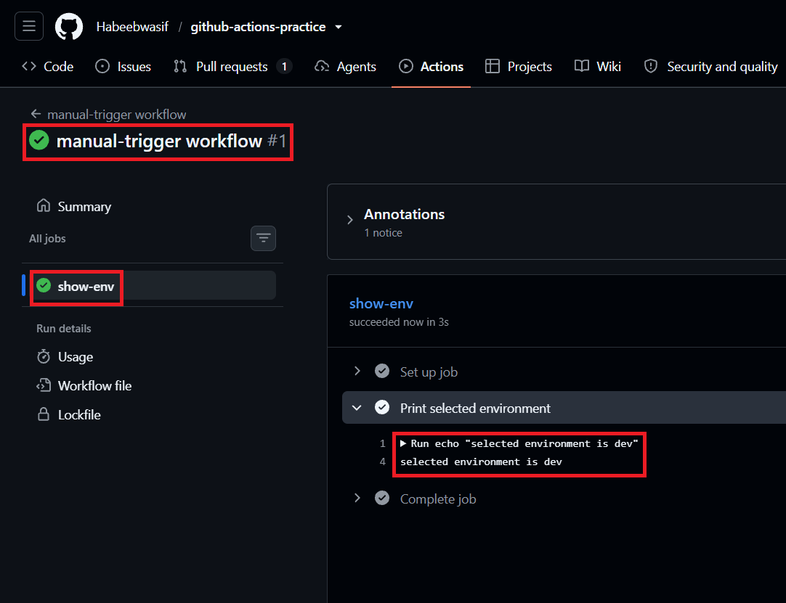
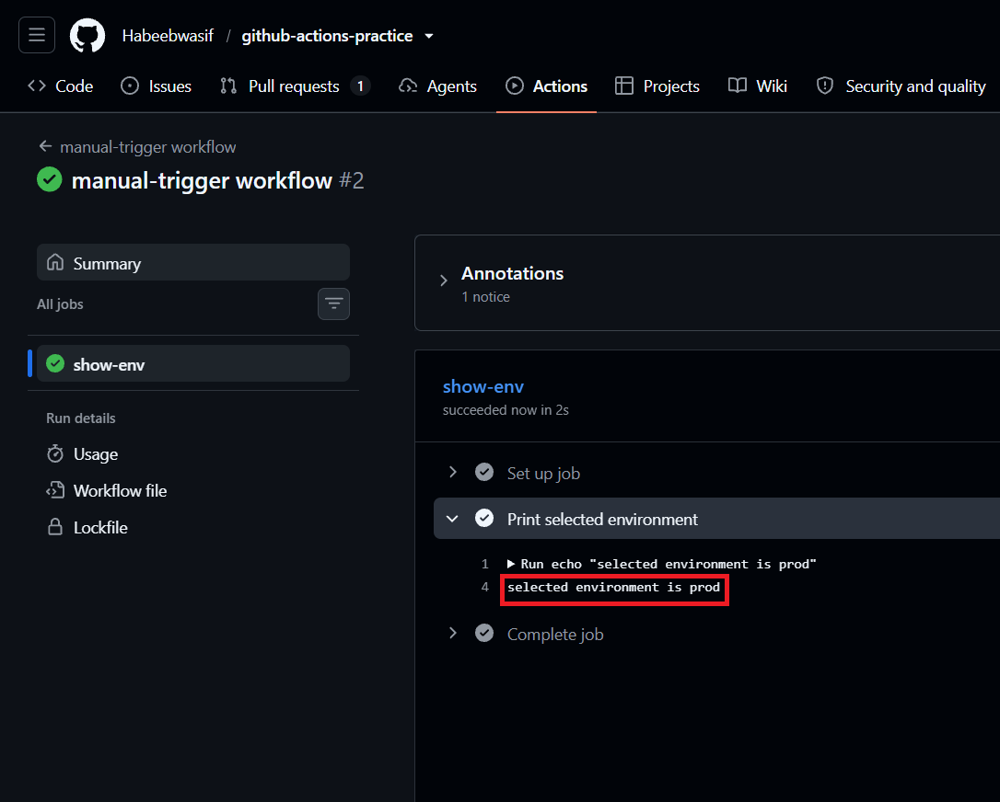
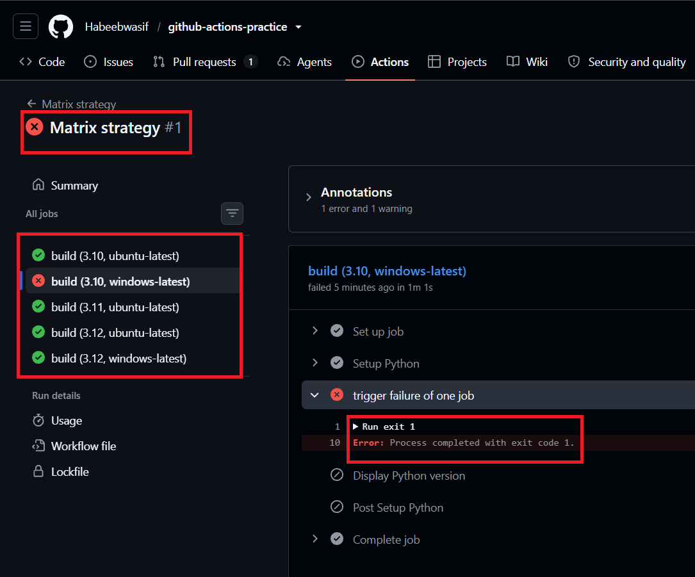

# Day 41 – Triggers & Matrix Builds

## Task 1: Trigger on Pull Request
1. Create `.github/workflows/pr-check.yml`
2. Trigger it only when a pull request is **opened or updated** against `main`
3. Add a step that prints: `PR check running for branch: <branch name>`
4. Create a new branch, push a commit, and open a PR
5. Watch the workflow run automatically

**Verify:** Does it show up on the PR page?

> Yes, it showed up on the PR page.

[PR-Check](https://github.com/Habeebwasif/github-actions-practice/blob/main/.github/workflows/pr-check.yml)

### Created a Branch, pushed a commit and opened a PR.

### Running Workflow

---

## Task 2: Scheduled Trigger
1. Add a `schedule:` trigger to any workflow using cron syntax
2. Set it to run every day at midnight UTC (`0 0 * * *`)
3. Write in your notes: What is the cron expression for every Monday at 9 AM?

> Cron Expression for every Monday at 9 AM:  0 9 * * 1

[Cron-Schedule](https://github.com/Habeebwasif/github-actions-practice/blob/main/.github/workflows/cron_schedule.yml)

### Running Workflow

---

## Task 3: Manual Trigger
1. Create `.github/workflows/manual.yml` with a `workflow_dispatch:` trigger
2. Add an **input** that asks for an `environment` name (staging/production)
3. Print the input value in a step
4. Go to the **Actions** tab → find the workflow → click **Run workflow**

**Verify:** Can you trigger it manually and see your input printed?

> Yes, I'm able to trigger it manually and select my choice.

[Manual-WF](https://github.com/Habeebwasif/github-actions-practice/blob/main/.github/workflows/manual.yml)

### Running Workflow

---

## Task 4: Matrix Builds
Create `.github/workflows/matrix.yml` that:
1. Uses a matrix strategy to run the same job across:
   - Python versions: `3.10`, `3.11`, `3.12`
2. Each job installs Python and prints the version
3. Watch all 3 run in parallel

Then extend the matrix to also include 2 operating systems — how many total jobs run now?

> Total 6 (without exclude)

[Matrix-WF](https://github.com/Habeebwasif/github-actions-practice/blob/main/.github/workflows/matrix.yml)

---

### Task 5: Exclude & Fail-Fast
1. In your matrix, **exclude** one specific combination (e.g., Python 3.10 on Windows)
2. Set `fail-fast: false` — trigger a failure in one job and observe what happens to the rest
3. Write in your notes: What does `fail-fast: true` (the default) do vs `false`?

`fail-fast: true` (Default) - If any single job in matrix fails, GitHub immediately cancels all 
other running and in-progress jobs within that matrix.

`fail-fast: false` - If a job fails, GitHub allows all other running jobs in the matrix to complete normally.

### Running Workflow

