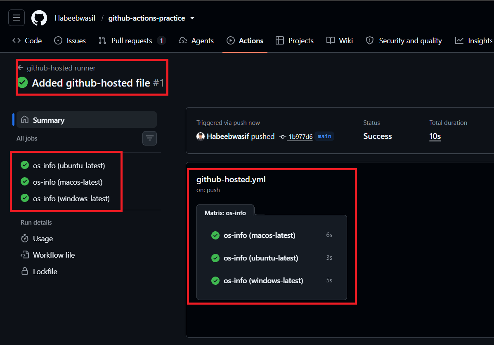
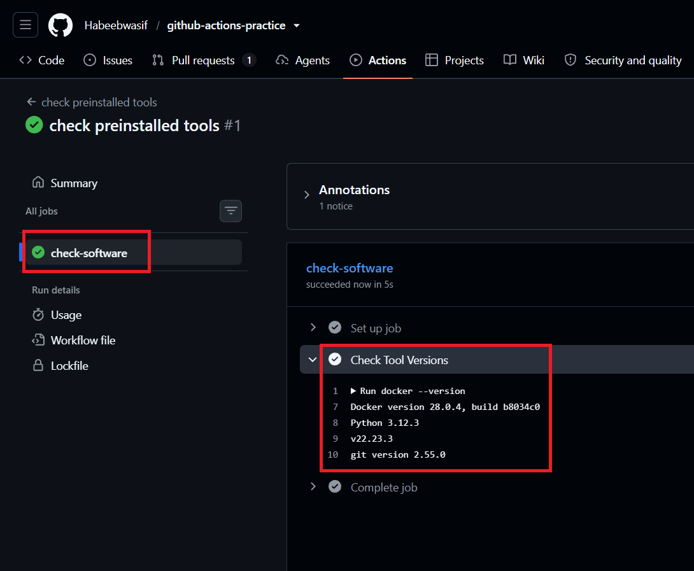
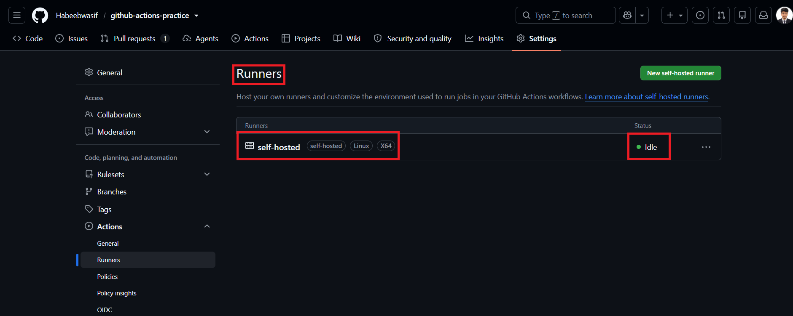
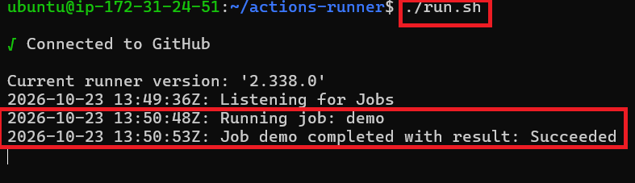
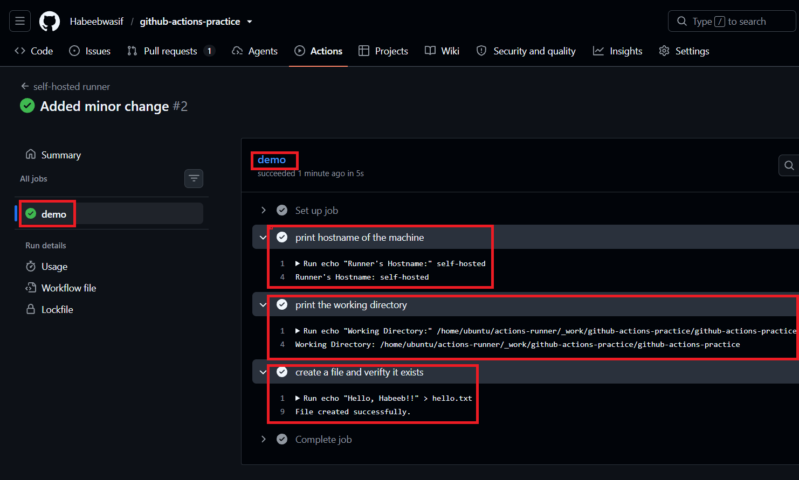
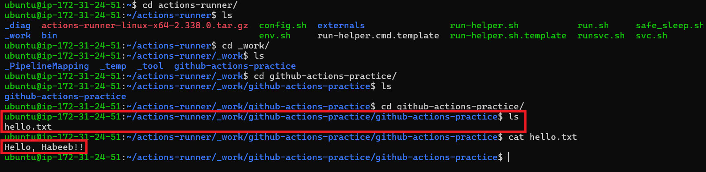
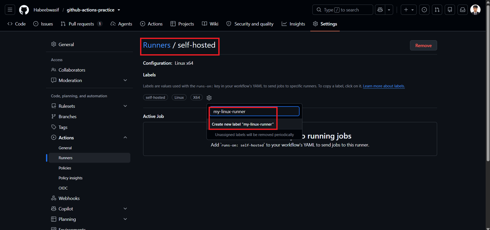
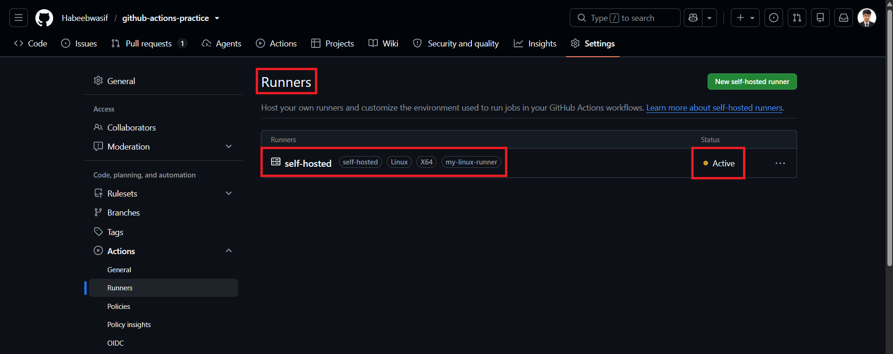
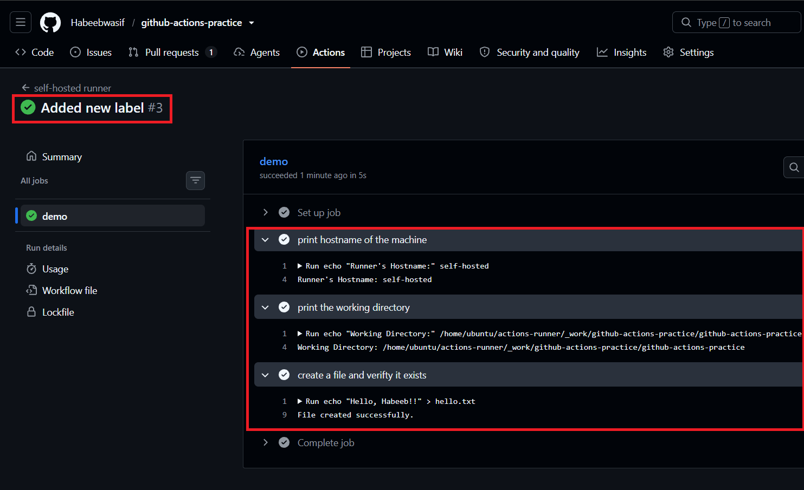

# Day 42 – Runners: GitHub-Hosted & Self-Hosted

## Task 1: GitHub-Hosted Runners
1. Create a workflow with 3 jobs, each on a different OS:
   - `ubuntu-latest`
   - `windows-latest`
   - `macos-latest`
2. In each job, print:
   - The OS name
   - The runner's hostname
   - The current user running the job
3. Watch all 3 run in parallel

[GitHub-Hosted](https://github.com/Habeebwasif/github-actions-practice/blob/main/.github/workflows/github-hosted.yml)

## What is a GitHub-hosted runner? Who manages it?

**What it is**
- A virtual machine (VM) that GitHub provides to run your workflow jobs
- Available in Linux, Windows, and macOS
- Comes with common tools already installed (Git, Docker, Node.js, Python, Java, etc.)
- Selected in a workflow with `runs-on`, for example `runs-on: ubuntu-latest`

**Who manages it**
- GitHub manages it, not you
- GitHub sets up the machine, patches the OS, and updates the tools
- You don't need to install, maintain, or pay for any hardware

**How it behaves**
- Every job gets a fresh, clean VM
- The VM is deleted after the job finishes, so nothing is left behind

---

## Task 2: Explore What's Pre-installed
1. On the `ubuntu-latest` runner, run a step that prints:
   - Docker version
   - Python version
   - Node version
   - Git version
  
[Pre-Installed](https://github.com/Habeebwasif/github-actions-practice/blob/main/.github/workflows/pre-installed.yml)

## Why does it matter that runners come with tools pre-installed?

- **Saves time:** No need to install Git, Docker, Node.js, Python, etc. before every job
- **Faster workflows:** Jobs start working on your code right away instead of setting up the environment
- **Less setup work:** Your workflow file stays short and simple, with fewer steps to write and maintain
- **Fewer errors:** Install steps can fail (network issues, version conflicts), and skipping them removes that risk
- **Consistent environment:** Every run starts with the same tools and versions, so results are predictable
- **Lower cost:** Less time spent installing means fewer billed minutes

**Contrast with self-hosted:** you must install and update all tools yourself.

---

## Task 3: Set Up a Self-Hosted Runner
1. Go to your GitHub repo → Settings → Actions → Runners → **New self-hosted runner**
2. Choose Linux as the OS
3. Follow the instructions to download and configure the runner on:
   - Your local machine, OR
   - A cloud VM (EC2, Utho, or any VPS)
4. Start the runner — verify it shows as **Idle** in GitHub

**Verify:** Your runner appears in the Runners list with a green dot.

---

## Task 4: Use Your Self-Hosted Runner
1. Create `.github/workflows/self-hosted.yml`
2. Set `runs-on: self-hosted`
3. Add steps that:
   - Print the hostname of the machine (it should be YOUR machine/VM)
   - Print the working directory
   - Create a file and verify it exists on your machine after the run
4. Trigger it and watch it run on your own hardware

**Verify:** Check your machine — is the file there? 

> Yes, file is located.

[Self-Hosted](https://github.com/Habeebwasif/github-actions-practice/blob/main/.github/workflows/self-hosted.yml)

---

## Task 5: Labels
1. Add a **label** to your self-hosted runner (e.g., `my-linux-runner`)
2. Update your workflow to use `runs-on: [self-hosted, my-linux-runner]`
3. Trigger it — does it still pick up the job?
4. Write in your notes: Why are labels useful when you have multiple self-hosted runners?

> Yes, the runner still picks up the jobs.

> Labels let a workflow choose which self-hosted runner runs a job, 
> based on what it needs (OS, hardware, environment), instead of getting any random one.

---

## Task 6: GitHub-Hosted vs Self-Hosted
Fill this in your notes:

| | GitHub-Hosted | Self-Hosted |
|---|---|---|
| Who manages it? | GitHub | We manage it |
| Cost | Free 2000 mins (per month, public repos unlimited) | As per our own infrastructure usage |
| Pre-installed tools | Yes (common languages, build tools, Docker, etc.) | No (we install and maintain ourselves) |
| Good for | Small independent jobs, quick CI/CD setup | Production workloads, specialized environments |
| Security concern | Controlled by GitHub —so must be handled carefully | Our responsibility — we must secure the machine, patch OS/tools, and protect secrets |

