# Day 43 – Jobs, Steps, Env Vars & Conditionals

## Task 1: Multi-Job Workflow
Create `.github/workflows/multi-job.yml` with 3 jobs:
- `build` — prints "Building the app"
- `test` — prints "Running tests"
- `deploy` — prints "Deploying"

Make `test` run only **after** `build` succeeds.
Make `deploy` run only **after** `test` succeeds.

**Verify:** Check the workflow graph in the Actions tab — does it show the dependency chain? 

> Yes, it does showw the dependency chain.

[Multi-Job-Workflow](https://github.com/Habeebwasif/github-actions-practice/blob/main/.github/workflows/multi-job.yml)

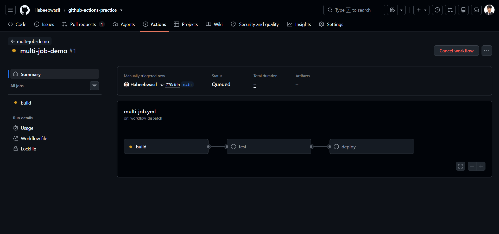

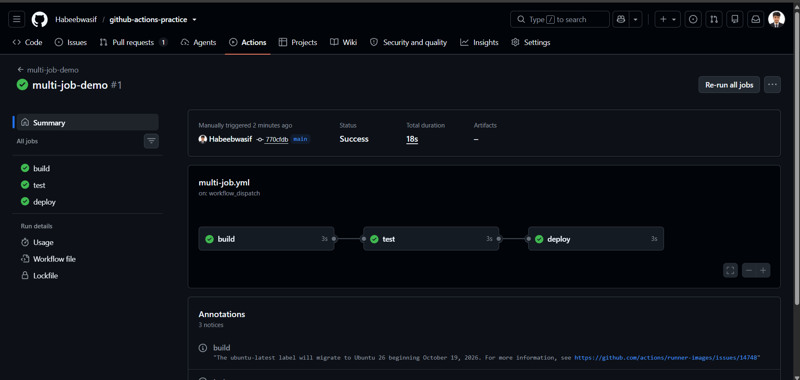

---

## Task 2: Environment Variables
In a new workflow, use environment variables at 3 levels:
1. **Workflow level** — `APP_NAME: myapp`
2. **Job level** — `ENVIRONMENT: staging`
3. **Step level** — `VERSION: 1.0.0`

[Env-workflow](https://github.com/Habeebwasif/github-actions-practice/blob/main/.github/workflows/env_variable.yml)

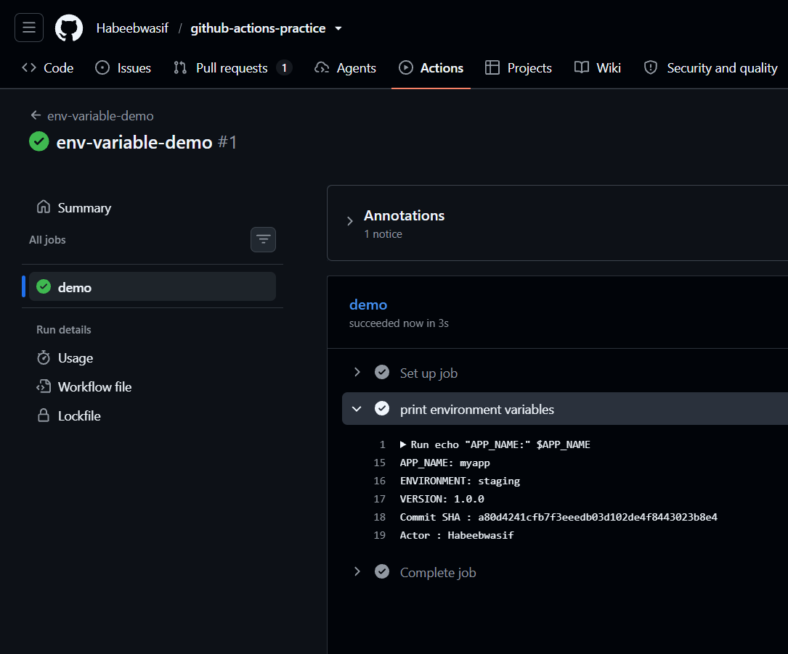

---

## Task 3: Job Outputs
1. Create a job that **sets an output** — e.g., today's date as a string
2. Create a second job that **reads that output** and prints it
3. Pass the value using `outputs:` and `needs.<job>.outputs.<name>`

[Job-Date-Workflow](https://github.com/Habeebwasif/github-actions-practice/blob/main/.github/workflows/job_date.yml)

Write in your notes: Why would you pass outputs between jobs?

```
Each job runs on its own fresh runner, so outputs are how one job shares small values
(like a version, flag, or result) with the jobs that depend on it.
```

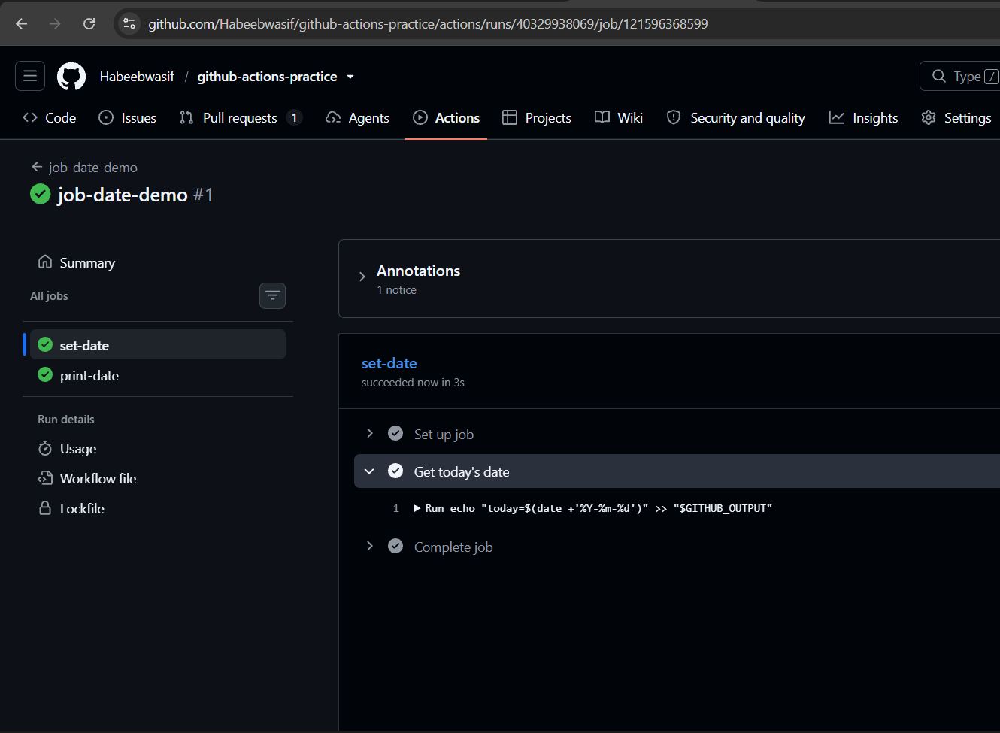

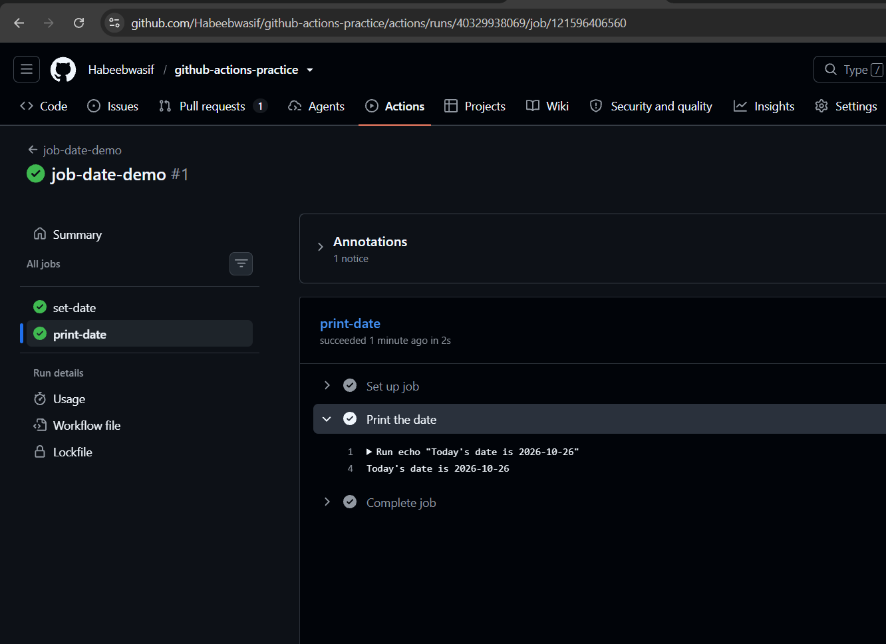

---

## Task 4: Conditionals
In a workflow, add:

[Conditional-Workflow](https://github.com/Habeebwasif/github-actions-practice/blob/main/.github/workflows/conditionals.yml)

1. A step that only runs when the branch is `main`

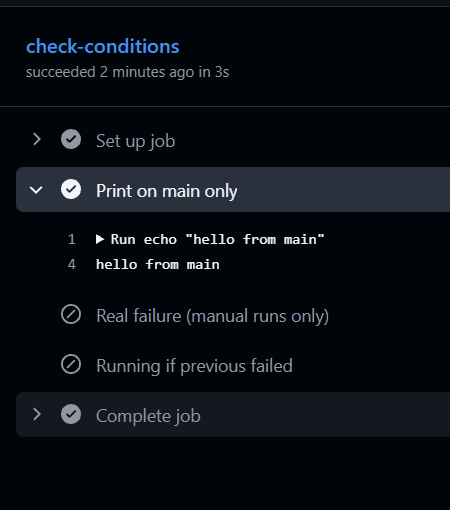

2. A step that only runs when the previous step **failed**

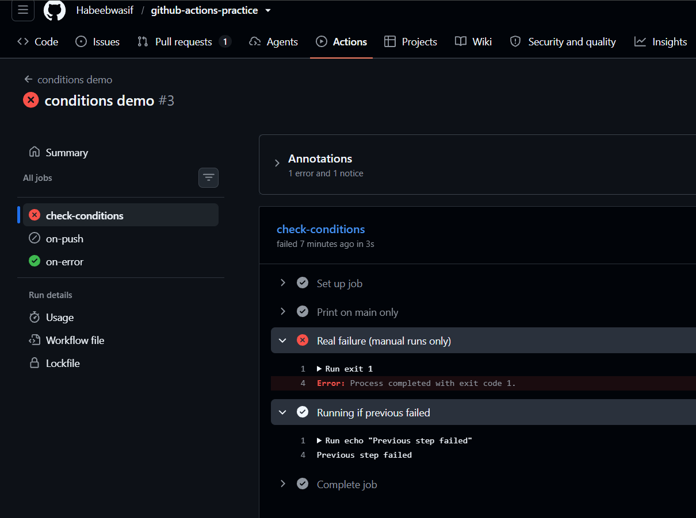

3. A job that only runs on **push** events, not on pull requests

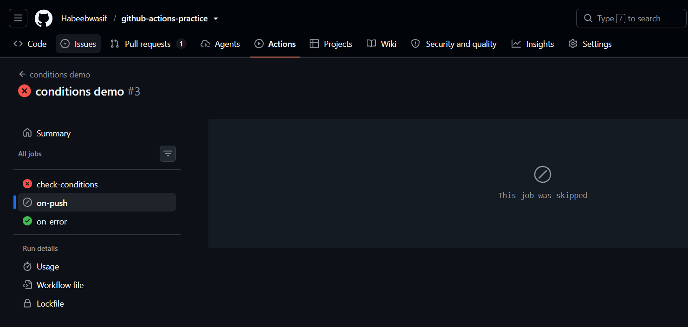

4. A step with `continue-on-error: true` — what does this do?

> It lets a step fail without failing the job: the error is still logged, but the job keeps running and can finish green.

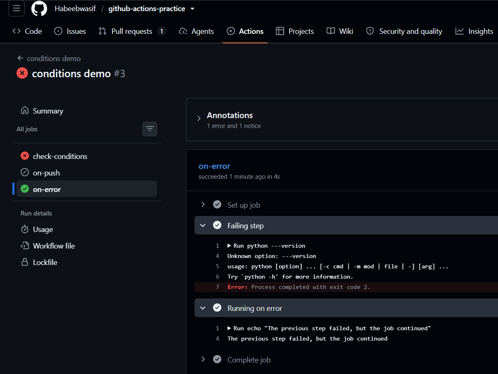

---

## Task 5: Putting It Together
Created `.github/workflows/smart-pipeline.yml` that:
1. Triggers on push to any branch
2. Has a `lint` job and a `test` job running in parallel
3. Has a `summary` job that runs after both, prints whether it's a `main` branch push or a feature branch push, and prints the commit message

[Smart-Pipeline-Workflow](https://github.com/Habeebwasif/github-actions-practice/blob/main/.github/workflows/smart-pipeline.yml)

### Lint and Test Job

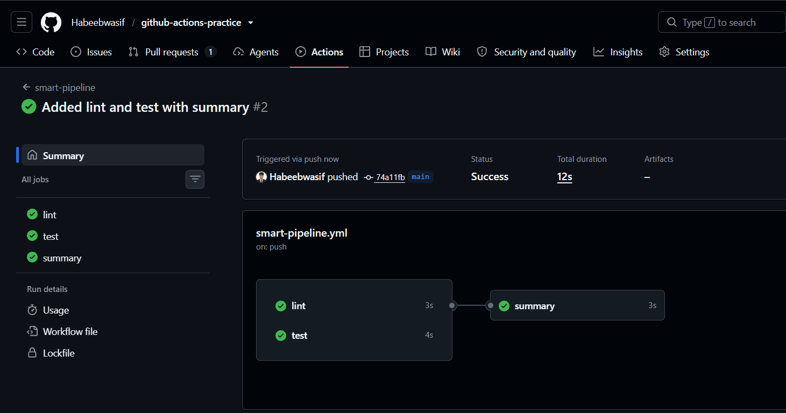

### Summary Job

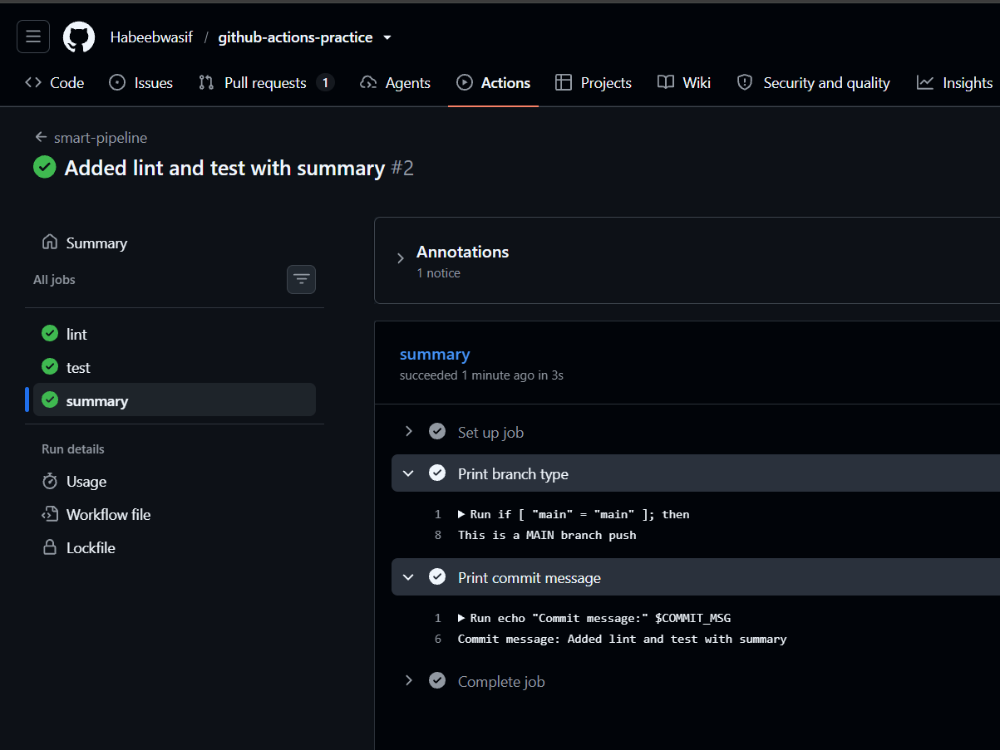

## Key Takeaway

### `needs:` and `outputs:` in my own words

### `needs:`

`needs:` tells a job to wait for other jobs before it starts. Without it, every job in a workflow starts at the same time, each on its own machine. With it, you control the order.

    summary:
      needs: [lint, test]

Here `summary` waits until both `lint` and `test` finish, and by default it only runs if both succeeded. It also unlocks a second ability: a job can only read another job's outputs if it lists that job in `needs:`.

### `outputs:`

`outputs:` is how a job hands a small piece of data to other jobs. Every job runs on a separate fresh machine, so a value created in one job doesn't exist in another. `outputs:` publishes that value so later jobs can read it.

    set-date:
      outputs:
        today: ${{ steps.get_date.outputs.today }}

This says: "expose a job output named `today`, whose value comes from the step with `id: get_date`." The step itself writes the value with `echo "today=..." >> "$GITHUB_OUTPUT"`.
