# Day 44 – Secrets, Artifacts, Real CI Testing & Caching

## Overview

Today I learned how GitHub Actions securely manages sensitive information, shares files between jobs using artifacts, executes real scripts in a CI pipeline, validates workflow failures, and improves workflow performance using dependency caching.

---

# Task 1: GitHub Secrets

## Overview of what I did

- Created a repository secret named `MY_SECRET_MESSAGE`.
- Wrote a workflow to verify whether the secret exists.
- Passed the secret as an environment variable.
- Verified that GitHub masks secret values in workflow logs.

## What I Learned

- How to securely store sensitive information in GitHub.
- Why secrets should never be hardcoded.
- GitHub automatically masks secret values in logs.
- Secrets can be safely accessed using environment variables.

[Secrets-Demo](https://github.com/Habeebwasif/github-actions-practice/blob/main/.github/workflows/secrets-demo.yml)

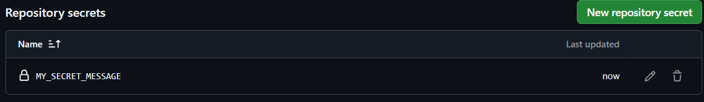

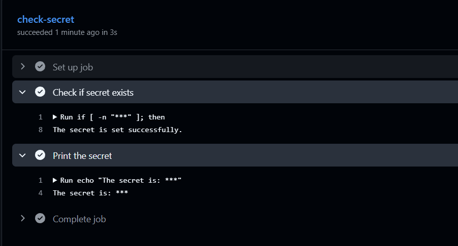

---

### Task 2: Use Secrets as Environment Variables
1. Pass a secret to a step as an environment variable
2. Use it in a shell command without ever hardcoding it
3. Add `DOCKER_USERNAME` and `DOCKER_TOKEN` as secrets (you'll need these on Day 45)

[Secret-Env](https://github.com/Habeebwasif/github-actions-practice/blob/main/.github/workflows/secret_env.yml)

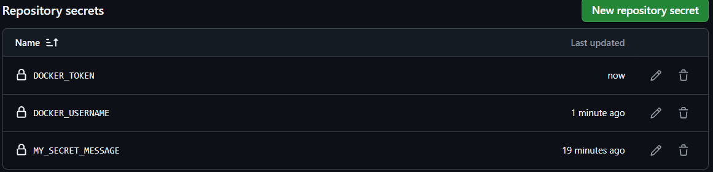

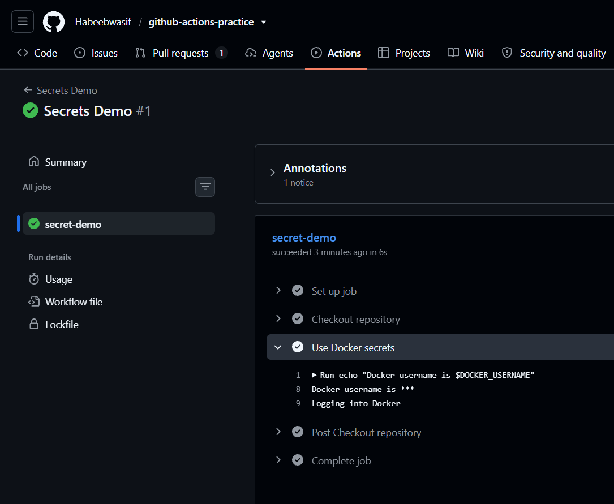

---

### Task 3: Upload Artifacts
1. Create a step that generates a file — e.g., a test report or a log file
2. Use `actions/upload-artifact` to save it
3. After the workflow runs, download the artifact from the Actions tab

[Upload-Artifact](https://github.com/Habeebwasif/github-actions-practice/blob/main/.github/workflows/upload-artifact.yml)

**Verify:** Can you see and download it from GitHub?

> Yes, able to see and download it from GitHub.

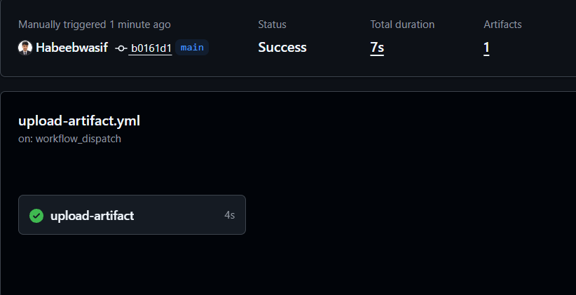

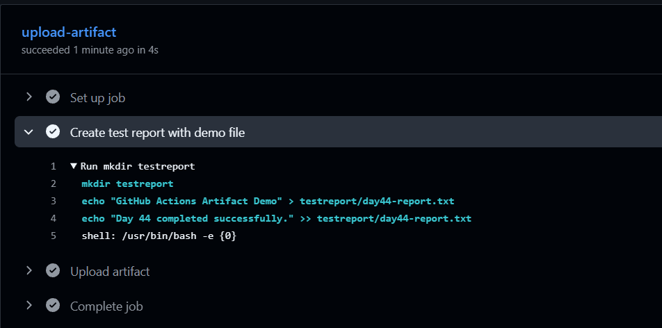

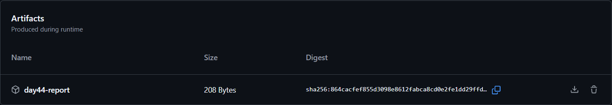

---

### Task 4: Download Artifacts Between Jobs
1. Job 1: generate a file and upload it as an artifact
2. Job 2: download the artifact from Job 1 and use it (print its contents)

[Download-Artifact](https://github.com/Habeebwasif/github-actions-practice/blob/main/.github/workflows/download-artifact.yml)

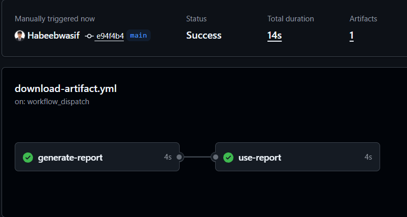

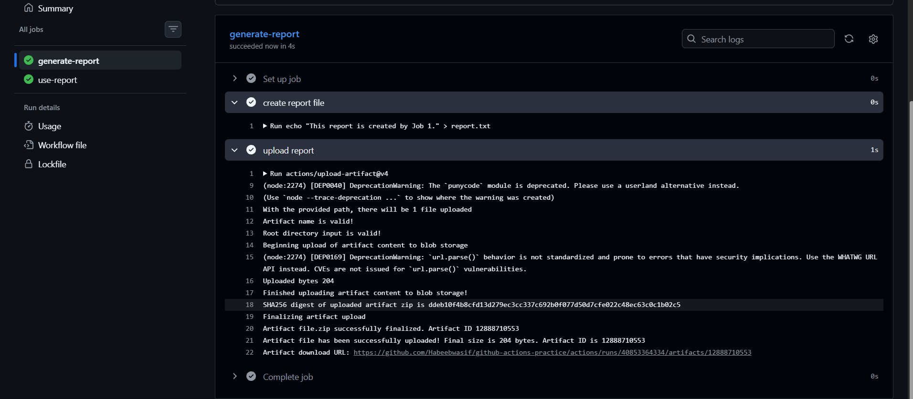

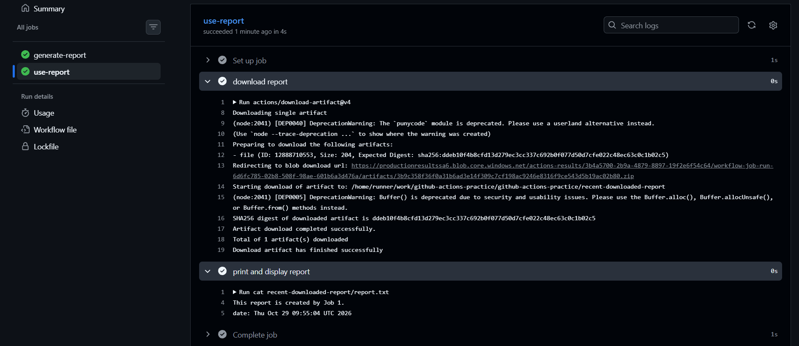

Write in your notes: When would you use artifacts in a real pipeline?

> I would use them:
> To save and share files a run produces (build outputs, test reports, logs, release packages)
> so later jobs or people can download them after the runner is destroyed.

---

### Task 5: Run Real Tests in CI
Take any script from your earlier days (Python or Shell) and run it in CI:
1. Add your script to the `github-actions-practice` repo
2. Write a workflow that:
   - Checks out the code
   - Installs any dependencies needed
   - Runs the script
   - Fails the pipeline if the script exits with a non-zero code
  
[Run-Tests-CI](https://github.com/Habeebwasif/github-actions-practice/blob/main/.github/workflows/Run-testsCI.yml)

3. Intentionally break the script — verify the pipeline goes red

> Intentionally broke the script with Exit 1.

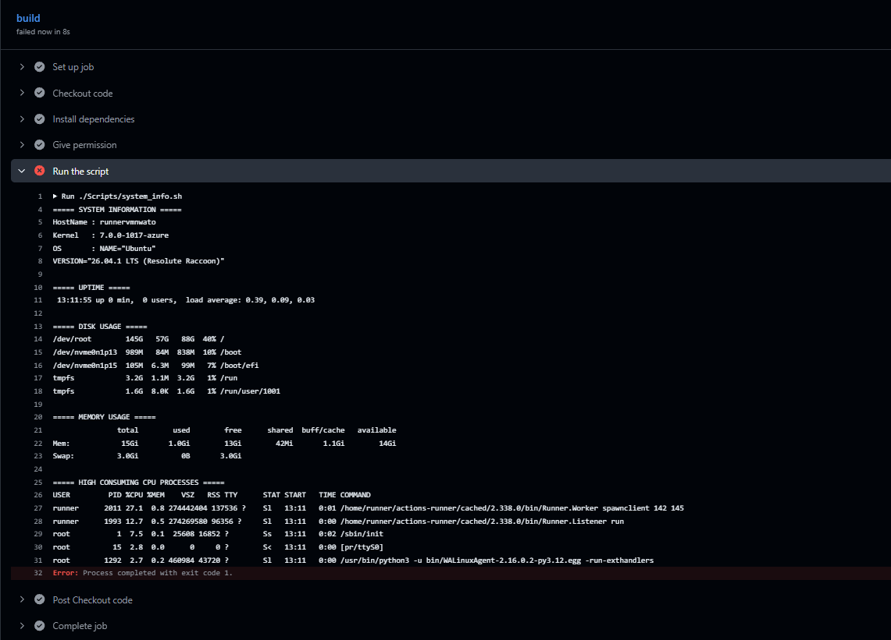

4. Fix it — verify it goes green again

> FIXED IT.

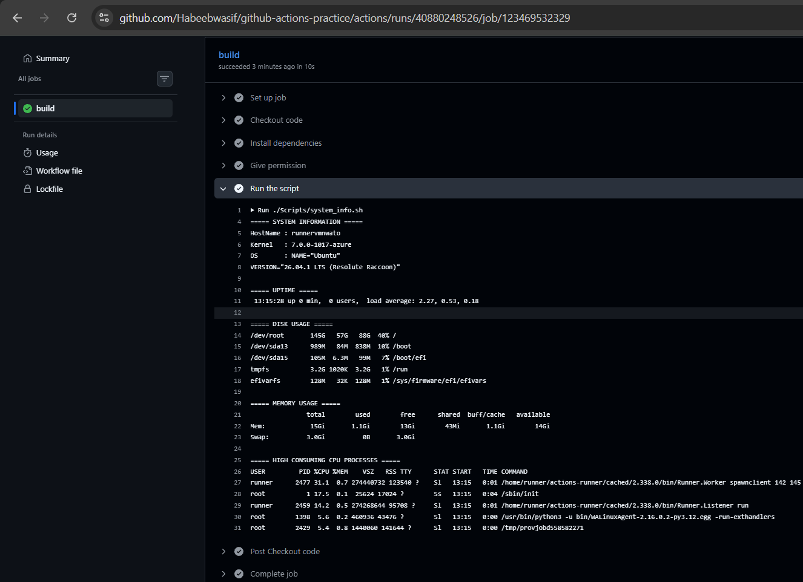

---

### Task 6: Caching
1. Add `actions/cache` to a workflow that installs dependencies
2. Run it twice — observe the time difference

[Cache-Workflow](https://github.com/Habeebwasif/github-actions-practice/blob/main/.github/workflows/cache.yml)

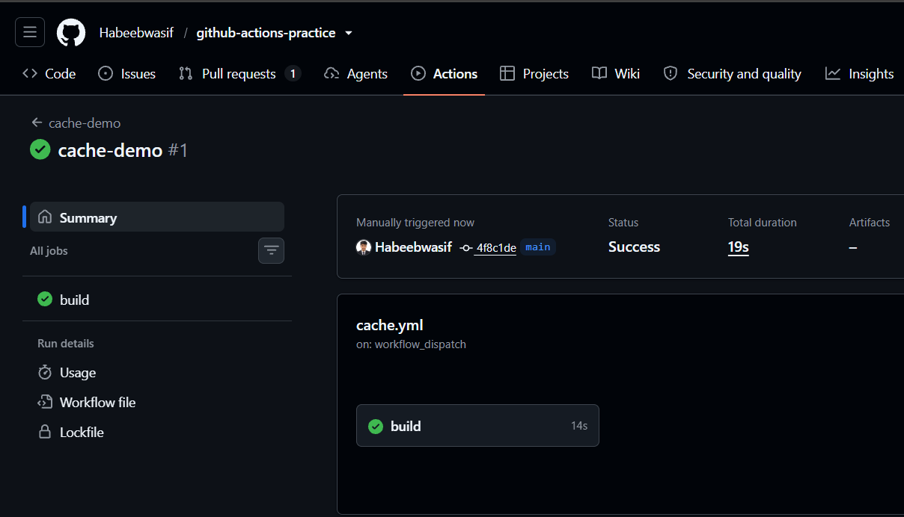

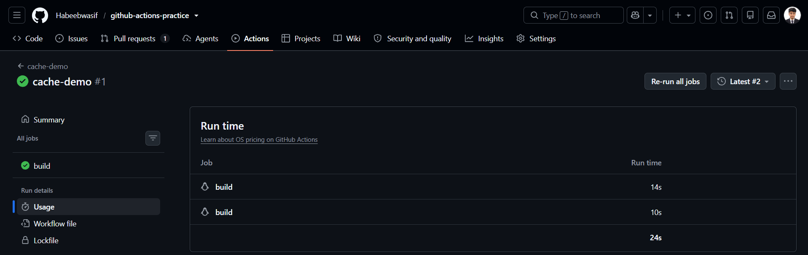

3. Write in your notes: What is being cached and where is it stored?

> The pip download cache (~/.cache/pip) is cached, and it’s stored in GitHub’s cache storage
> (not in the repo or on the runner), then restored to the next run’s fresh runner.
---

## What I Learned:

Never hardcode passwords, tokens, or API keys in code or workflow files. Store them in GitHub Settings → Secrets and variables → Actions and
use them as ${{ secrets.NAME }}, so they stay encrypted and are masked (***) in logs.

