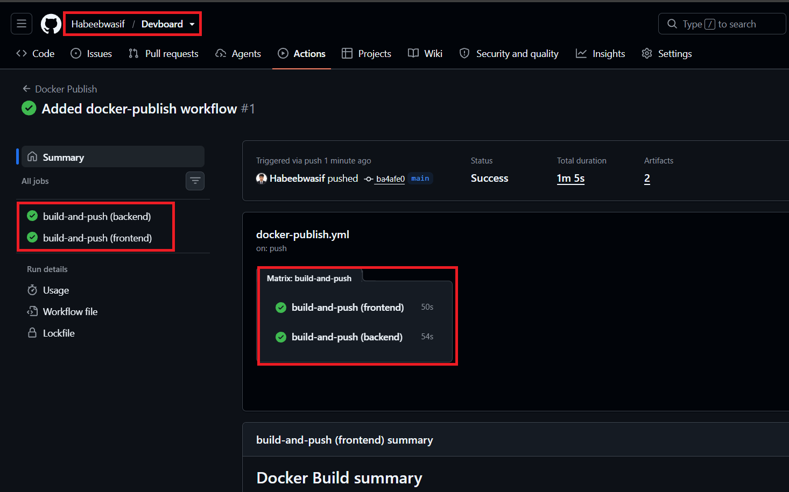
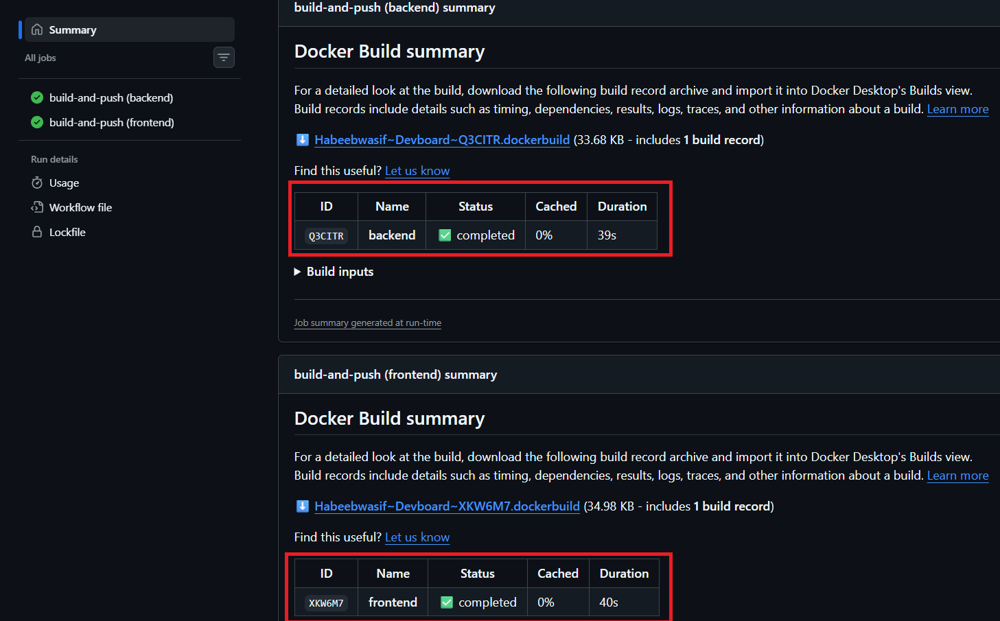
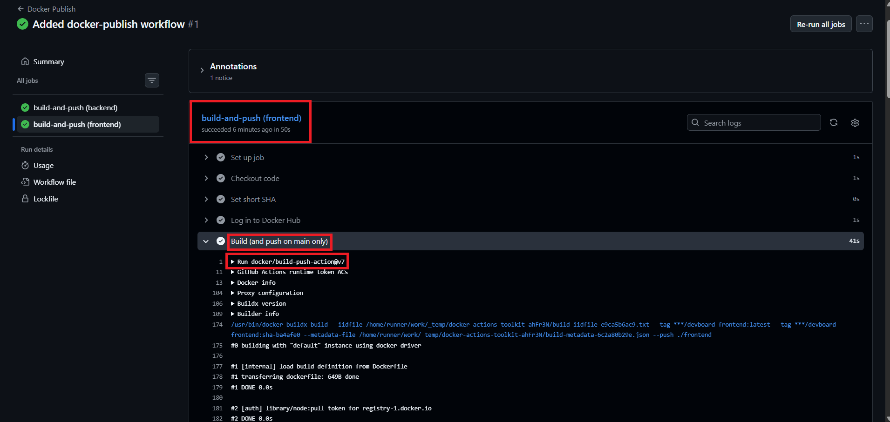
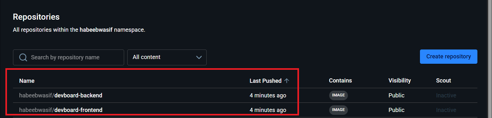
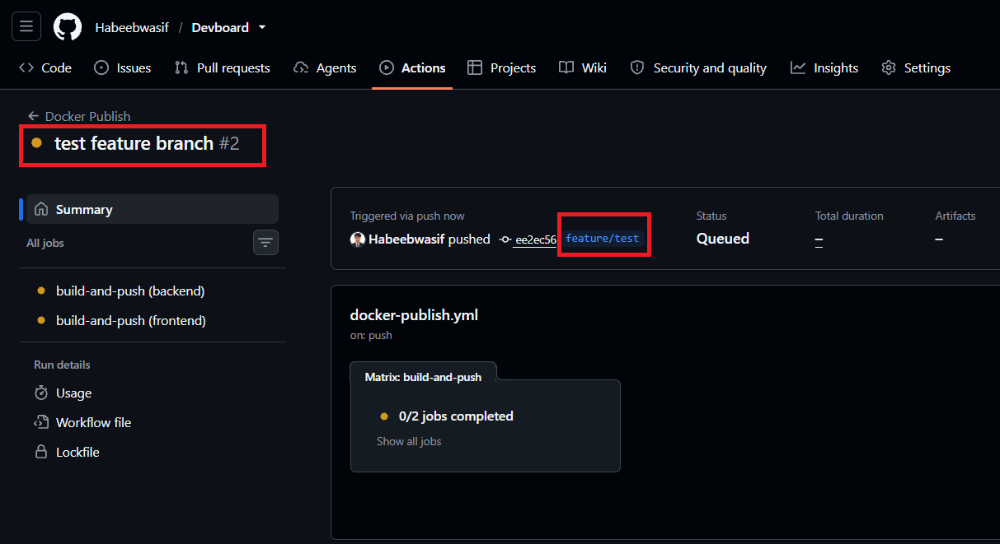
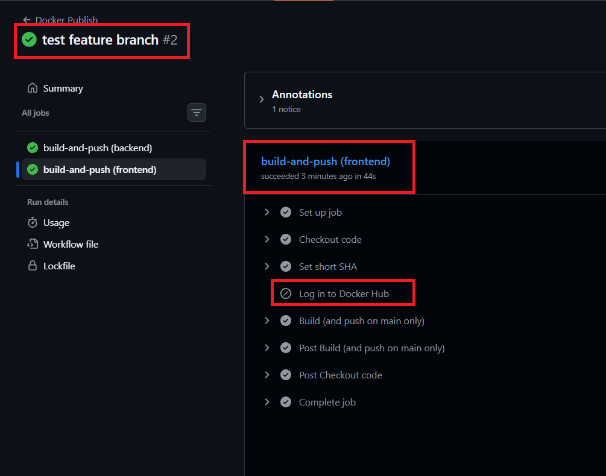
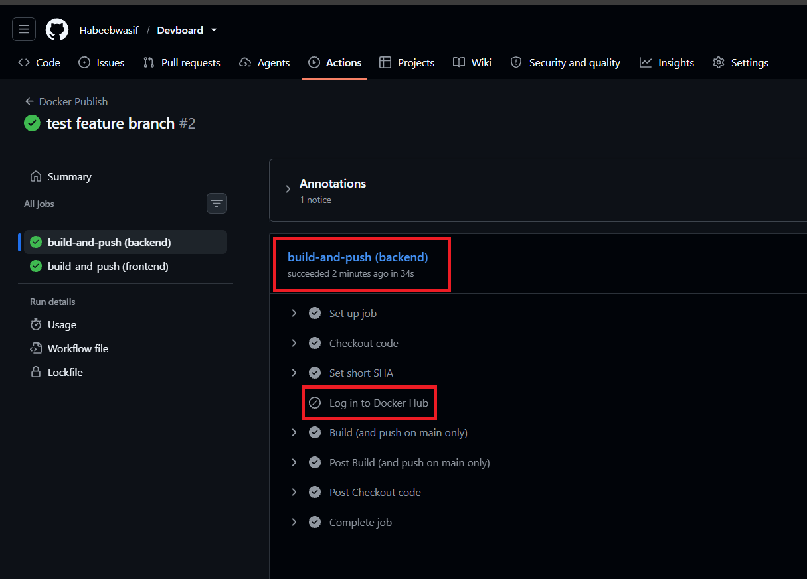
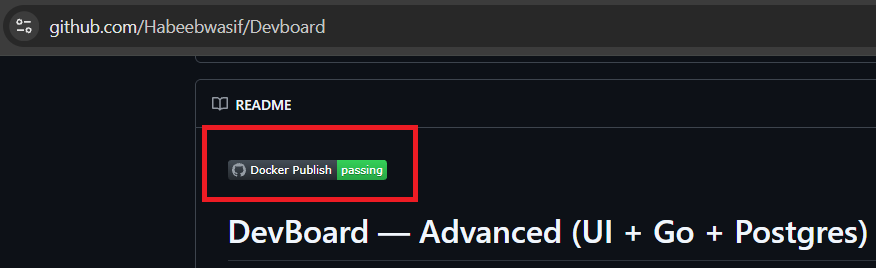
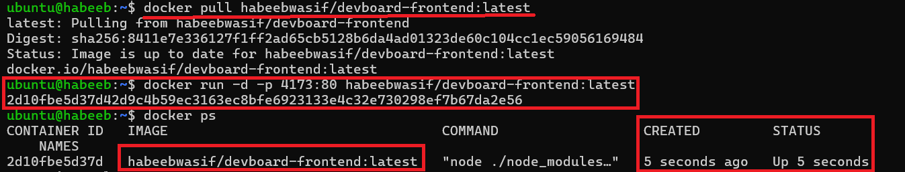
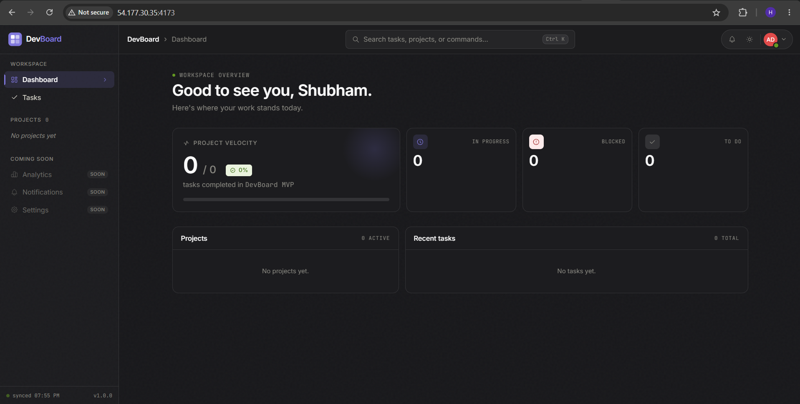

# Day 45 – Docker Build & Push in GitHub Actions

## Overview

Today I built a complete CI/CD pipeline for my **DevBoard** project. Every push to GitHub now builds the Docker images automatically, and pushes to `main` publish them to Docker Hub, with no manual steps.

- **Repo:** https://github.com/Habeebwasif/devboard
- **Workflow:** [`.github/workflows/docker-publish.yml`](https://github.com/Habeebwasif/Devboard/blob/main/.github/workflows/docker-publish.yml)
- **Images:**
  - https://hub.docker.com/r/habeebwasif/devboard-frontend
  - https://hub.docker.com/r/habeebwasif/devboard-backend

I used a **matrix strategy** to build both the `backend` and `frontend` images 
in parallel from the same workflow.

---

## Task 1: Prepare

- Used my DevBoard app (Node.js backend + Vite/React frontend) instead of a sample app
- Confirmed both `backend/` and `frontend/` have a `Dockerfile`
- Added the repo secrets in **Settings → Secrets and variables → Actions**:
  - `DOCKER_USERNAME`
  - `DOCKER_TOKEN` (a Docker Hub access token with Read & Write, not my password)





---

## Task 2: Build the Docker Image in CI

- Created `.github/workflows/docker-publish.yml`
- Set the workflow to trigger on pushes and on pull requests to `main`
- Added a matrix with `backend` and `frontend` so both images build in one run
- Added the steps:
  - Check out the code with `actions/checkout`
  - Compute a 7-character short SHA using `cut`
  - Build the image with `docker/build-push-action`, using `context: ./${{ matrix.folder }}`
- Checked the build logs and both jobs finished green



---

## Task 3: Push to Docker Hub

- Added a login step with `docker/login-action` using `DOCKER_USERNAME` and `DOCKER_TOKEN`
- Tagged each image two ways:
  - `habeebwasif/devboard-<folder>:latest`
  - `habeebwasif/devboard-<folder>:sha-<short-sha>`
- Turned on `push` in the build step
- Pushed to `main` and checked Docker Hub: both images appeared, each with the `latest` and `sha-xxxxxxx` tags



---

## Task 4: Only Push on Main

- Added a condition so the login and push only happen on a push to `main`:

  ```yaml
  if: github.ref == 'refs/heads/main' && github.event_name == 'push'
  ```
  
  and for the build step:
  
  ```yaml
  push: ${{ github.ref == 'refs/heads/main' && github.event_name == 'push' }}
  ```
  
- Tested it by creating a feature branch and pushing an empty commit:

  ```bash
  git checkout -b feature/test
  git commit --allow-empty -m "test feature branch"
  git push -u origin feature/test
  ```



- Result: the run was green, the **Log in to Docker Hub** step was **skipped**, the image was only built, and nothing new appeared on Docker Hub





- Merged to `main` and confirmed the push step ran there.

---

## Task 5: Add a Status Badge

- Opened the Actions tab and located the `docker-publish.yml` workflow
- Added the badge to the top of `README.md`:

  ```markdown
  
  ```
  
- Pushed to `main` and the badge turned green after the run passed



---

## Task 6: Pull and Run It

- Connected to my EC2 instance and pulled the image:

  ```bash
  docker pull habeebwasif/devboard-frontend:latest
  ```
  
- Fixed the mapping (`-p HOST_PORT:CONTAINER_PORT`):

  ```bash
  docker run -d -p 4173:4173 habeebwasif/devboard-frontend:latest
  ```
  
- Added an inbound rule for **TCP 4173** in the EC2 security group
- The DevBoard frontend loaded successfully





## The journey from git push to a running container:

- `git push` sends commits to GitHub.

- GitHub sees the push to `main` and triggers the workflow from `.github/workflows`.

- A fresh `ubuntu-latest` runner starts and checks out the code.

- The runner logs in to Docker Hub using the stored secrets.

- It builds each image from its Dockerfile and tags it `latest` and `sha-xxxxxxx`.

- It pushes both tags to Docker Hub.

- On any machine, docker pull downloads the image and docker run starts a container from it.

---
