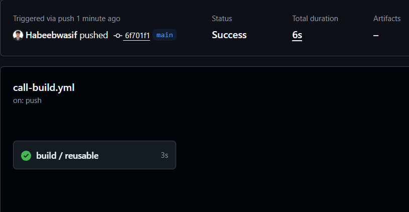
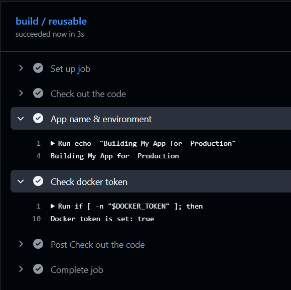
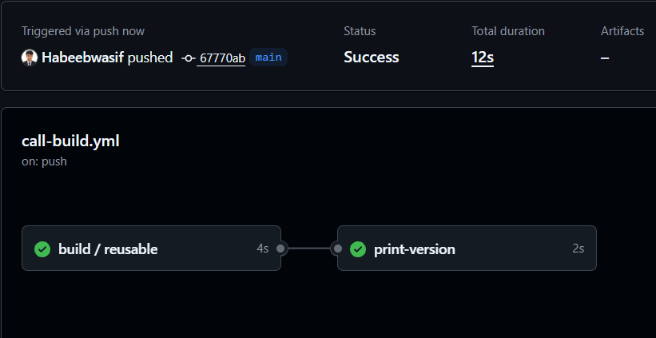
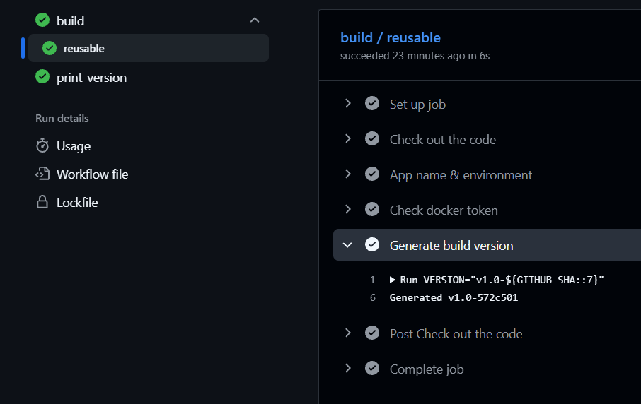
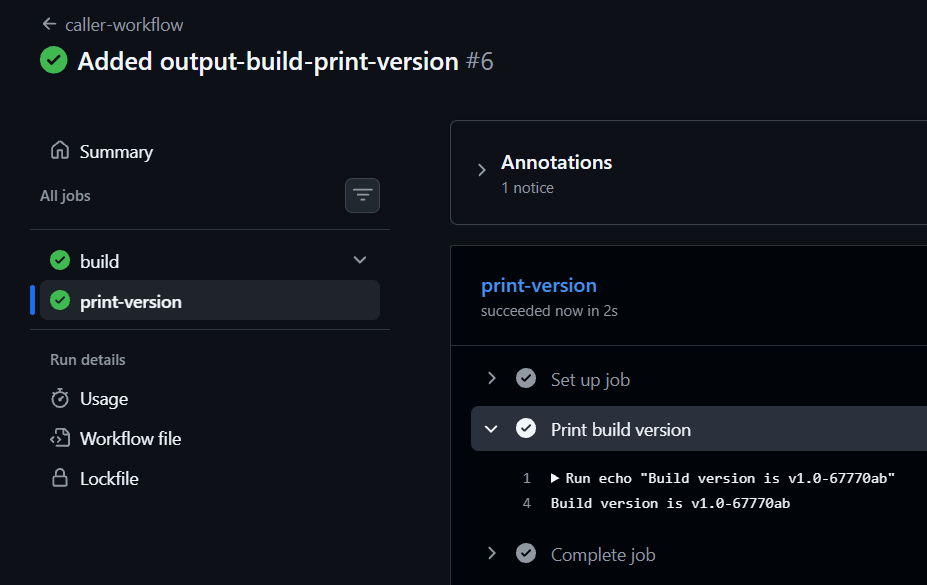
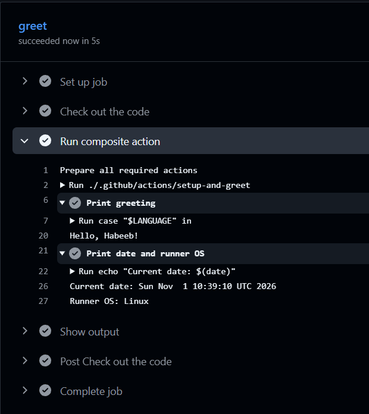

# Day 46 – Reusable Workflows & Composite Actions

## Overview

Until now I wrote every workflow from scratch. Today I learned how to stop repeating myself in GitHub Actions by using two building blocks:

- **Reusable workflows**, which are called with `workflow_call`. They work like a function that other workflows can call, with inputs, secrets and outputs.
- **Composite actions**, which bundle several steps into one custom action that I can use with `uses:` inside any job.

---

## Task 1: Understand `workflow_call`

**1. What is a reusable workflow?**
> A workflow that is written once and can be called by other workflows, in the same repo or in other repos. It saves me from copy-pasting the same jobs everywhere, and fixing it in one place fixes it for every caller.

**2. What is the `workflow_call` trigger?**
> It is the trigger that makes a workflow callable. Under `on: workflow_call:` I declare what the workflow accepts (`inputs:`, `secrets:`) and what it returns (`outputs:`). It doesn't run on its own. It only runs when another workflow calls it.

**3. How is calling a reusable workflow different from using a regular action (`uses:`)?**
> - A regular action is used at the **step** level (`steps[*].uses`) and runs inside the caller's job and runner.
> - A reusable workflow is called at the **job** level (`jobs.<id>.uses`). It runs its own jobs on its own runners, and the calling job can't have `steps:` of its own.

**4. Where must a reusable workflow file live?**
> In the `.github/workflows/` directory.

One limit I noted from the hints: a reusable workflow can be called by at most 20 unique caller workflows in a single run.

---

## Task 2: Create Your First Reusable Workflow

I created `.github/workflows/reusable-build.yml` with the `workflow_call` trigger, two inputs (`app_name` and `environment`, defaulting to `staging`), and a required secret `docker_token`. The job checks out the code, prints the build message, and confirms the Docker token is set.

For the token step I pass the secret through `env:` and test it with `[ -n "$DOCKER_TOKEN" ]`. This prints `Docker token is set: true` without ever printing the secret itself, and it avoids putting `${{ secrets... }}` straight into the shell script.

On its own this file can't run, because it needs a caller.

[`Reusable-build`](https://github.com/Habeebwasif/github-actions-practice/blob/main/.github/workflows/reusable-build.yml)

---

## Task 3: Create a Caller Workflow

[`Call-Build`](https://github.com/Habeebwasif/github-actions-practice/blob/main/.github/workflows/call-build.yml)

---

## Task 4: Add Outputs to the Reusable Workflow

Outputs have to be passed through three levels: step → job → workflow. I followed the hint's syntax for this:

1. A step with `id: version` generates `v1.0-<short-sha>` (the first 7 characters of `GITHUB_SHA`) and writes it to `$GITHUB_OUTPUT`.
2. The job exposes it under `jobs.reusable.outputs.build_version`.
3. `on: workflow_call: outputs:` exposes it with `value: ${{ jobs.reusable.outputs.build_version }}`.

In the caller I added a second job, `print-version`, with `needs: build`. It reads `needs.build.outputs.build_version` and prints it. The second job printed the version generated inside the reusable workflow, and it matched the short SHA of my commit.

[`Call-Build`](https://github.com/Habeebwasif/github-actions-practice/blob/main/.github/workflows/call-build.yml)

---

## Task 5: Create a Composite Action

I created the composite action at `.github/actions/setup-and-greet/action.yml`, using `runs: using: "composite"` as the hint says.

- **Inputs:** `name` (required) and `language` (default `en`).
- **Steps:** the first step picks a greeting for the language (English, Spanish, French, or Hindi) and prints it. It also sets the output `greeted=true`. The second step prints the current date and the runner OS.
- **Output:** `greeted` is exposed at the action level and points to the step's output.

Two things I kept in mind: every `run` step in a composite action needs `shell: bash`, and the repo must be checked out before using a local action. I used it in a new workflow with `uses: ./.github/actions/setup-and-greet`, passing `name: Habeeb` and `language: en`. The log printed `Hello, Habeeb!`, then the date and runner OS, and a following step printed `Greeted: true`.

[`Action.yml`](https://github.com/Habeebwasif/github-actions-practice/blob/main/.github/actions/setup-and-greet/action.yml)

### Workflow using the action

[`Use-Greet.yml`](https://github.com/Habeebwasif/github-actions-practice/blob/main/.github/workflows/use-greet.yml)

---

## Task 6: Reusable Workflow vs Composite Action

| | Reusable Workflow | Composite Action |
|---|---|---|
| Triggered by | `workflow_call` | `uses:` in a step |
| Can contain jobs? | Yes, one or more jobs, each with its own runner | No, steps only. It runs inside the caller's job |
| Can contain multiple steps? | Yes, inside each job | Yes (every `run` step needs `shell:`) |
| Lives where? | A YAML file in `.github/workflows/` | A folder with an `action.yml`, e.g. `.github/actions/setup-and-greet/` |
| Can accept secrets directly? | Yes, through a `secrets:` section under `workflow_call` (or `secrets: inherit`) | No, there is no `secrets:` section. Pass the secret in as an input |
| Best for | Full pipelines: build, test or deploy, with their own jobs, runners, environments and outputs | Small bundles of steps (setup, lint, greet) reused inside a job |

**In short:** a reusable workflow is a whole job or pipeline that I call from a job. A composite action is a group of steps that I call from within a step. If I need separate jobs or runners, I use a reusable workflow. If I just want to avoid copy-pasting the same steps, I use a composite action.

---
