# Day-47 GitHub Actions Practice

Hands-on practice with GitHub Actions. In this repo I built workflows that cover the main trigger types: pull request checks, scheduled runs, path and branch filters, chained workflows, and external events. Below is what I built for each task, how I tested it, and what I saw.

## Overview

| Task | Workflow file | Trigger | What it does |
|---|---|---|---|
| 1. PR event types | [`pr-lifecycle.yml`](https://github.com/Habeebwasif/github-actions-practice/blob/main/.github/workflows/pr-lifecycle.yml) | `pull_request` (`opened`, `synchronize`, `reopened`, `closed`) | Prints PR details and detects when a PR is merged |
| 2. PR validation | [`pr-checks.yml`](https://github.com/Habeebwasif/github-actions-practice/blob/main/.github/workflows/pr-checks.yml) | `pull_request` to `main` | Checks file size, branch name and PR description |
| 3. Scheduled tasks | [`scheduled-tasks.yml`](https://github.com/Habeebwasif/github-actions-practice/blob/main/.github/workflows/scheduled-tasks.yml) | `schedule` + `workflow_dispatch` | Prints what triggered it and health-checks a URL |
| 4. Path and branch filters | [`smart-triggers.yml`](https://github.com/Habeebwasif/github-actions-practice/blob/main/.github/workflows/smart-triggers.yml), [`skip-docs.yml`](https://github.com/Habeebwasif/github-actions-practice/blob/main/.github/workflows/skip-docs.yml) | `push` with `paths` / `paths-ignore` | Runs only for the right files on `main` and `release/*` |
| 5. Chained workflows | [`tests.yml`](https://github.com/Habeebwasif/github-actions-practice/blob/main/.github/workflows/tests.yml), [`deploy-after-tests.yml`](https://github.com/Habeebwasif/github-actions-practice/blob/main/.github/workflows/deploy-after-tests.yml) | `push`, then `workflow_run` | Deploys only after tests succeed |
| 6. External trigger | [`external-trigger.yml`](https://github.com/Habeebwasif/github-actions-practice/blob/main/.github/workflows/external-trigger.yml) | `repository_dispatch` | Responds to a `deploy-request` event sent from outside GitHub |

All workflow files live in `.github/workflows/`.

---

## Task 1: Pull Request Event Types

**File:** [`.github/workflows/pr-lifecycle.yml`](https://github.com/Habeebwasif/github-actions-practice/blob/main/.github/workflows/pr-lifecycle.yml)

This workflow triggers on `pull_request`, but only for four activity types: `opened`, `synchronize`, `reopened` and `closed`. A single job (`pr-lifecycle`) prints details about the PR using the event data:

- **Event type:** `github.event.action`
- **PR title:** `github.event.pull_request.title`
- **PR author:** `github.event.pull_request.user.login`
- **Source and target branch:** `github.event.pull_request.head.ref` and `github.event.pull_request.base.ref`

The last step has a condition, `github.event.pull_request.merged == true`, so it only runs when the PR was actually merged and not just closed.

### How I tested it

I created a PR, pushed an update to it, closed and reopened a PR, and merged one, and watched the workflow fire with a different event type each time:

1. **Opening a PR** triggers the workflow with the `opened` event.
2. **Pushing a new commit to the PR branch** triggers it again with `synchronize`.
3. **Reopening a closed PR** triggers it with `reopened`.
4. **Merging a PR** fires the `closed` event, and the conditional step runs because `merged` is `true`.

### Output

**`opened`:** the PR was opened from `test/pr-reopen` into `main`. All the print steps ran, and the merged-status step was skipped (grey icon) because the PR isn't merged:

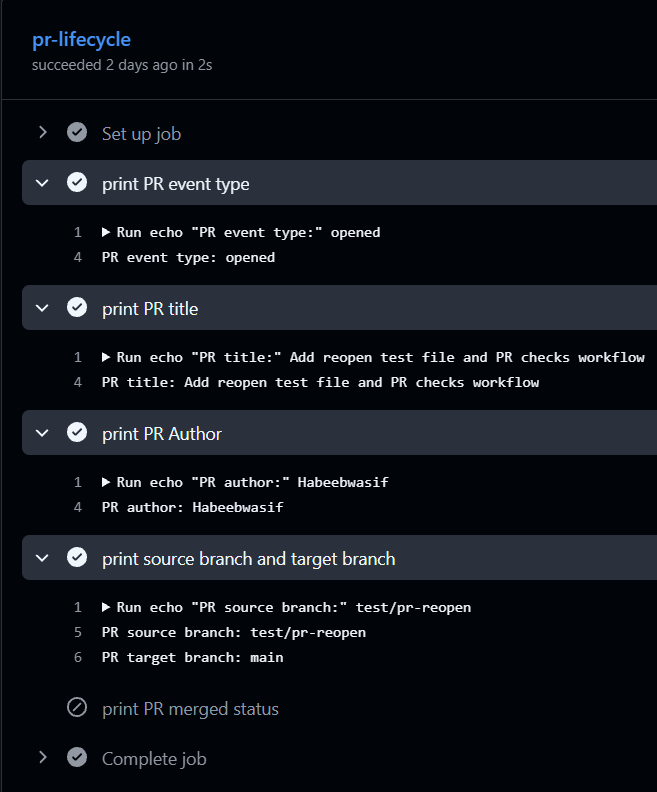

**`synchronize`:** fired when I pushed an update to the PR. The merged-status step was skipped again:

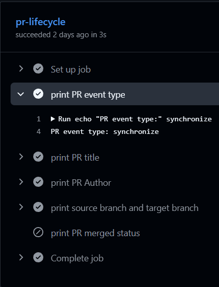

**`reopened`:** fired when I reopened a closed PR. Still no merge, so the conditional step was skipped:

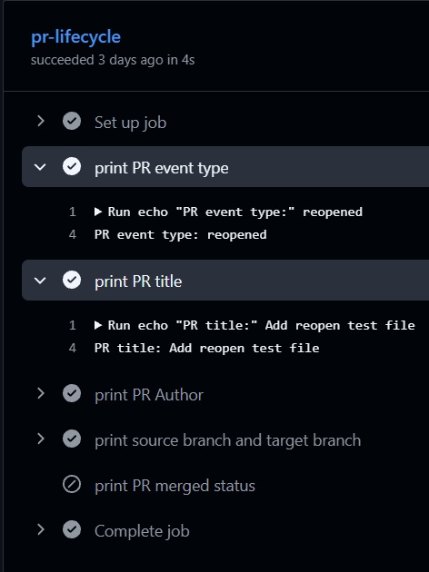

**`closed` and merged:** fired when I merged the PR from `test/pr-lifecycle` into `main`. This is the only run where the merged-status step executed and printed `PR merged status is Merged`:

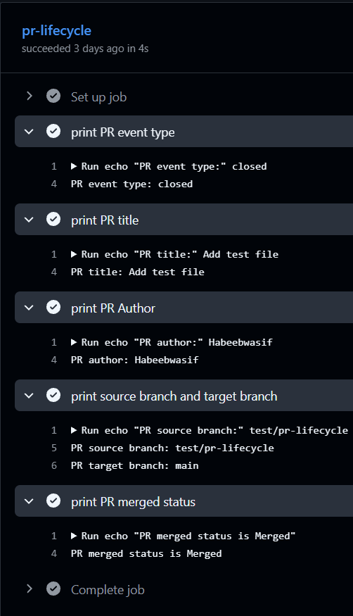

### Notes

- `synchronize` means new commits were pushed to the PR's source branch.
- `closed` fires both when a PR is merged and when it is closed without merging. That's why the merged check is needed.
- The `merged == true` step is skipped for `opened`, `synchronize` and `reopened`, because those PRs aren't merged yet.

---

## Task 2: PR Validation Workflow

**File:** [`.github/workflows/pr-checks.yml`](https://github.com/Habeebwasif/github-actions-practice/blob/main/.github/workflows/pr-checks.yml)

I built a "PR gate" with three jobs that run in parallel whenever a pull request targets `main`:

- **`file-size-check`** checks out the code and fails if any changed file is larger than 1 MB.
- **`branch-name-check`** reads `github.head_ref` and fails unless the branch starts with `feature/`, `fix/` or `docs/`.
- **`pr-body-check`** reads the PR description and prints a warning if it is empty, but does not fail.

### How I tested it

I opened a PR from a badly named branch (`test/pr-reopen`) with an empty description. The branch check failed, the others passed.

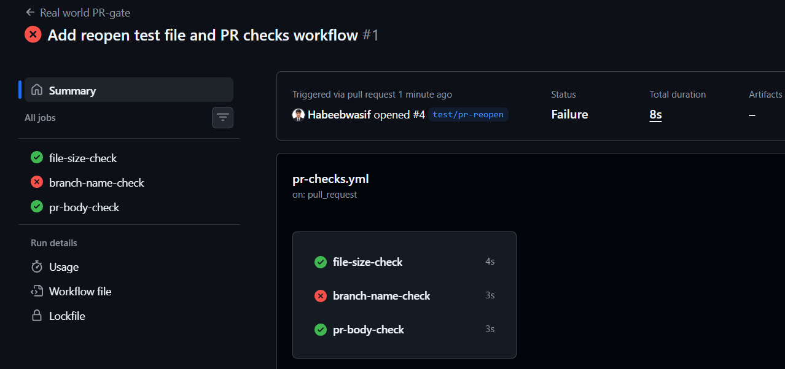

The `branch-name-check` failed with a clear error message:

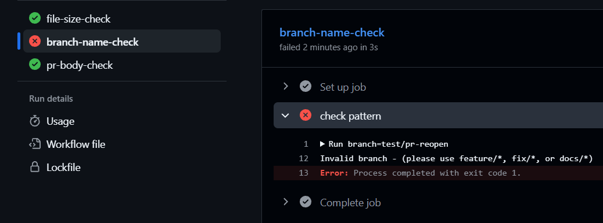

The empty description only produced a warning, so that job still passed:

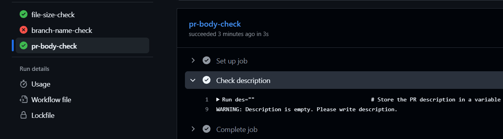

The file size check passed because no changed file exceeded 1 MB:

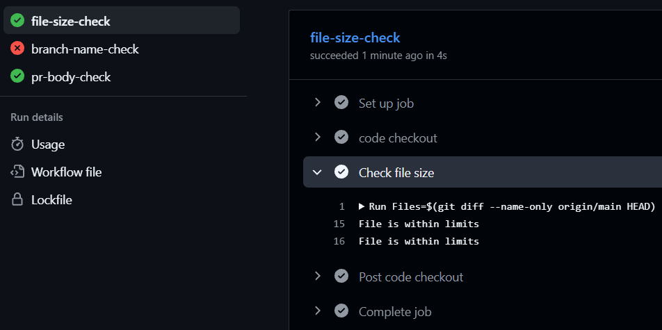

Then I opened a PR from a correctly named branch (`feature/Valid-pr`) with a description. All three checks passed:

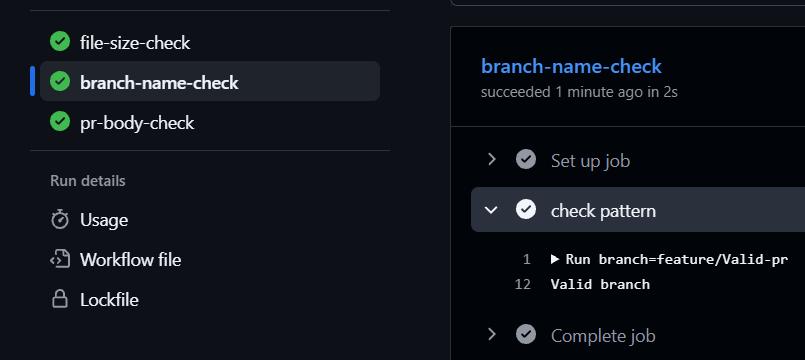

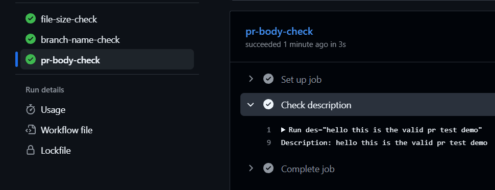

**Result:** a badly named branch fails the check, as expected.

---

## Task 3: Scheduled Workflows

**File:** [`.github/workflows/scheduled-tasks.yml`](https://github.com/Habeebwasif/github-actions-practice/blob/main/.github/workflows/scheduled-tasks.yml)

This workflow has two cron schedules plus `workflow_dispatch`, so I can test manually:

- `'30 2 * * 1'` runs every Monday at 2:30 AM UTC
- `'0 */6 * * *'` runs every 6 hours

It has two steps:

1. **Show schedule** prints whether the run was manual or scheduled, and which cron fired (`github.event.schedule`).
2. **Health check** uses `curl` to get the HTTP status code of a URL and fails the job if it is not `200`.

### Output

A real scheduled run. It was triggered by the 6-hourly cron, and the log shows the cron expression:

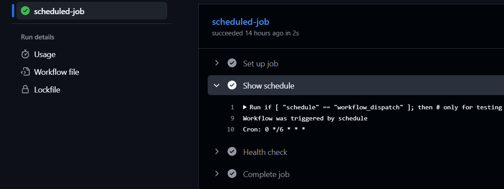

A manual run using `workflow_dispatch`, with the health check returning `200`:

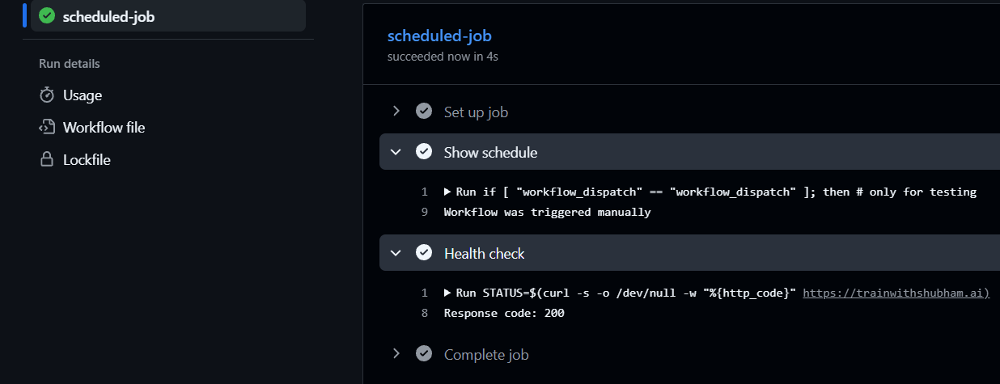

### Notes

**Cron for every weekday at 9 AM IST:** `'30 3 * * 1-5'`
GitHub cron uses UTC, and IST is UTC+5:30, so 9:00 AM IST is 03:30 UTC.

**Cron for the first day of every month at midnight:** `'0 0 1 * *'`

**Why scheduled workflows may be delayed or skipped:**
- During busy periods (especially at the top of the hour) GitHub's runners are overloaded, so scheduled jobs can be delayed or dropped.
- In public repos, scheduled workflows are automatically disabled after 60 days without repository activity.
- Scheduled workflows only run from the workflow file on the default branch.

---

## Task 4: Path and Branch Filters

**Files:** [`.github/workflows/smart-triggers.yml`](https://github.com/Habeebwasif/github-actions-practice/blob/main/.github/workflows/smart-triggers.yml) and [`.github/workflows/skip-docs.yml`](https://github.com/Habeebwasif/github-actions-practice/blob/main/.github/workflows/skip-docs.yml)

Both workflows only trigger on pushes to `main` or `release/*`.

- **`smart-triggers.yml`** uses `paths`, so it runs only when files in `src/**` or `app/**` change.
- **`skip-docs.yml`** uses `paths-ignore` (`*.md` and `docs/**`), so it is skipped when only docs change.

I used two separate files because `paths` and `paths-ignore` can't be combined for the same event in one workflow. Branch and path filters work as an AND: both have to match.

### Output

Pushing a change in `src/` ran the source code workflow:

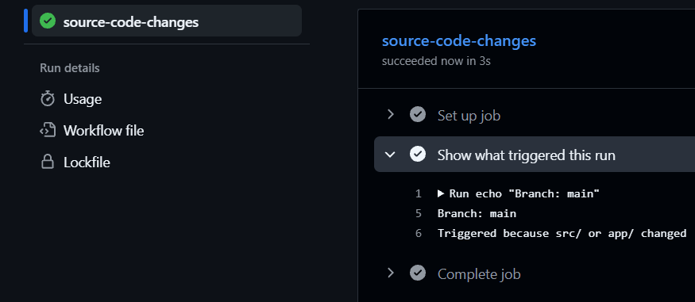

Pushing a non-docs change ran the skip-docs workflow:

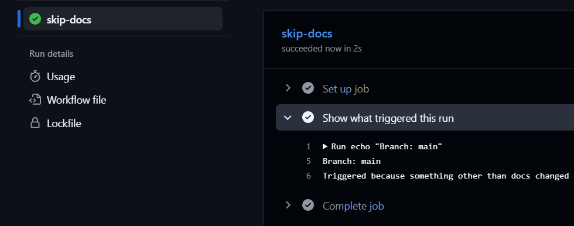

### Notes

- `'*.md'` only matches markdown files in the repo root. To ignore `.md` files in every folder, use `'**.md'`.
- With `paths-ignore`, the workflow is skipped only if **all** changed files match the ignored patterns.
- A skipped workflow doesn't create a run at all, so the proof is that no new run appears in the Actions tab.

---

## Task 5: Chaining Workflows with `workflow_run`

**Files:** [`.github/workflows/tests.yml`](https://github.com/Habeebwasif/github-actions-practice/blob/main/.github/workflows/tests.yml) and [`.github/workflows/deploy-after-tests.yml`](https://github.com/Habeebwasif/github-actions-practice/blob/main/.github/workflows/deploy-after-tests.yml)

- **`tests.yml`** (named `Run Tests`) runs on every push and executes a simple test step.
- **`deploy-after-tests.yml`** uses `workflow_run` to start when `Run Tests` completes. Because `completed` fires for both success and failure, it has two jobs with conditions on `github.event.workflow_run.conclusion`:
  - `deploy` runs only if the tests succeeded
  - `skip-deploy` runs otherwise, prints a warning and does not deploy

### Output

The Actions list shows `Run Tests` finishing first, then `Deploy After Tests` starting automatically:

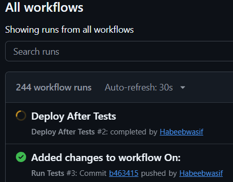

The tests passed:

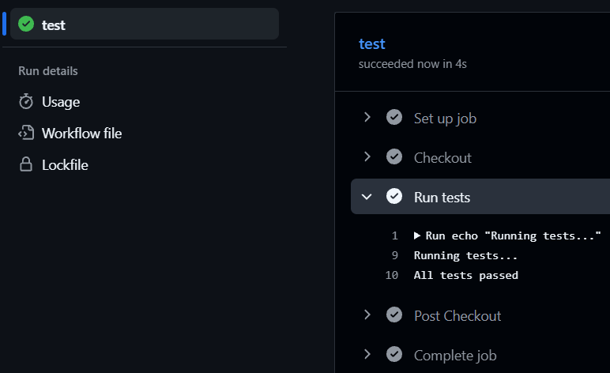

The deploy workflow was triggered by `workflow_run`. The `deploy` job ran and `skip-deploy` was skipped, because the tests succeeded:

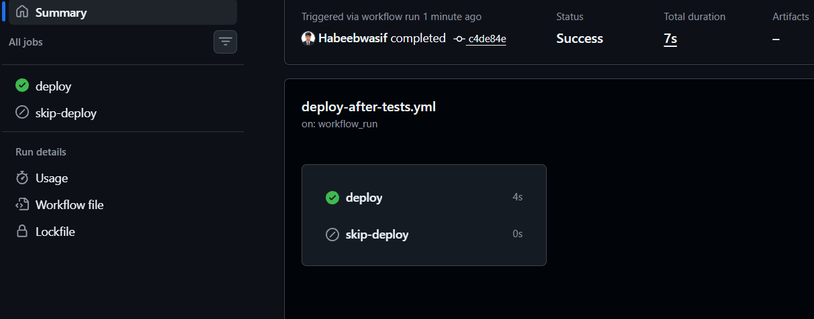

The deploy log shows the branch and the commit of the tests that triggered it:

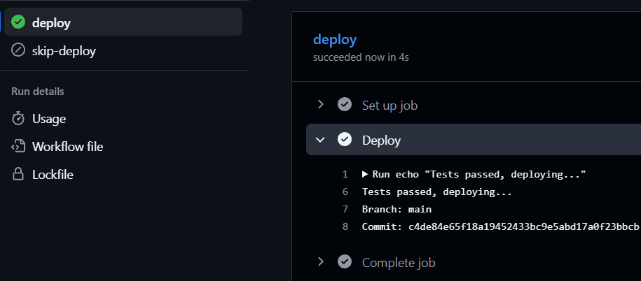

**Result:** pushing a commit runs the tests first, and the deploy workflow starts only after they finish.

---

## Task 6: External Triggers with `repository_dispatch`

**File:** [`.github/workflows/external-trigger.yml`](https://github.com/Habeebwasif/github-actions-practice/blob/main/.github/workflows/external-trigger.yml)

This workflow listens for `repository_dispatch` events of type `deploy-request` and prints the `environment` value from `client_payload`.

I triggered it from my terminal with the GitHub CLI:

```powershell
gh api repos/Habeebwasif/github-actions-practice/dispatches -f event_type=deploy-request -f 'client_payload[environment]=production'
```

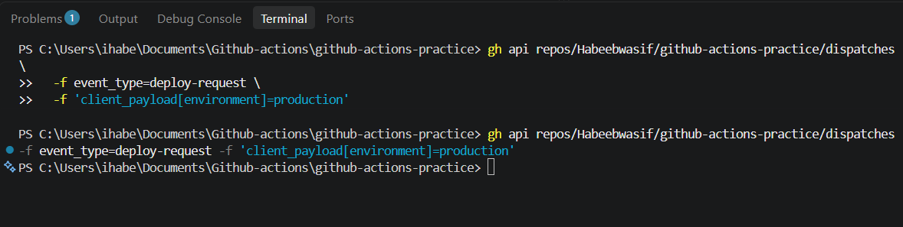

### Output

The event started a run of the workflow:

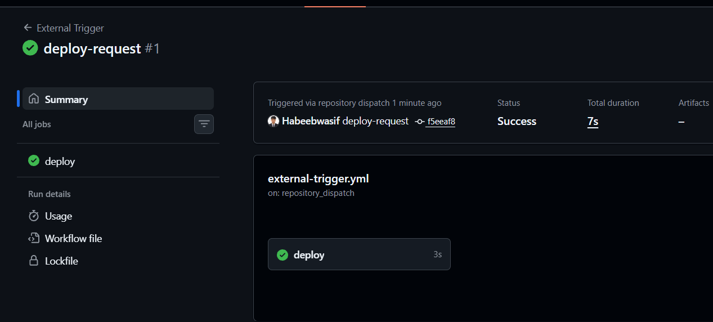

The log shows the event type and the payload value I sent:

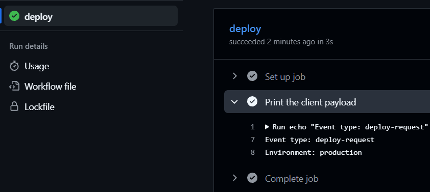

### Notes: when would an external system trigger a pipeline?

- **Slack bot / ChatOps:** someone types `/deploy production` and the bot starts the deploy.
- **Monitoring tool:** Datadog or Prometheus detects high errors and triggers a rollback or diagnostics workflow.
- **Another repo or service:** a build in one repo finishes and starts a deploy in another, or a CMS publish triggers a site rebuild.
- **Third-party systems:** a registry or vendor notifies that a new version is available, or an approval tool approves a change request.

---

## What I learned

- A trigger can be narrowed to specific activity types (like `opened` or `synchronize`), and `closed` needs a `merged` check to tell a merge from a plain close.
- Different triggers (`pull_request`, `schedule`, `push`, `workflow_run`, `repository_dispatch`) fit different situations, and `workflow_dispatch` is useful for testing.
- Jobs run in parallel by default, and `exit 1` is what makes a job fail.
- Path and branch filters are an AND, and a filtered-out workflow creates no run at all.
- `workflow_run` and `repository_dispatch` workflows only work from the default branch.
- Scheduled workflows are best effort, not exact.
