# GitHub Actions Capstone: End-to-End CI/CD Pipeline

This is my Day 48 capstone for #90DaysOfDevOps. I took a full-stack notes app and built a complete CI/CD pipeline around it using only GitHub Actions: tests on every pull request, a Docker build and push on every merge to `main`, an approval-gated deploy, and a scheduled health check.

The pipeline puts together what I learned from Day 40 to Day 47: workflows, triggers, secrets, Docker builds, reusable workflows and environments.

## The app

The app is my own [notes-app](https://github.com/Habeebwasif/notes-app), which lives in the `notes-app/` folder of this repo. It has three parts:

- **Frontend:** static HTML, CSS and JavaScript served by Nginx (`notes-app/frontend`)
- **Backend:** a Node.js and Express API (`notes-app/backend`)
- **Database:** MySQL, started with Docker Compose

The API exposes `/api/notes` and a `/health` endpoint that reports whether the database is up. The backend and frontend each have their own Dockerfile and are published as two images on Docker Hub:

- [habeebwasif/notes-api](https://hub.docker.com/r/habeebwasif/notes-api)
- [habeebwasif/notes-frontend](https://hub.docker.com/r/habeebwasif/notes-frontend)

## Repo layout

```
github-actions-capstone/
├── .github/workflows/
│   ├── reusable-build-test.yml
│   ├── reusable-docker.yml
│   ├── pr-pipeline.yml
│   ├── main-pipeline.yml
│   └── health-check.yml
├── notes-app/
│   ├── backend/        (Express API, Dockerfile, test/smoke.test.js)
│   ├── frontend/       (Nginx, Dockerfile)
│   └── docker-compose.yml
├── images/             (screenshots)
├── LICENSE
└── README.md
```

## Pipeline architecture

```
PR opened / updated
  └─► build & test ─► pr-comment ("PR checks passed")          (no Docker push)

Merge to main
  └─► build & test ─► short-sha ─► Docker build & push ─► deploy
                                    notes-api              (environment: production,
                                    notes-frontend          manual approval)
                                    tags: sha-xxxxxxx + latest

Every 12 hours (and manually)
  └─► health check: pull images ─► start stack ─► curl /health ─► summary ─► cleanup
```

Two reusable workflows do the real work. The three pipelines call them.

---

## What I did, task by task

### Task 1: Set up the project repo

I created the `github-actions-capstone` repo and added my notes-app inside a `notes-app/` subfolder, with the `.github/workflows` folder at the repo root. The app already had Dockerfiles and a README.

The backend had no tests, so I added a basic one: `notes-app/backend/test/smoke.test.js`. It uses Node's built-in test runner, so it needs no new dependencies. It checks that `server.js` has valid syntax and that `express` and `mysql2` load. I wired it up by adding `"test": "node --test"` to the `scripts` in `package.json`. It needs no database, which keeps CI simple.

### Task 2: Reusable workflow, build and test

File: [Reusable Workflow](https://github.com/Habeebwasif/github-actions-capstone/blob/main/.github/workflows/reusable-build-test.yml )

- Trigger: `workflow_call`
- Inputs: `node_version` (default `20`) and `run_tests` (boolean, default `true`)
- Steps: check out, set up Node, `npm ci`, run tests (only when `run_tests` is true), then set the `test_result` output to `passed` or `failed`
- It does not deploy. It only builds and tests.

I added one extra input, `working_directory` (default `notes-app/backend`), because my `package.json` is in a subfolder.

The `test_result` output passes through three levels: the step writes it, the job exposes it, and the workflow hands it to the caller. The last step uses `always()` so the result is recorded even when the tests fail.

### Task 3: Reusable workflow, Docker build and push

File: [.github/workflows/reusable-docker.yml](https://github.com/Habeebwasif/github-actions-capstone/blob/main/.github/workflows/reusable-docker.yml)

- Trigger: `workflow_call`
- Inputs: `image_name` and `tag`
- Secrets: `docker_username` and `docker_token`
- Steps: check out, log in to Docker Hub, build and push the image with the given tag, then set the `image_url` output to the full image path

I added two extra inputs:

- `context`: the folder with the Dockerfile. My Dockerfiles are in `notes-app/backend` and `notes-app/frontend`, not the repo root, and this lets one workflow build both images.
- `extra_tag`: an optional second tag, so a single build can push both `sha-<hash>` and `latest`. Without it I would have built each image twice.


### Task 4: PR pipeline

File: [.github/workflows/pr-pipeline.yml](https://github.com/Habeebwasif/github-actions-capstone/blob/main/.github/workflows/pr-pipeline.yml)

- Trigger: `pull_request` to `main`, types `opened` and `synchronize`
- Job `build-test` calls the reusable build-test workflow with `run_tests: true`
- Job `pr-comment` runs after it and prints "PR checks passed for branch: `<branch>`"
- There is no Docker login, build or push anywhere in this workflow

I pass the branch name through an `env` variable and use a `run: |` block. That avoids script injection from odd branch names, and it avoids a YAML parsing error from the colon inside the message.

**Verified:** I opened a PR and only `build-test` and `pr-comment` ran. No image was pushed to Docker Hub. Pushing another commit to the PR triggered the pipeline again through `synchronize`.

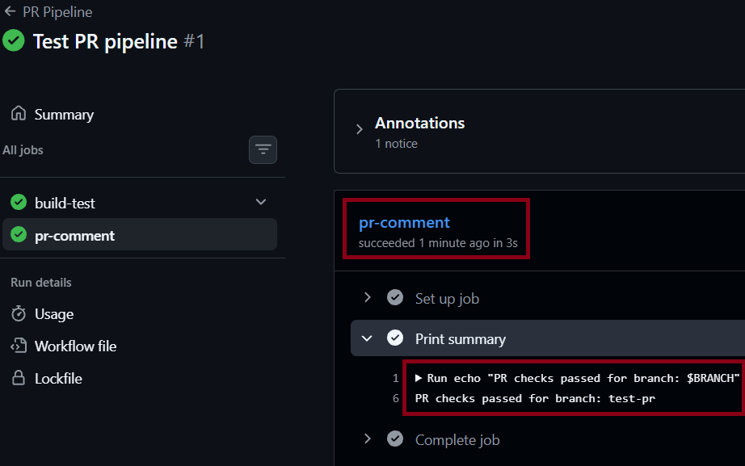
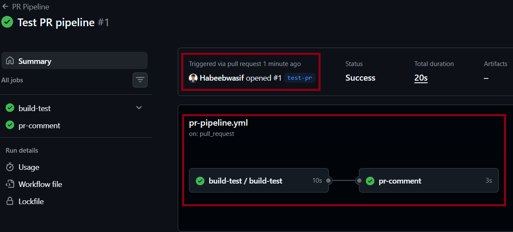
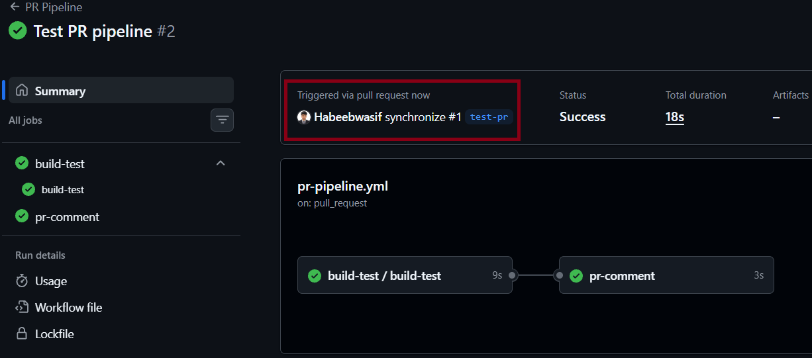

### Task 5: Main branch pipeline

File: [.github/workflows/main-pipeline.yml](https://github.com/Habeebwasif/github-actions-capstone/blob/main/.github/workflows/main-pipeline.yml)

- Trigger: `push` to `main`
- Job 1 `build-test` calls the reusable build-test workflow
- Job `short-sha` runs `cut -c1-7` on the commit hash and exposes it as an output. GitHub expressions have no substring function, so this needs its own job.
- Job 2 has two parts, `docker-api` and `docker-frontend`, which run in parallel after the tests. They call the reusable Docker workflow, tagging each image `sha-<short hash>` and `latest`.
- Job 3 `deploy` runs after both Docker jobs. It prints "Deploying image: ... to production" and uses `environment: production`.

**Setup:** I created the `production` environment in Settings → Environments with Required reviewers enabled, so the deploy job pauses until I approve it.

**Verified:** after merging, the run went tests → short-sha → Docker build and push → deploy waiting for approval. After I approved it, the deploy job finished and the run was green. Both images were pushed to Docker Hub.

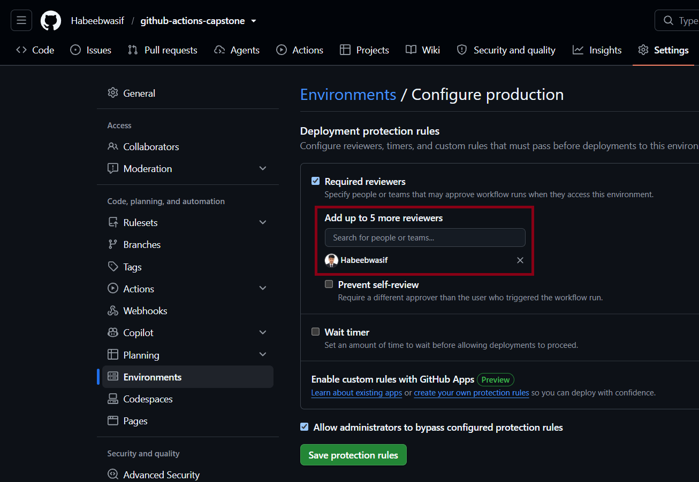

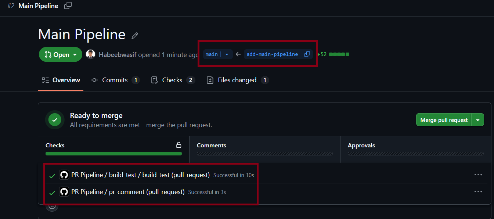

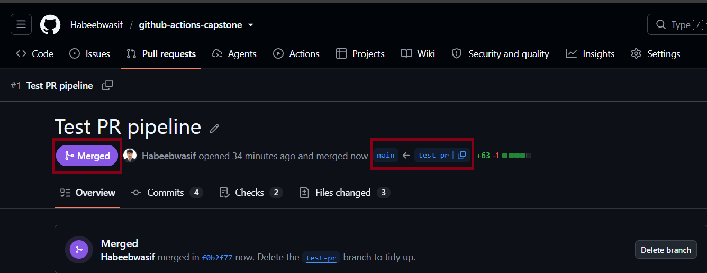

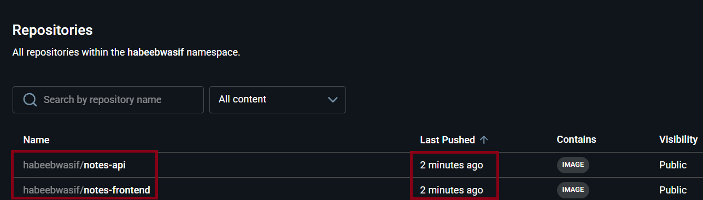

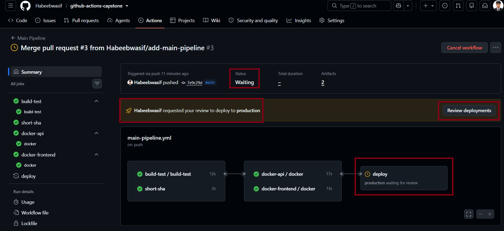

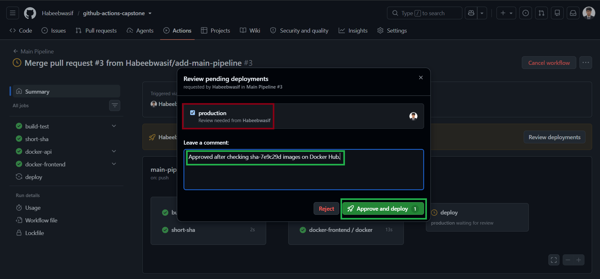

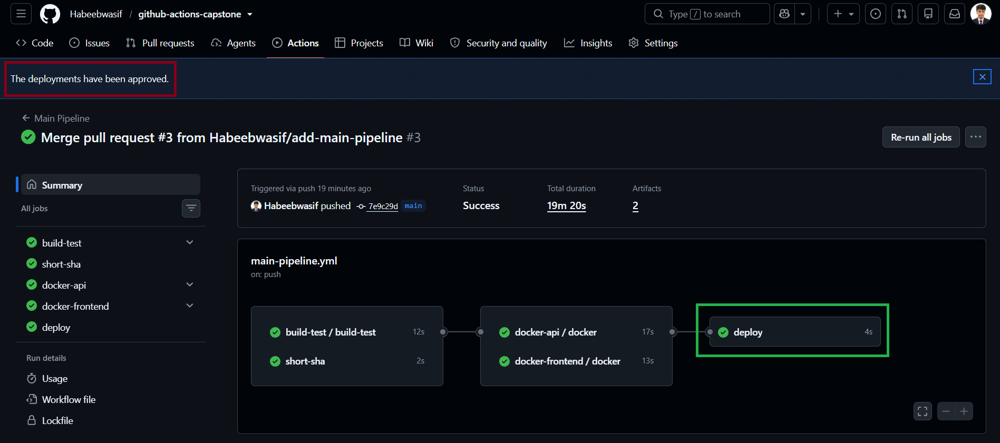

### Task 6: Scheduled health check

File: [.github/workflows/health-check.yml](https://github.com/Habeebwasif/github-actions-capstone/blob/main/.github/workflows/health-check.yml)

- Trigger: `schedule` with cron `'0 */12 * * *'`, plus `workflow_dispatch` so I can run it manually
- Steps: pull the latest images, start the containers in detached mode, wait 5 seconds, curl `/health`, print PASSED or FAILED (the job fails if the check fails), then stop and remove everything
- It writes a "Health Check Report" to `$GITHUB_STEP_SUMMARY` with the image, status and time

Differences from the plain task, and why:

- **I use Docker Compose instead of a single `docker run`.** My `/health` endpoint reports database status, so the API alone can't pass. Compose starts the frontend, API and MySQL together. I used `up -d --wait` because MySQL takes longer than 5 seconds to become healthy.
- **A "Create .env" step.** My `.env` is git-ignored, so each run creates a throwaway one with CI-only values. The runner is destroyed after every run, so it has to be recreated every time.
- **`if: always()` on cleanup and the summary**, so they run even when the check fails. The status in the summary is read from the check step instead of hardcoded.

**Verified:** the workflow ran from its schedule and the report shows PASSED.

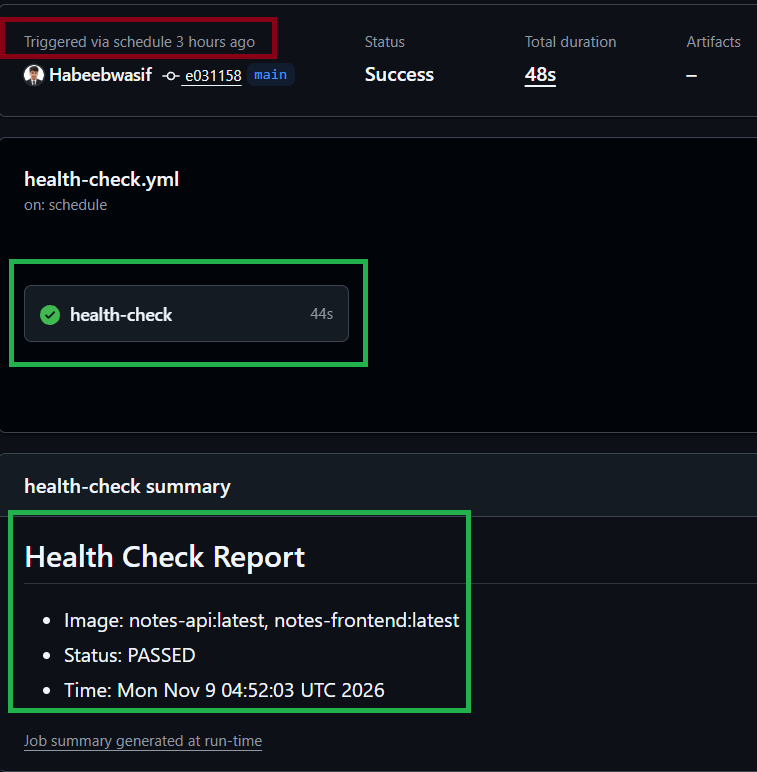
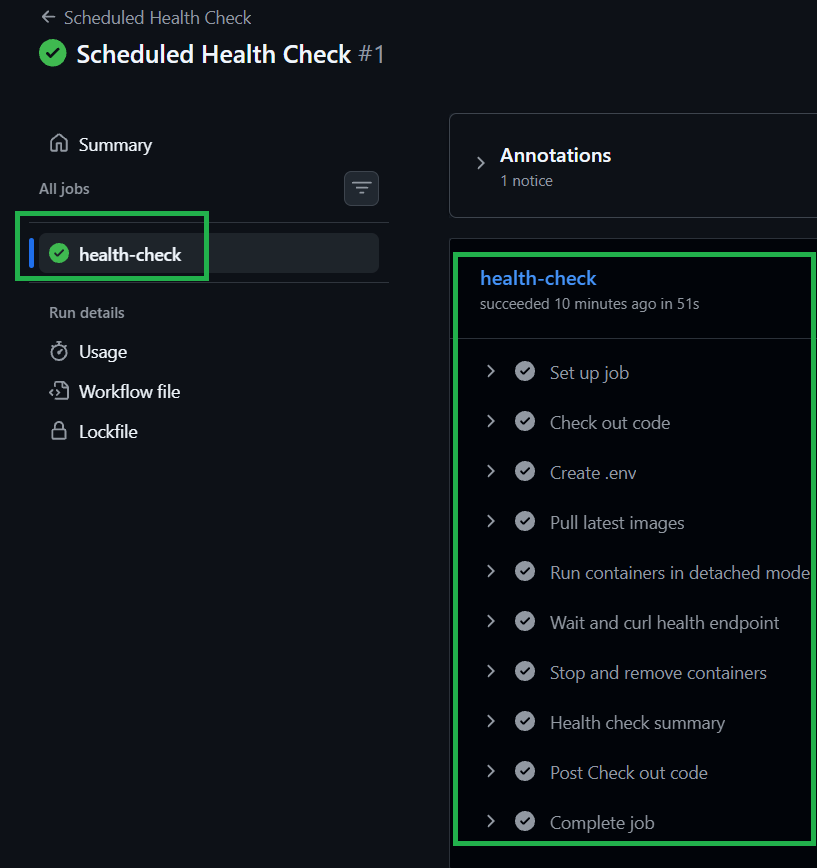

### Task 7: Badges and documentation

- I added status badges for the three pipelines at the top of this README. The two reusable workflows have no badges because they only run when called.
- The architecture diagram is above.
- What I would add next is in the last section.

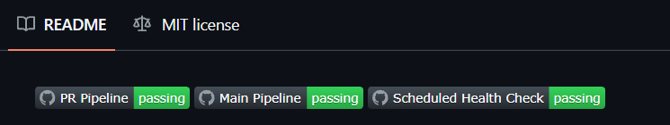

---

## Setup

| Where | Name | Purpose |
|---|---|---|
| Secret | `DOCKER_USERNAME` | Docker Hub username for login |
| Secret | `DOCKER_TOKEN` | Docker Hub access token (Read & Write) |
| Variable | `DOCKERHUB_USERNAME` | Used to build the image names (`<user>/notes-api`) |
| Environment | `production` | Required reviewers, for manual deploy approval |

The image name has to come from a variable because the `secrets` context isn't available in the `with:` block of a reusable-workflow call.

## Problems I ran into

- **`extra_tag` not defined.** VS Code flagged `extra_tag` as invalid in the main pipeline because the reusable Docker workflow didn't declare that input yet. Adding it fixed it.
- **YAML error from a colon.** `run: echo "... branch: ..."` fails to parse. Using a `run: |` block fixed it.
- **`image_url` output skipped.** The Docker jobs show the warning "Skip output 'image_url' since it may contain secret". GitHub masks any output that contains a secret's text, and my Docker username is stored as a secret. The images were still pushed, but the output didn't reach the `deploy` job, so its message came out with an empty image name. The fix is to build the image name in the deploy step from `vars.DOCKERHUB_USERNAME` and the short SHA, or to pass the username from a variable instead of a secret. It's fine to expose the username as everyone can see anyhow in dockerhub.

## What I would add next

- Trivy image scanning after the build, failing on CRITICAL vulnerabilities and uploading the report as an artifact (the DevSecOps step for Day 49)
- A PR comment posted with `actions/github-script`, so the result shows on the PR page and not only in the logs
- Slack or email notifications when the pipeline or health check fails
- Staging and production environments, with automatic deploy to staging and approval for production
- A real deploy step (SSH, Kubernetes or a cloud service) with rollback to the previous `sha-` tag if the health check fails
- Real API tests (for example Jest and supertest) that run against a test database
- Branch protection, so a PR can't merge until the PR pipeline passes
- Dependabot for actions and npm dependencies

## Links

- Docker Hub: [notes-api](https://hub.docker.com/r/habeebwasif/notes-api) and [notes-frontend](https://hub.docker.com/r/habeebwasif/notes-frontend)
- Original app: [Habeebwasif/notes-app](https://github.com/Habeebwasif/notes-app)

