# Day 49 – DevSecOps: Adding Security to My CI/CD Pipeline


## Overview

On Day 48 I built a CI/CD pipeline for my notes app (a Node.js Express API, an Nginx frontend and MySQL) using only GitHub Actions. On Day 49 I added security to that same pipeline.

To me, DevSecOps means the pipeline checks security automatically, every time, instead of someone remembering to check weeks later. A vulnerability found in a pull request takes minutes to fix. The same one found in production takes days. A serious finding now fails the pipeline the same way a failing test does.

What I added:

| Where | Security step |
|---|---|
| Merge to `main` | Trivy scan of both Docker images, which blocks the push on CRITICAL or HIGH findings |
| Merge to `main` | Trivy results uploaded to the GitHub Security tab (SARIF) |
| Pull requests | Dependency review, which fails on critical vulnerabilities in newly added packages |
| Repository settings | Secret scanning and push protection |
| Every workflow | Least-privilege `permissions` blocks |

## Pipeline architecture

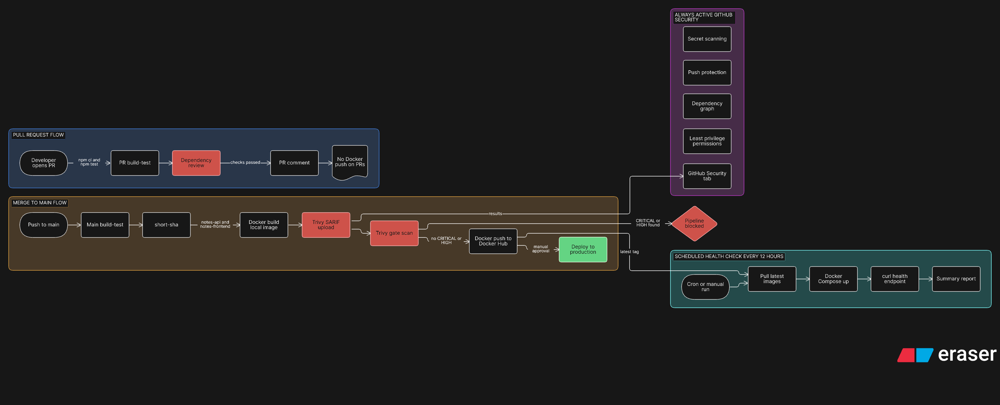

---

## Task 1: Scan the Docker image with Trivy

I added the scan to `reusable-docker.yml`, so both `notes-api` and `notes-frontend` are scanned on every merge to `main`.

The task suggests scanning after the Docker build. My workflow built and pushed in a single step, which would have scanned an image that was already on Docker Hub. So I split it into three steps: build the image locally, scan it, then push. The push only runs if the scan passes, which matches the task's "Docker push (only if scan passes)".

```yaml
- name: Scan Docker Image for Vulnerabilities
  uses: aquasecurity/trivy-action@0.36.0
  with:
    image-ref: ${{ inputs.image_name }}:${{ inputs.tag }}
    format: 'table'
    exit-code: '1'
    severity: 'CRITICAL,HIGH'
```

I did not use `@master` as in the task snippet. A branch runs whatever is on it at that moment. In March 2026 almost all the version tags of this very action were force-pushed to point at credential-stealing malware, so I pinned a release from after that incident.

## The issue I hit: the first scan failed

Right after adding the scan, the pipeline failed on `notes-api`. The Trivy step went red, the push step was skipped and `deploy` never ran. That's what I wanted a scan to do, but it meant my image had real problems.

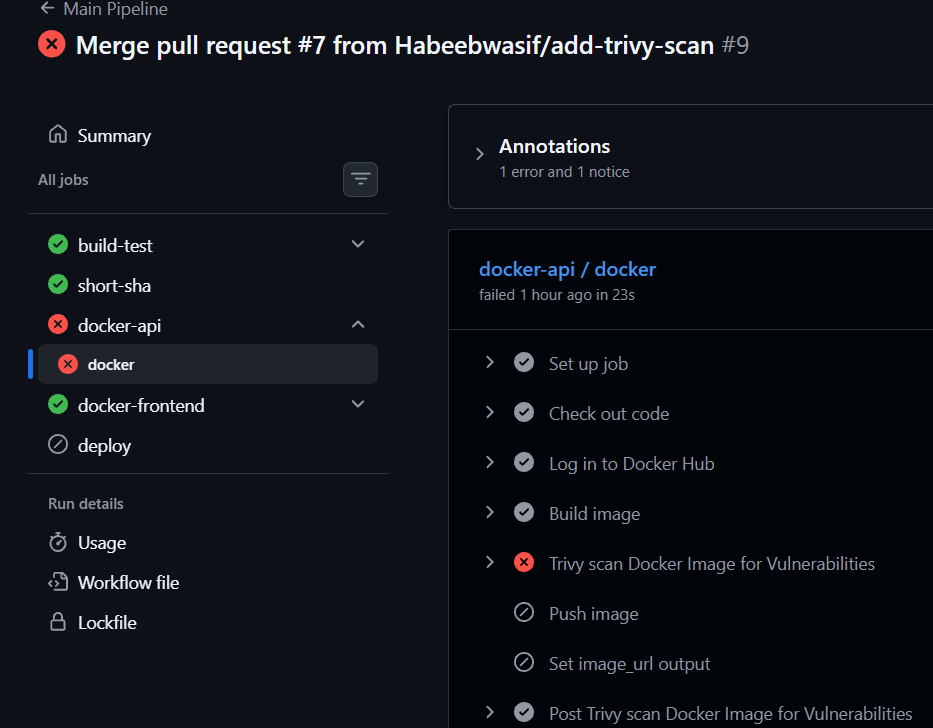

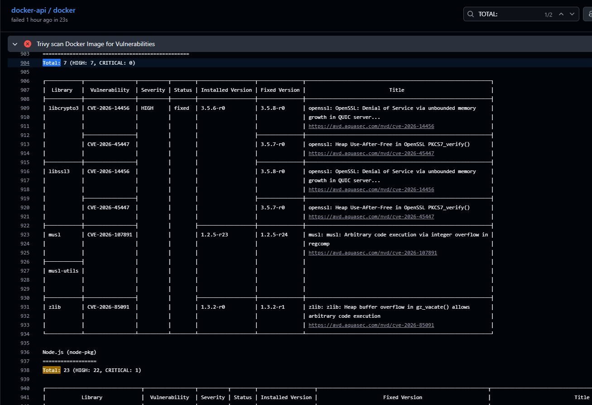

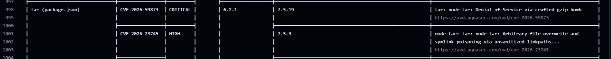


**Base image:** `node:20-alpine` (Alpine 3.23.4)

| Where | Findings |
|---|---|
| Alpine OS packages | 7 |
| Node.js packages | 23 (22 HIGH, 1 CRITICAL) |
| **Total on `notes-api`** | **30** |

`notes-frontend` passed.

The CRITICAL finding was `tar` 6.2.1, CVE-2026-59873 (denial of service through a crafted gzip bomb), fixed in 7.5.19.

**What I found when I read the report:** I expected the problems to be in my code. They were not.

- **22 of the 23 Node findings** were in the copy of npm that is bundled with the Node base image (`tar` had 9, `brace-expansion` 5, `minimatch` 3, and `pacote`, `sigstore`, `ip-address`, `glob` and `cross-spawn` 1 each).
- **Only 1** was in my own dependencies: `body-parser`.
- My container only runs `node server.js`. It never uses npm at runtime.

**How I fixed it**

1. **Removed npm from the final image.** The build stage still has npm, because `npm ci` needs it, and only `node_modules` is copied across. The final stage doesn't need it.
2. **Patched the Alpine packages** with `apk upgrade`.
3. **Updated my own dependency.** `npm audit fix` fixed `body-parser`, and I committed the new `package-lock.json`.

```dockerfile
FROM node:20-alpine

WORKDIR /app

# Patch OS packages, and drop npm: the API only needs node at runtime
RUN apk upgrade --no-cache \
    && rm -rf /usr/local/lib/node_modules/npm /usr/local/bin/npm /usr/local/bin/npx
```

After the fix the scan passed on both images, the images were pushed to Docker Hub and the deploy ran.

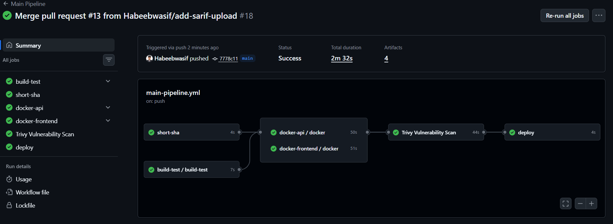

**What I learned:** most of the findings came from tools that were shipped in the image but never used. Shipping less in the image is a security fix in itself. I also noticed that Node 20 is old, so moving to a newer Node base image is a good next step. I'll do it as a separate change because it needs proper testing.

## Task 2: Secret scanning and push protection

I enabled both under Settings → Advanced Security. No workflow changes are needed.

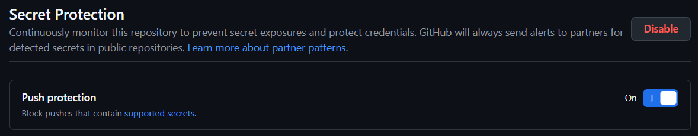

- **Secret scanning vs push protection:** secret scanning searches the repo, including its history, for known secret formats and raises an alert for anything already pushed. Push protection checks a push while it happens and blocks it if it contains a secret, so the secret never reaches the repo. One detects after the fact and the other prevents.
- **If GitHub detects a leaked AWS key:** it creates an alert in the Security tab and notifies the maintainers. On public repos it also notifies the provider, so AWS can warn the account owner or restrict the key. Deleting the file is not enough, because the key stays in the Git history and bots scan public repos within minutes. The key has to be revoked and rotated straight away.

## Task 3: Dependency review on pull requests

I added a `dependency-review` job to `pr-pipeline.yml`. It runs after `build-test`, and `pr-comment` only runs when both jobs pass.

```yaml
dependency-review:
  needs: build-test
  runs-on: ubuntu-latest
  steps:
    - name: Check out code
      uses: actions/checkout@v7

    - name: Check Dependencies for Vulnerabilities
      uses: actions/dependency-review-action@v4
      with:
        fail-on-severity: critical
```

I tested it with a pull request that adds a package to the backend, and the check showed up on the PR.

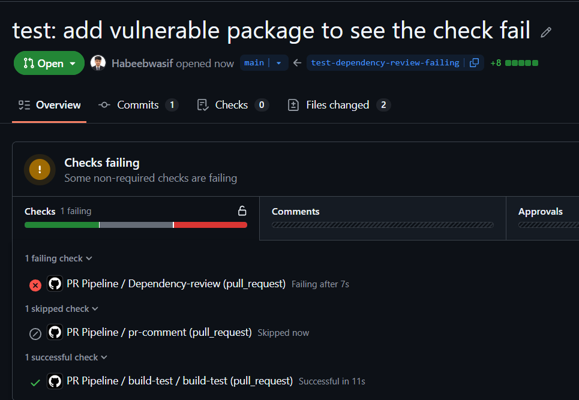

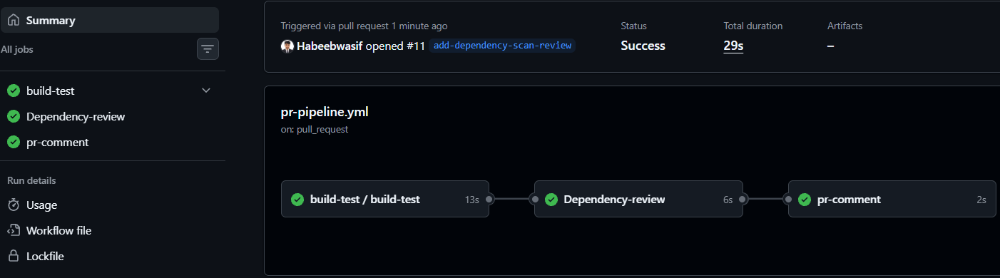

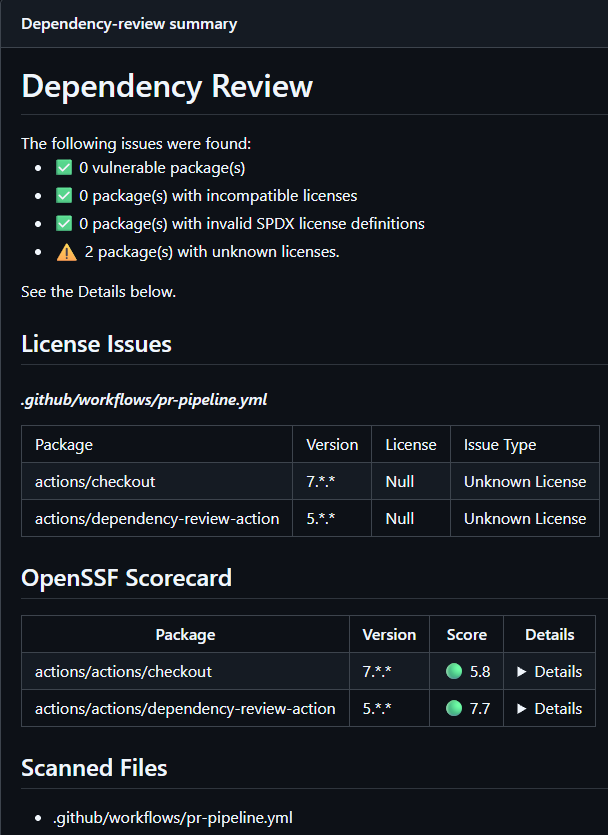

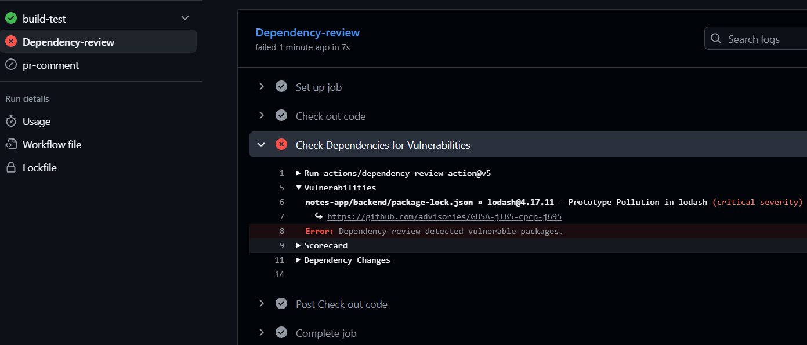

**How it differs from Trivy:** dependency review only looks at packages that a PR adds or changes, and it runs on the PR, before merging and before any image exists. Trivy scans the finished image, including the base OS, after the merge. The first catches problems earlier and the second covers more.

## Task 4: Permissions

By default a workflow gets a broad token. I added a `permissions` block to my workflows:

```yaml
permissions:
  contents: read
```

A job only gets more when it needs it:

| Job | Extra permission | Why |
|---|---|---|
| Docker jobs | `security-events: write` | To upload the Trivy results to the Security tab |
| PR comment (if used) | `pull-requests: write` | To post a comment on the PR |

A called workflow can never have more permissions than the workflow that calls it, so the Docker jobs in `main-pipeline.yml` have to grant `security-events: write` as well.

**Why limiting permissions is good practice:** if an action or a dependency of an action is compromised, it can only do what the token allows. With write access to the repo it could push code, change workflows, tamper with releases or read secrets. With `contents: read` the damage is limited. This is not a theoretical risk. The Trivy action itself was hit by a supply chain attack this year.

## Task 5: The full secure pipeline

The diagram is at the top of this README. Security now runs at every stage: dependency review on PRs, the Trivy gate before anything is pushed, secret scanning and push protection on the repo, and limited permissions everywhere.

## Brownie points: Trivy results in the Security tab

I added a second Trivy run that produces SARIF output, and uploaded it with `github/codeql-action/upload-sarif`. The results now appear in the repo's Security tab under Code scanning.

```yaml
- name: Trivy scan for Security tab (SARIF)
  uses: aquasecurity/trivy-action@0.35.0
  with:
    image-ref: ${{ inputs.image_name }}:${{ inputs.tag }}
    format: 'sarif'
    output: 'trivy-results.sarif'
    exit-code: '0'

- name: Upload Trivy results to the Security tab
  uses: github/codeql-action/upload-sarif@v4
  with:
    sarif_file: 'trivy-results.sarif'
    category: trivy-${{ inputs.context }}
```

- The SARIF scan uses `exit-code: '0'` and runs before the gate, so the findings are uploaded even when the gate fails.
- I used `upload-sarif@v4`, because v3 is being deprecated in December 2026.
- Each image has its own `category`. Without it the two uploads would overwrite each other.

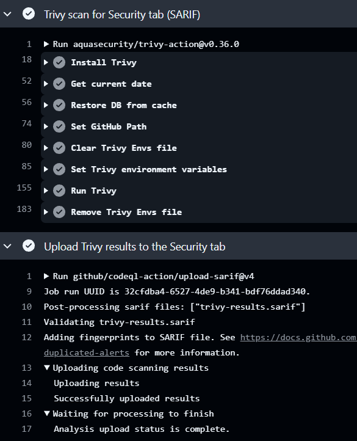

## Other problems I ran into

- **`image_url` output skipped.** The Docker jobs warned "Skip output 'image_url' since it may contain secret". GitHub drops any job output that contains the value of a secret, and my Docker username was a secret. The deploy job then printed an empty image name. The username is public, so I changed it to a normal input in `reusable-docker.yml`. Only the token stays a secret. Anything passed through `secrets:` into a reusable workflow counts as a secret there, even if it comes from a variable, so passing it as an input was the fix.
- **Missing input error.** After that change VS Code flagged "Input docker_username is required, but not provided". One of my two Docker jobs in `main-pipeline.yml` was missing the new line.
- **Node.js 20 deprecation warning.** It comes from `actions/cache` used inside the Trivy action, not from my workflow. The scan still runs. It needs an upstream fix, and I'm keeping the action pinned instead of using `@master` to get rid of it.

## What I learned

- A scan that fails on the first run is a good sign. It proves the pipeline really blocks bad images.
- Most image vulnerabilities came from the base image and its tools, not from my own code.
- Putting the scan before the push means a vulnerable image never reaches Docker Hub.
- Don't store public values as secrets. GitHub masks them, and they get dropped from job outputs.
- Pinning actions to a version, and limiting permissions, protects the pipeline itself and not only the app.

## What I would add next

- Pin every action to a full commit SHA instead of a tag
- Move to a newer Node base image and re-scan
- Dependabot for actions, npm and Docker base images
- OIDC (keyless authentication) once the pipeline deploys to a real cloud
- Scan the Dockerfile and the workflows themselves for misconfigurations

`#90DaysOfDevOps` `#DevOpsKaJosh` `#TrainWithShubham`
