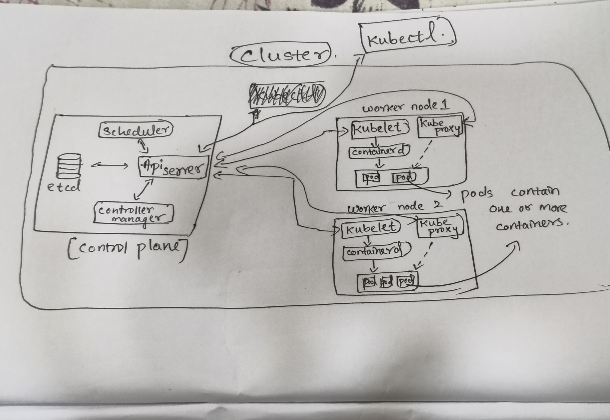
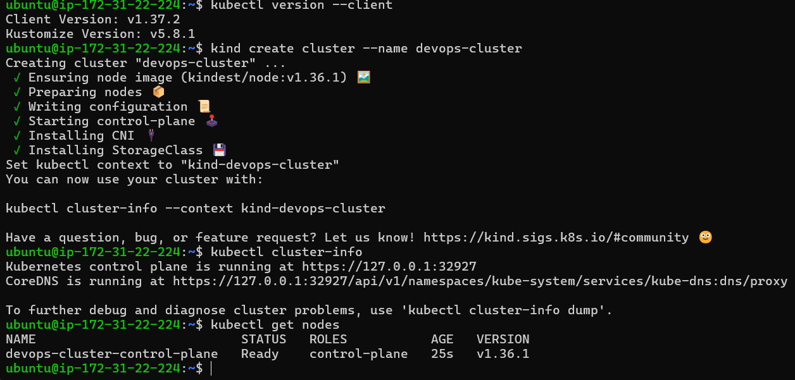
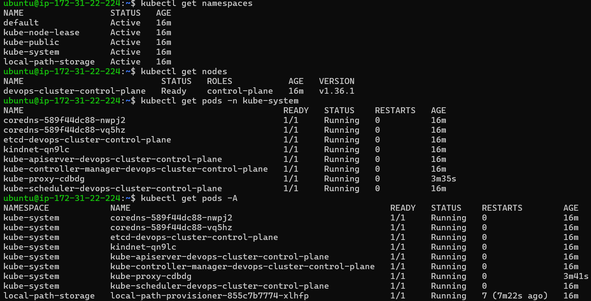
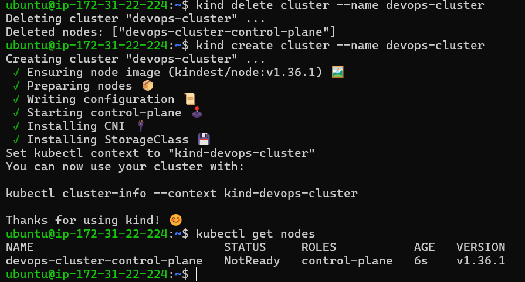
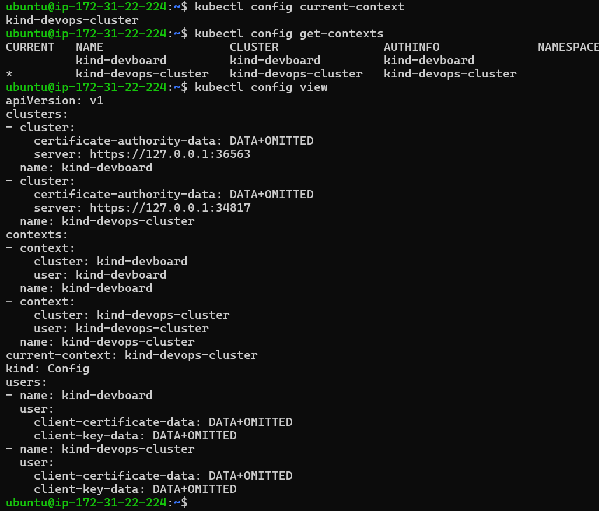

# Day 50 – Kubernetes Architecture and Cluster Setup

## Task 1: The Kubernetes Story

Q. Why was Kubernetes created? What problem does it solve that Docker alone cannot?

Kubernetes was created to run and manage many containers across many servers (auto-scaling, auto-healing, networking, rollout update), which Docker alone can't do. 

Q. Who created Kubernetes and what was it inspired by?

It was created by Google in 2014 (inspired by their internal system Borg). Today, it is maintained by Cloud Native Computing Foundation (CNCF).

Q. What does the name "Kubernetes" mean?

The name is Greek for "helmsman/pilot"- a person who steers a ship. 

## Task 2: Kubernetes Architecture



The control plane (API Server, etcd, Scheduler, Controller Manager) decides and stores the cluster state, while worker nodes (kubelet, kube-proxy, container runtime) run the pods. `kubectl apply` goes to the API Server, is saved in etcd, the Scheduler picks a node and the kubelet starts the pod; if the API server is down you can't manage the cluster (running pods keep running), and if a worker node dies its pods are rescheduled onto other nodes.

### Notes

**What happens when I run `kubectl apply -f pod.yaml`?**

1. `kubectl` reads the kubeconfig and sends the request to the **API Server**, which authenticates and validates it.
2. The API Server saves the Pod object in **etcd**.
3. The **Scheduler** sees a pod with no node, picks a suitable worker node and tells the API Server.
4. The **kubelet** on that node sees the pod assigned to it and asks the **container runtime** (containerd) to pull the image and start the containers.
5. The kubelet reports the pod status back to the API Server (stored in etcd), **kube-proxy** sets up the networking rules, and the **Controller Manager** keeps watching that actual state matches desired state.

**What happens if the API Server goes down?**

`kubectl` can't connect and no new changes can be made, and the scheduler, controllers and kubelets can't read or update the cluster state. Pods that are already running keep running on the nodes, but there is no scaling, self-healing or new scheduling until the API Server is back.

**What happens if a worker node goes down?**

Its kubelet stops sending heartbeats, so the control plane marks the node `NotReady` after a grace period. Pods managed by a Deployment/ReplicaSet are recreated on other healthy nodes, while standalone pods are not recreated.

**Control Plane (Master Node):**
- API Server — the front door to the cluster, every command goes through it
- etcd — the database that stores all cluster state
- Scheduler — decides which node a new pod should run on
- Controller Manager — watches the cluster and makes sure the desired state matches reality

**Worker Node:**
- kubelet — the agent on each node that talks to the API server and manages pods
- kube-proxy — handles networking rules so pods can communicate
- Container Runtime — the engine that actually runs containers (containerd, CRI-O)

After drawing, verify your understanding:
- What happens when you run `kubectl apply -f pod.yaml`? Trace the request through each component.
- What happens if the API server goes down?
- What happens if a worker node goes down?

---

---

## Task 3: Install kubectl

```bash
kubectl version --client
```

Client version: `v1.37.2` (Kustomize `v5.8.1`).



---

## Task 4: Set Up the Local Cluster

**Tool chosen:** kind (Kubernetes in Docker)

**Why:** It is lightweight, runs the cluster inside Docker containers, and creates/deletes a cluster in under a minute, which makes it easy to practice.

```bash
kind create cluster --name devops-cluster
kubectl cluster-info
kubectl get nodes
```

The cluster `devops-cluster` came up with one node, `devops-cluster-control-plane`, status `Ready`, version `v1.36.1`.


---

## Task 5: Explore the Cluster

```bash
kubectl cluster-info
kubectl get nodes
kubectl describe node devops-cluster-control-plane
kubectl get namespaces
kubectl get pods -A
kubectl get pods -n kube-system
```



Namespaces: `default`, `kube-node-lease`, `kube-public`, `kube-system`, `local-path-storage`.

> Note: this screenshot was taken about 100 seconds after the cluster was created, so `coredns` was still `0/1` and `kube-proxy` showed `Error` while restarting. These settle once the node networking is ready.

### What each kube-system pod does

| Pod | Role |
|-----|------|
| `kube-apiserver` | Front door of the cluster; every command and component talks through it |
| `etcd` | Key-value database that stores all cluster state |
| `kube-scheduler` | Decides which node a new pod runs on |
| `kube-controller-manager` | Watches the cluster and keeps actual state matching desired state |
| `coredns` | DNS for the cluster so pods/services can find each other by name |
| `kube-proxy` | Maintains network rules on each node so pods and services can communicate |
| `kindnet` | The CNI plugin used by kind; gives pods their network |

---

## Task 6: Cluster Lifecycle

```bash
kind delete cluster --name devops-cluster
kind create cluster --name devops-cluster
kubectl get nodes
```



The node showed `NotReady` just 6 seconds after recreation; it turns `Ready` once the kubelet and networking finish starting.



```bash
kubectl config current-context
kubectl config get-contexts
kubectl config view
```

Current context: `kind-devops-cluster` (another context, `kind-devboard`, also exists).


**What is a kubeconfig?** A YAML file that stores cluster details, user credentials and contexts so `kubectl` knows which cluster to talk to.

**Where is it stored?** By default at `~/.kube/config`.
