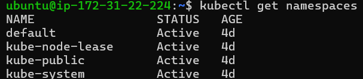
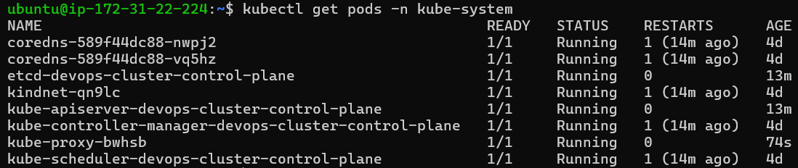
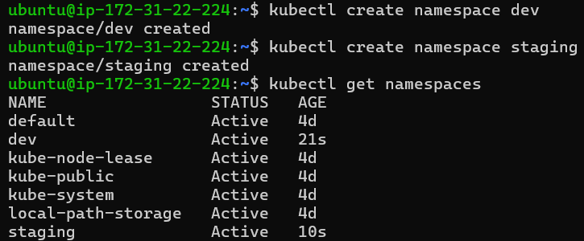
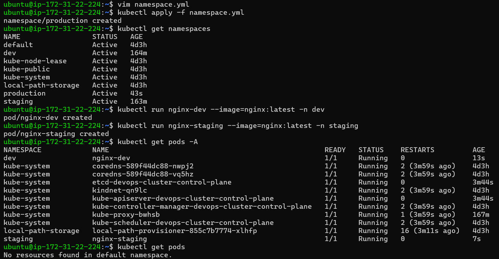
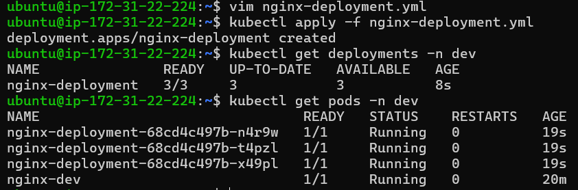
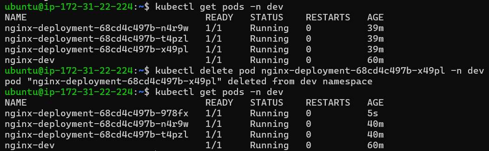
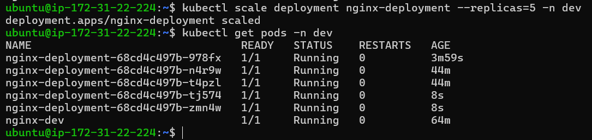
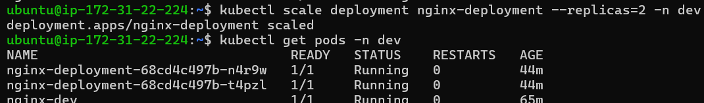
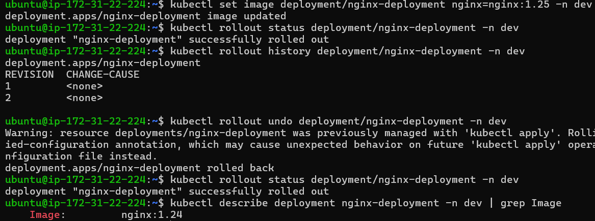
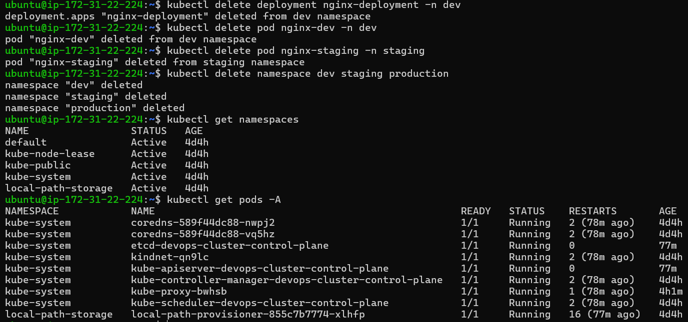

# Day 52 – Kubernetes Namespaces and Deployments

### Task 1: Explore Default Namespaces

- `What are Namespaces`: Namespaces split one cluster into separate sections, like folders. Built-in ones: default, kube-system, kube-public, kube-node-lease.

- `Why use them`: separate environments (dev, staging, production), avoid name clashes, apply quotas/access per team, and delete a whole section at once.

Kubernetes comes with built-in namespaces. List them:

```bash
kubectl get namespaces
```



You should see at least:
- `default` — where your resources go if you do not specify a namespace
- `kube-system` — Kubernetes internal components (API server, scheduler, etc.)
- `kube-public` — publicly readable resources
- `kube-node-lease` — node heartbeat tracking

Check what is running inside `kube-system`:
```bash
kubectl get pods -n kube-system
```



These are the control plane components keeping your cluster alive. Do not touch them.

**Verify:** How many pods are running in `kube-system`?

> 8 pods are running and all 8 are healthy (1/1 Ready)

### Task 2: Create and Use Custom Namespaces
Create two namespaces — one for a development environment and one for staging:

```bash
kubectl create namespace dev
kubectl create namespace staging
```

Verify they exist:
```bash
kubectl get namespaces
```



You can also create a namespace from a manifest:
```yaml
# namespace.yaml
apiVersion: v1
kind: Namespace
metadata:
  name: production
```

```bash
kubectl apply -f namespace.yaml
```

Now run a pod in a specific namespace:
```bash
kubectl run nginx-dev --image=nginx:latest -n dev
kubectl run nginx-staging --image=nginx:latest -n staging
```

List pods across all namespaces:
```bash
kubectl get pods -A
```

Notice that `kubectl get pods` without `-n` only shows the `default` namespace. You must specify `-n <namespace>` or use `-A` to see everything.



**Verify:** Does `kubectl get pods` show these pods? What about `kubectl get pods -A`?

- No for `kubectl get pods`, yes for `kubectl get pods -A`.
- `kubectl get pods` only checks the default namespace, where I have no pods.
- `kubectl get pods -A` checks all namespaces, so it shows nginx-dev (in dev) and nginx-staging (in staging).

---

### Task 3: Create Your First Deployment
A Deployment tells Kubernetes: "I want X replicas of this Pod running at all times." If a Pod crashes, the Deployment controller recreates it automatically.

Create a file `nginx-deployment.yaml`:

```yaml
apiVersion: apps/v1
kind: Deployment
metadata:
  name: nginx-deployment
  namespace: dev
  labels:
    app: nginx
spec:
  replicas: 3
  selector:
    matchLabels:
      app: nginx
  template:
    metadata:
      labels:
        app: nginx
    spec:
      containers:
      - name: nginx
        image: nginx:1.24
        ports:
        - containerPort: 80
```

Key differences from a standalone Pod:
- `kind: Deployment` instead of `kind: Pod`
- `apiVersion: apps/v1` instead of `v1`
- `replicas: 3` tells Kubernetes to maintain 3 identical pods
- `selector.matchLabels` connects the Deployment to its Pods
- `template` is the Pod template — the Deployment creates Pods using this blueprint

Apply it:
```bash
kubectl apply -f nginx-deployment.yaml
```

Check the result:
```bash
kubectl get deployments -n dev
kubectl get pods -n dev
```

You should see 3 pods with names like `nginx-deployment-xxxxx-yyyyy`.



- Deployment pod: replaced immediately by the ReplicaSet, with a different name.
- Standalone pod: gone

**Verify:** What do the READY, UP-TO-DATE, and AVAILABLE columns mean in the deployment output?

- READY (3/3): pods that are working and ready to use. 2/3 would mean one pod isn’t ready yet.
- UP-TO-DATE (3): pods running with newest settings (like the latest image). When I update something, this number goes up as old pods get replaced with new ones.
- AVAILABLE (3): pods which are ready and can actually take user traffic right now.

---

### Task 4: Self-Healing — Delete a Pod and Watch It Come Back
This is the key difference between a Deployment and a standalone Pod.

```bash
# List pods
kubectl get pods -n dev

# Delete one of the deployment's pods (use an actual pod name from your output)
kubectl delete pod <pod-name> -n dev

# Immediately check again
kubectl get pods -n dev
```

How scaling works (both imperative and declarative)
- Imperative: `kubectl scale deployment nginx-deployment --replicas=5 -n dev`
- Declarative: we edit replicas in the YAML, then `kubectl apply -f nginx-deployment.yml`

The Deployment controller detects that only 2 of 3 desired replicas exist and immediately creates a new one. The deleted pod is replaced within seconds.

**Verify:** Is the replacement pod's name the same as the one you deleted, or different?



> The deleted pod is replaced with a new pod with different name.

---

### Task 5: Scale the Deployment
Change the number of replicas:

```bash
# Scale up to 5
kubectl scale deployment nginx-deployment --replicas=5 -n dev
kubectl get pods -n dev

# Scale down to 2
kubectl scale deployment nginx-deployment --replicas=2 -n dev
kubectl get pods -n dev
```

Watch how Kubernetes creates or terminates pods to match the desired count.

You can also scale by editing the manifest — change `replicas: 4` in your YAML file and run `kubectl apply -f nginx-deployment.yaml` again.

**Verify:** When you scaled down from 5 to 2, what happened to the extra pods?





> The 3 extra pods were terminated and deleted.
---

### Task 6: Rolling Update
Update the Nginx image version to trigger a rolling update:

```bash
kubectl set image deployment/nginx-deployment nginx=nginx:1.25 -n dev
```

Watch the rollout in real time:
```bash
kubectl rollout status deployment/nginx-deployment -n dev
```

Kubernetes replaces pods one by one — old pods are terminated only after new ones are healthy. This means zero downtime.

Check the rollout history:
```bash
kubectl rollout history deployment/nginx-deployment -n dev
```

Now roll back to the previous version:
```bash
kubectl rollout undo deployment/nginx-deployment -n dev
kubectl rollout status deployment/nginx-deployment -n dev
```

Verify the image is back to the previous version:
```bash
kubectl describe deployment nginx-deployment -n dev | grep Image
```

- Update: `kubectl set image deployment/nginx-deployment nginx=nginx:1.25 -n dev` replaces pods gradually, so there is no downtime.
- Rollback: `kubectl rollout undo deployment/nginx-deployment -n dev` returns to the previous revision.

**Verify:** What image version is running after the rollback?



> `nginx:1.24` is running after the rollback

---

### Task 7: Clean Up
```bash
kubectl delete deployment nginx-deployment -n dev
kubectl delete pod nginx-dev -n dev
kubectl delete pod nginx-staging -n staging
kubectl delete namespace dev staging production
```

Deleting a namespace removes everything inside it. Be very careful with this in production.

```bash
kubectl get namespaces
kubectl get pods -A
```

**Verify:** Are all your resources gone?

> Yes, everything created in this cluster is gone and now only the built-in system components remains.



---

