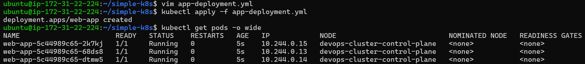
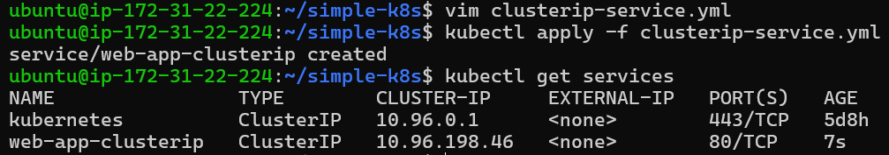
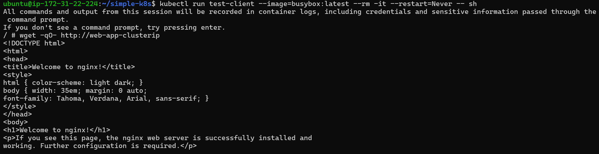
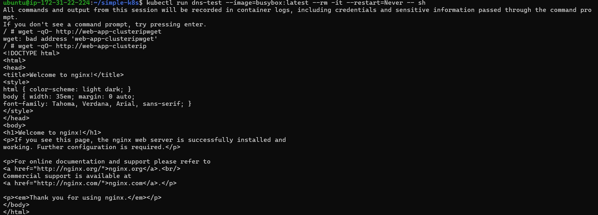
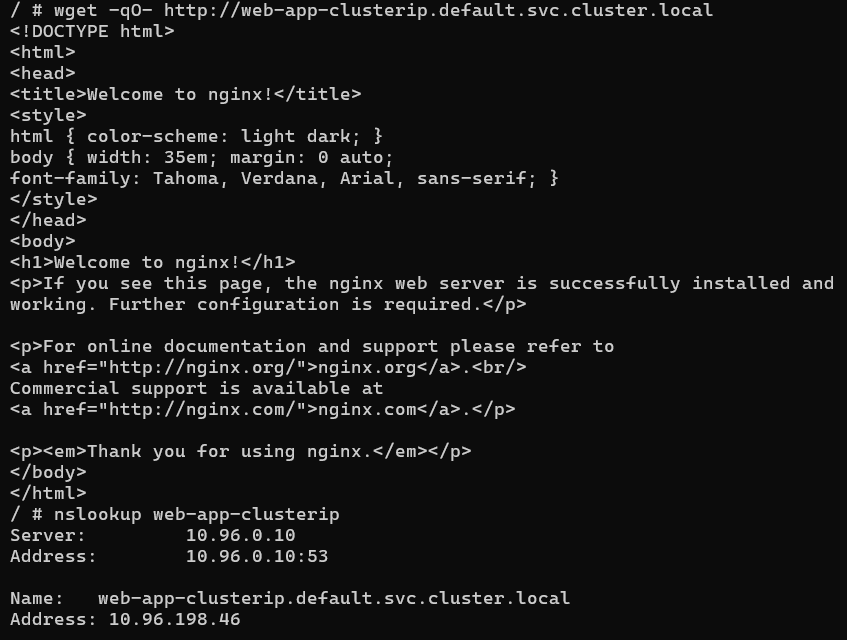
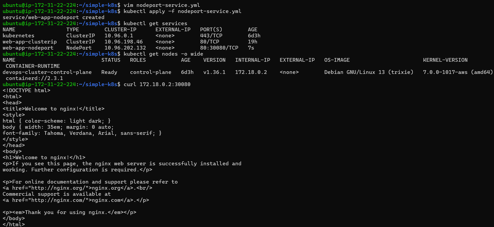
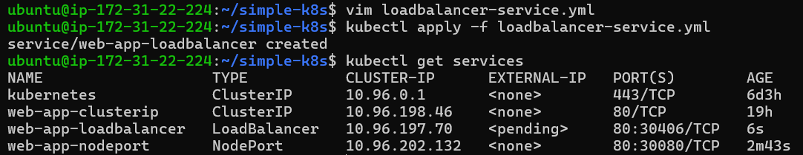
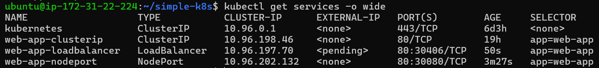
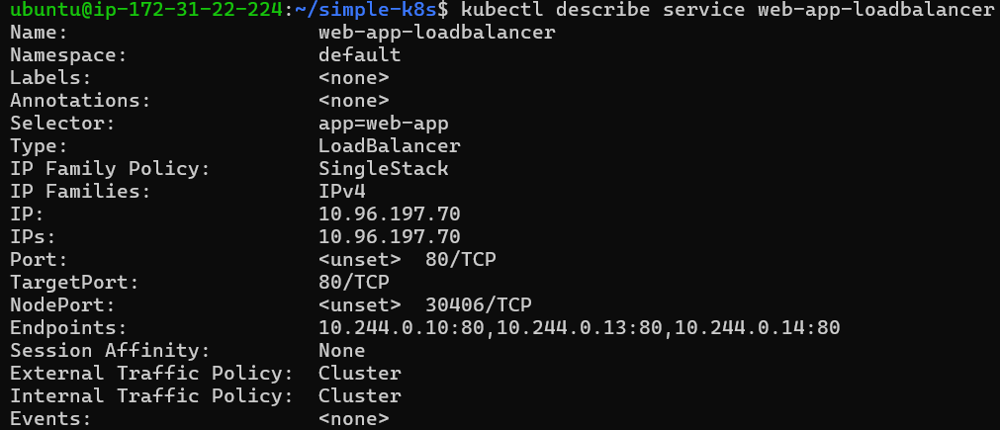
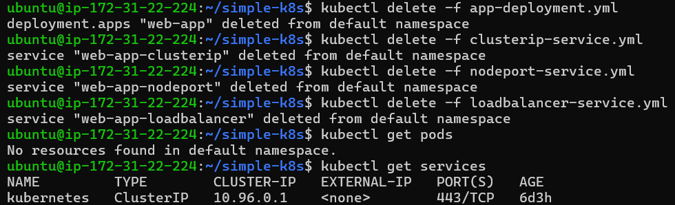

# Day 53 – Kubernetes Services

Pods get IP addresses that change whenever they restart, and a Deployment runs several Pods, so there is no single address to connect to. A **Service** fixes both problems by giving the Pods:

- a **stable IP and DNS name** that does not change
- **load balancing** across every Pod matching its label selector

```
[Client] --> [Service (stable IP)] --> [Pod 1]
                                   --> [Pod 2]
                                   --> [Pod 3]
```

**Environment:** single-node cluster `devops-cluster-control-plane` (Kubernetes v1.36.1, containerd) running on an AWS Ubuntu host.

---

## Task 1: Deploy the Application

```bash
kubectl apply -f app-deployment.yml
kubectl get pods -o wide
```



| Pod | Status | IP |
|-----|--------|----|
| web-app-5c44989c65-2k7kj | Running (1/1) | 10.244.0.15 |
| web-app-5c44989c65-68ds8 | Running (1/1) | 10.244.0.13 |
| web-app-5c44989c65-dtmw5 | Running (1/1) | 10.244.0.14 |

**Verify: Are all 3 pods running?** Yes. All three show `1/1 READY`, `Running`, with 0 restarts.

These IPs are not stable. In the Task 6 `describe` output lists `10.244.0.10` instead of `.15` so a Pod was replaced and got a new IP. The Service picked it up automatically.

---

## Task 2: ClusterIP Service (Internal Access)

```bash
kubectl apply -f clusterip-service.yml
kubectl get services
```



`web-app-clusterip` was created with CLUSTER-IP **10.96.198.46** on port `80/TCP` and no external IP.

Testing from inside the cluster with a temporary pod:

```bash
kubectl run test-client --image=busybox:latest --rm -it --restart=Never -- sh
wget -qO- http://web-app-clusterip
```



**Verify: Does the Service respond?** Yes. The temporary busybox pod fetched the "Welcome to nginx!" page through the Service name. The Service forwards each request to one of the 3 healthy Pods that match `app: web-app`.

---

## Task 3: Discover Services with DNS

```bash
kubectl run dns-test --image=busybox:latest --rm -it --restart=Never -- sh
wget -qO- http://web-app-clusterip                                # short name
wget -qO- http://web-app-clusterip.default.svc.cluster.local      # full DNS name
nslookup web-app-clusterip
```

Short name:



Full DNS name and `nslookup`:



Both names return the same nginx page. `nslookup` output:

```
Server:   10.96.0.10          (the cluster DNS service)
Address:  10.96.0.10:53

Name:     web-app-clusterip.default.svc.cluster.local
Address:  10.96.198.46
```

**Verify: What IP does `nslookup` return? Does it match the CLUSTER-IP?** 

It returns **10.96.198.46**, which matches the CLUSTER-IP of `web-app-clusterip` from `kubectl get services`. 

The DNS name is `<service-name>.<namespace>.svc.cluster.local`. Use the short name within the same namespace and the full name to reach a Service in another namespace.

---

## Task 4: NodePort Service (External Access via Node)

```bash
kubectl apply -f nodeport-service.yml
kubectl get services
kubectl get nodes -o wide
curl 172.18.0.2:30080
```



- `web-app-nodeport` is type `NodePort`, CLUSTER-IP `10.96.202.132`, ports `80:30080/TCP`.
- The node's INTERNAL-IP is `172.18.0.2` (this is a Kind-style cluster, so the node IP is used directly).
- `curl 172.18.0.2:30080` returned the nginx welcome page.

**Verify: Can you see the Nginx welcome page using the NodePort?** 

Yes. The traffic flow was `172.18.0.2:30080` -> Service -> Pod:80.

---

## Task 5: LoadBalancer Service (Cloud External Access)

```bash
kubectl apply -f loadbalancer-service.yml
kubectl get services
```



`web-app-loadbalancer` was created with CLUSTER-IP `10.96.197.70`, ports `80:30406/TCP`, and EXTERNAL-IP **`<pending>`**.

**Verify: What does the EXTERNAL-IP column show? Why is it `<pending>`?** 

It shows `<pending>`. A LoadBalancer Service asks the cloud provider (AWS, GCP, Azure) to provision a real external load balancer. 

This is a local cluster with no cloud controller to do that, so the request just waits. This is expected. On a real cloud cluster the column would show a public IP or hostname.

---

## Task 6: Service Types Side by Side

```bash
kubectl get services -o wide
```



All three services use the same selector, `app=web-app`, so they route to the same set of Pods.

| Type | Accessible From | Use Case |
|------|----------------|----------|
| ClusterIP | Inside the cluster only | Internal communication between services |
| NodePort | Outside via `<NodeIP>:<NodePort>` | Development, testing, direct node access |
| LoadBalancer | Outside via a cloud load balancer | Production traffic in cloud environments |

Each type builds on the previous one: a LoadBalancer creates a NodePort, which sits on top of a ClusterIP.

```bash
kubectl describe service web-app-loadbalancer
```



**Verify: Does the LoadBalancer service also have a ClusterIP and NodePort?** 

Yes:

- **ClusterIP:** `IP: 10.96.197.70`
- **NodePort:** `30406/TCP` (auto-assigned from the 30000-32767 range)
- **LoadBalancer:** `Type: LoadBalancer` (EXTERNAL-IP still pending)
- **Endpoints:** `10.244.0.10:80, 10.244.0.13:80, 10.244.0.14:80`, the three Pods behind the Service

---

### Task 7: Clean Up
```bash
kubectl delete -f app-deployment.yaml
kubectl delete -f clusterip-service.yaml
kubectl delete -f nodeport-service.yaml
kubectl delete -f loadbalancer-service.yaml

kubectl get pods
kubectl get services
```

Only the built-in `kubernetes` service in the default namespace should remain.

**Verify:** Is everything cleaned up?



---

## Key Takeaways

- Pod IPs change, but a Service's ClusterIP and DNS name stay the same.
- Services find Pods through label selectors, and the endpoint list updates automatically when Pods are replaced.
- ClusterIP is for internal traffic, NodePort exposes a port on every node, and LoadBalancer adds a cloud-provisioned external load balancer on top of both.
- Kubernetes DNS lets Pods reach Services by name instead of by IP.
