# Day 54 – Kubernetes ConfigMaps and Secrets
 
Today I learned how to keep configuration out of container images. Instead of hardcoding database URLs, flags and passwords into an image (and rebuilding it for every change), Kubernetes lets me store them as separate objects and inject them into Pods at runtime.
 
---
 
## 1. What are ConfigMaps and Secrets, and when to use each?
 
### ConfigMap
A ConfigMap is an API object used to store non-confidential data in key-value pairs.
 
### Secret
A Secret stores sensitive data such as passwords, API keys and tokens.

### When to use each
 
| If the data is... | Use |
|---|---|
| Safe to be seen by anyone with access to the app | ConfigMap |
| A credential or something that would be a problem if leaked | Secret |
 
---
 
## 2. Environment variables vs volume mounts
 
Both ConfigMaps and Secrets can be consumed in two ways.
 
| | Environment variables | Volume mounts |
|---|---|---|
| How it works | Values are injected into the container's environment | Each key becomes a **file** inside a directory |
| Best for | Simple key-value settings | Full config files (e.g. Nginx config), credentials as files |
| Whole object | `envFrom` injects **all** keys | Mounting injects **all** keys as files |
| Single key | `env` with `valueFrom` (`configMapKeyRef` / `secretKeyRef`) | `items` or `subPath` |
| Updates live? | **No**, fixed when the container starts | **Yes**, updates after the kubelet syncs |
 
In my tasks:
- `busybox-pod` used **`envFrom`** to load `app-config` as environment variables.
- `nginx-pod` used a **volume mount** to place `nginx-config` at `/etc/nginx/conf.d`.
- `secret-pod` used **both**: `secretKeyRef` for `DB_USER` and a read-only volume for the whole Secret.
---
 
## 3. Why base64 is encoding, not encryption
 
Encoding only changes the *format* of data so it can be stored safely as text. Anyone can reverse it, and no key is needed. Encryption needs a secret key to read the data.
 
The Secret I created stored my values like this:
 
```
DB_PASSWORD: czNjdXJlUEBzc3cwcmQ=
DB_USER: YWRtaW4=
```
 
I decoded the password with a single base64 decode and got the original text back:
 
```
s3cureP@ssw0rd
```
 
So anyone who can read the Secret object can read the password.
 
---
 
## 4. How ConfigMap updates propagate (volumes yes, env vars no)
 
- Volumes: the kubelet periodically syncs mounted ConfigMaps into the Pod, so the files update automatically after a short delay, with no restart. In Task 6, live-pod switched from hello to world without restarting.
- Env vars: they're read once when the container starts, so later ConfigMap changes don't reach them. The Pod must be recreated to pick up new values.

- Exception: subPath mounts don't update live either.
 
---
 
### Task 1: ConfigMap from literals
I created `app-config` with three keys: `APP_ENV=production`, `APP_DEBUG=false` and `APP_PORT=8080`. My first attempt failed with "exactly one NAME is required" because I forgot to give the ConfigMap a name. After adding the name, it was created. Describing it and viewing it as YAML showed all three key-value pairs in plain text, with no encoding or encryption.

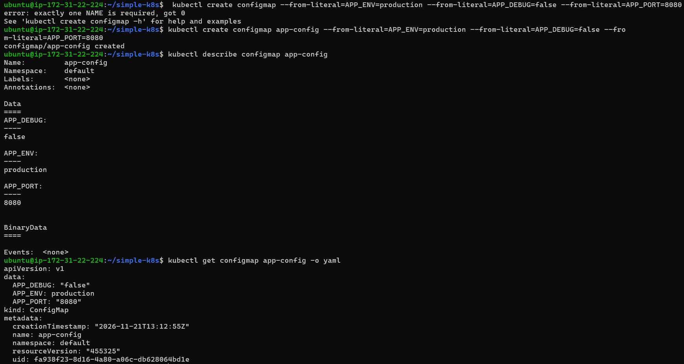

### Task 2: ConfigMap from a file
I wrote an Nginx config file (`nginx.conf`) with a normal `/` location that serves the default page, plus a new `/health` location that returns HTTP 200 with the text "healthy". I created `nginx-config` from it, using `default.conf` as the key. The key name becomes the filename when mounted. Viewing the ConfigMap as YAML showed the whole file contents stored as one multi-line string under `default.conf`.

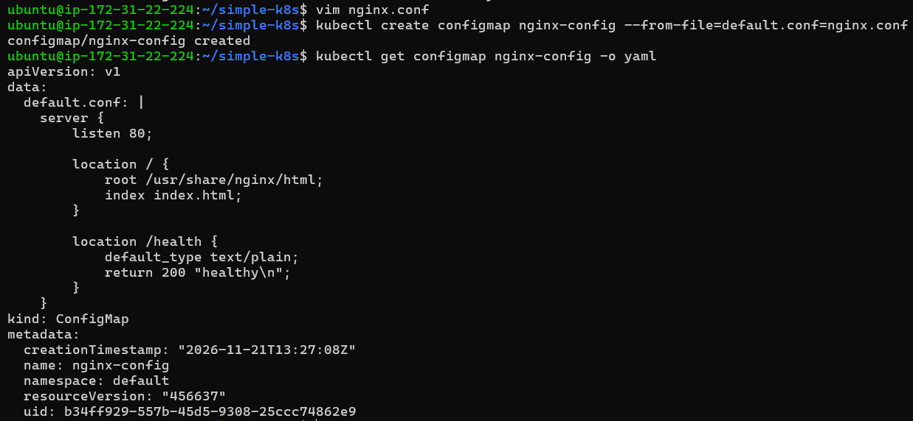

### Task 3: Using ConfigMaps in Pods
- **Env vars:** `busybox-pod` loaded every key from `app-config` through `envFrom`. Its logs printed:
```
ENV=production DEBUG=false PORT=8080
```

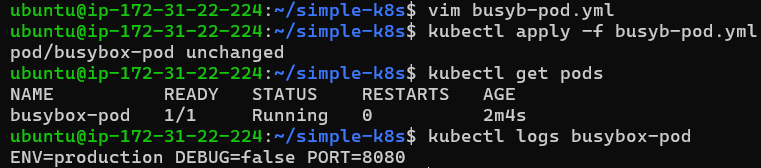

- **Volume mount:** `nginx-pod` mounted `nginx-config` at `/etc/nginx/conf.d`, replacing Nginx's default config with mine. Both Pods showed `1/1 Running` with 0 restarts. Calling the `/health` endpoint from inside the Pod returned:
```
healthy
```

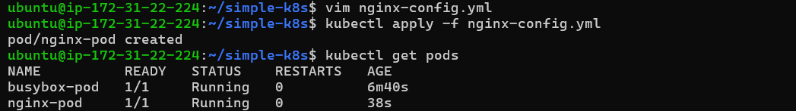

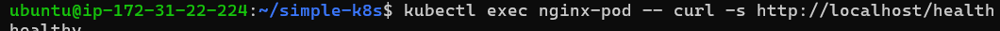

### Task 4: Creating a Secret
I created `db-credentials` with `DB_USER=admin` and `DB_PASSWORD=s3cureP@ssw0rd`, quoting the password so the shell would not misread the `@`. Viewing it as YAML showed base64 values (type `Opaque`):
 
```
DB_PASSWORD: czNjdXJlUEBzc3cwcmQ=
DB_USER: YWRtaW4=
```

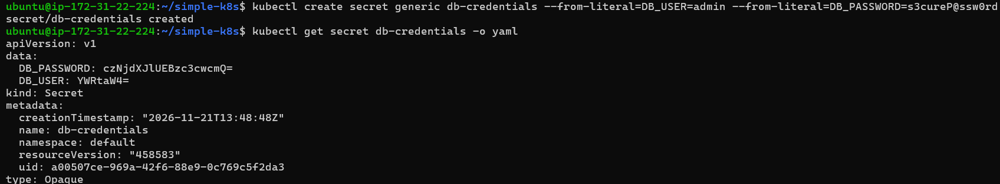

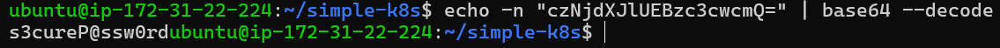

Decoding the password returned `s3cureP@ssw0rd`, confirming base64 is reversible by anyone. I used `echo -n` so no trailing newline was added to the encoded text.
 
### Task 5: Using Secrets in a Pod
`secret-pod` injected `DB_USER` as an environment variable through `secretKeyRef`, and also mounted the whole Secret at `/etc/db-credentials` as read-only. Inside the Pod, each Secret key had become a file:
 
```
DB_PASSWORD
DB_USER
```
 
Reading them returned plaintext, not base64:
 
```
s3cureP@ssw0rd
admin
```

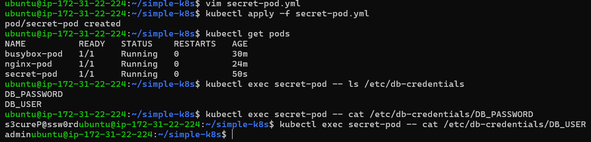
 
Kubernetes decodes the values automatically when it mounts them.
 
### Task 6: Updating a ConfigMap and watching propagation
I created `live-config` with `message=hello` and ran `live-pod`, which mounts it as a volume and prints the file contents with a timestamp every 5 seconds. While following its logs, I patched the ConfigMap to `message=world`. The output changed in the same running Pod, with no restart:
 
```
Sat Nov 21 14:15:16 UTC 2026: hello
Sat Nov 21 14:15:21 UTC 2026: hello
Sat Nov 21 14:15:26 UTC 2026: world
Sat Nov 21 14:15:31 UTC 2026: world
```

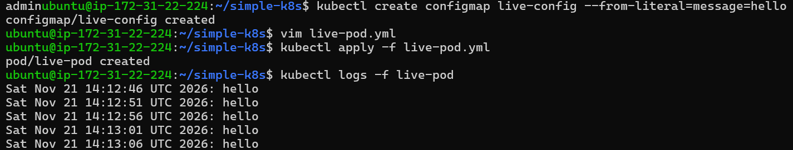

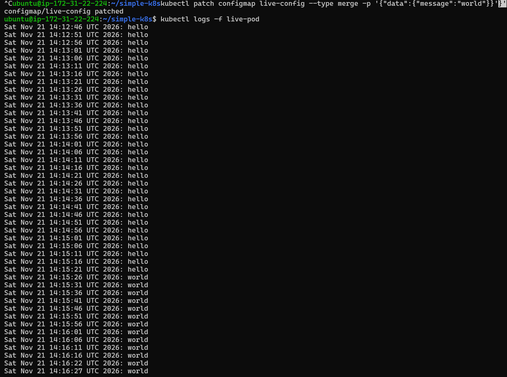
 
The change appears after a short delay because the kubelet syncs mounted ConfigMaps periodically. By contrast, `busybox-pod` only printed its environment variables once at startup, because env vars are fixed when the container starts.
 
One thing I learned along the way: a running Pod's `command` field cannot be edited. Trying to change it gives a "pod updates may not change fields other than..." error, so the Pod has to be deleted and recreated.
 
### Task 7: Clean up
I deleted all Pods, Secrets and ConfigMaps in the default namespace. Afterwards only the built-in `kubernetes` service remained. Because I deleted everything at once, it also removed `kube-root-ca.crt`, a ConfigMap Kubernetes creates automatically in every namespace. The cluster recreates it on its own, but in future I will delete resources by name so I only remove what I created.

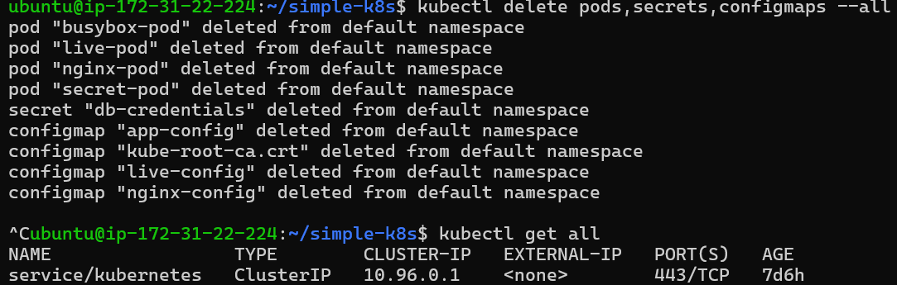

---
 
## Key takeaways
 
- ConfigMaps are for non-sensitive config, Secrets are for sensitive data.
- Use env vars for simple settings and volume mounts for whole files.
- base64 is **not** security. Protect Secrets with RBAC, encryption at rest and external secret managers.
- Volume-mounted config updates live, env vars need a Pod restart.
- Pod specs are mostly immutable, so changes mean delete and recreate.
 
