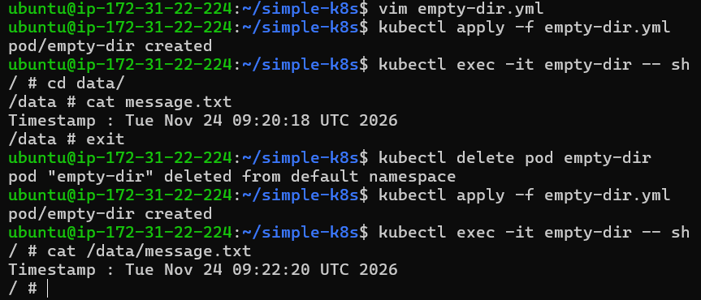
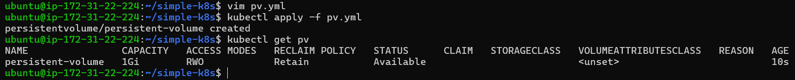
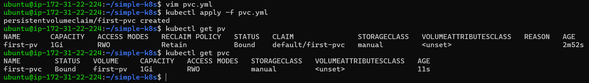
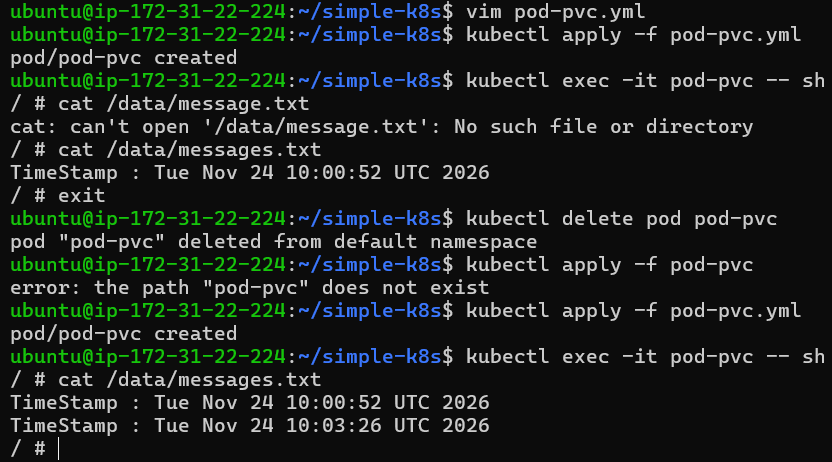
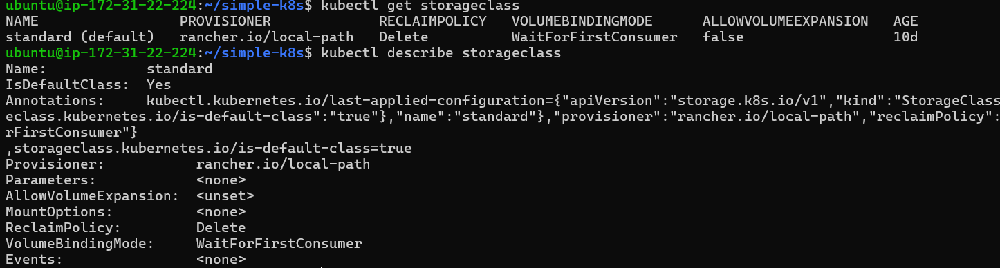
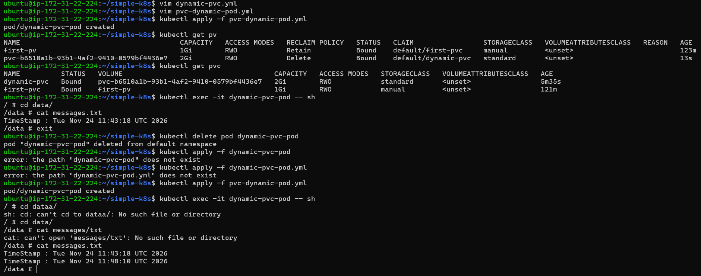
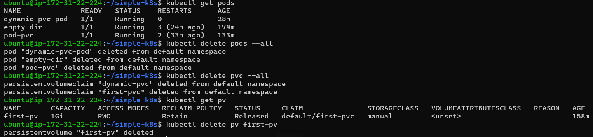

# Day 55 – Persistent Volumes (PV) and Persistent Volume Claims (PVC)

### 1. Why Persistent Storage?

- `emptyDir` data is lost when the Pod is deleted.
- Persistent storage lives outside the Pod, so data stays safe.
- A new Pod can use the same data.

### 2. PV and PVC

- PV (PersistentVolume) = the actual storage. Created by an admin.
- PVC (PersistentVolumeClaim) = our request for storage (size, access mode).
- Kubernetes matches a PVC to a PV. This is called binding.
- The Pod uses the PVC in its volumes section:

```bash
  volumes:
    - name: my-storage
      persistentVolumeClaim:
        claimName: my-claim
```

### 3. Static Vs Dynamic Provisioning
   
- Static: admin creates the PV by hand first.
- Dynamic: Kubernetes creates the PV automatically when we create a PVC.
> Dynamic needs a StorageClass.

### 4. Access Modes

- RWO (ReadWriteOnce): read/write from one node
- ROX (ReadOnlyMany): read only from many nodes
- RWX (ReadWriteMany): read/write from many nodes
- RWOP (ReadWriteOncePod): read/write from one Pod only

### 5. Reclaim Policies (what happens after the PVC is deleted)

- Retain: PV and data are kept. We clean it manually.
- Delete: PV and real storage are removed. This is the default for dynamic volumes.

### Flow
PV created -> PVC created -> PVC binds to PV -> Pod uses PVC -> PVC deleted -> reclaim policy decides what happens to data

### Task 1: See the Problem — Data Lost on Pod Deletion
1. Write a Pod manifest that uses an `emptyDir` volume and writes a timestamped message to `/data/message.txt`
2. Apply it, verify the data exists with `kubectl exec`
3. Delete the Pod, recreate it, check the file again — the old message is gone



**Verify:** Is the timestamp the same or different after recreation?

> The timestamp is different after recreation.

---

### Task 2: Create a PersistentVolume (Static Provisioning)
1. Write a PV manifest with `capacity: 1Gi`, `accessModes: ReadWriteOnce`, `persistentVolumeReclaimPolicy: Retain`, and `hostPath` pointing to `/tmp/k8s-pv-data`
2. Apply it and check `kubectl get pv` — status should be `Available`

Access modes to know:
- `ReadWriteOnce (RWO)` — read-write by a single node
- `ReadOnlyMany (ROX)` — read-only by many nodes
- `ReadWriteMany (RWX)` — read-write by many nodes

`hostPath` is fine for learning, not for production.



**Verify:** What is the STATUS of the PV?

> Status = Available

---

### Task 3: Create a PersistentVolumeClaim
1. Write a PVC manifest requesting `500Mi` of storage with `ReadWriteOnce` access
2. Apply it and check both `kubectl get pvc` and `kubectl get pv`
3. Both should show `Bound` — Kubernetes matched them by capacity and access mode



**Verify:** What does the VOLUME column in `kubectl get pvc` show?

> It shows the `PersistentVolume` name with status `Bound`.

---

### Task 4: Use the PVC in a Pod — Data That Survives
1. Write a Pod manifest that mounts the PVC at `/data` using `persistentVolumeClaim.claimName`
2. Write data to `/data/message.txt`, then delete and recreate the Pod
3. Check the file — it should contain data from both Pods



**Verify:** Does the file contain data from both the first and second Pod?

> Yes, it contains the data from both first and second pod.

---

### Task 5: StorageClasses and Dynamic Provisioning
1. Run `kubectl get storageclass` and `kubectl describe storageclass`
2. Note the provisioner, reclaim policy, and volume binding mode
3. With dynamic provisioning, developers only create PVCs — the StorageClass handles PV creation automatically



**Verify:** What is the default StorageClass in your cluster?

> `Standard` is the default `StorageClass` in cluster.

---

### Task 6: Dynamic Provisioning
1. Write a PVC manifest that includes `storageClassName: standard` (or your cluster's default)
2. Apply it — a PV should appear automatically in `kubectl get pv`
3. Use this PVC in a Pod, write data, verify it works



**Verify:** How many PVs exist now? Which was manual, which was dynamic?

> There are 2 PVs existing, `StorageClass: manual` one is `manual` and the other is `StorageClass: standard` as `dynamic`.

---

### Task 7: Clean Up
1. Delete all pods first
2. Delete PVCs — check `kubectl get pv` to see what happened
3. The dynamic PV is gone (Delete reclaim policy). The manual PV shows `Released` (Retain policy).
4. Delete the remaining PV manually



**Verify:** Which PV was auto-deleted and which was retained? Why?

> Dynamic PV was auto deleted because it had `reclaimPolicy: Delete` and Manual PV was retained because it had `reclaimPolicy: Retain`

> Lastly, I deleted the remaining PV manually.

---

