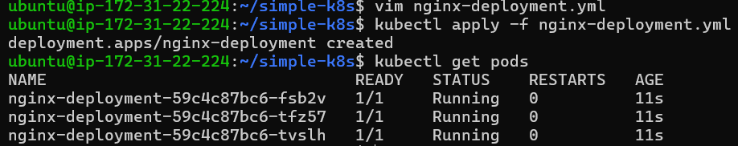
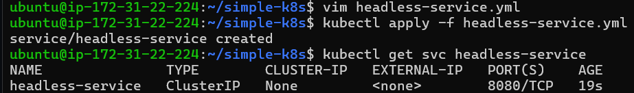
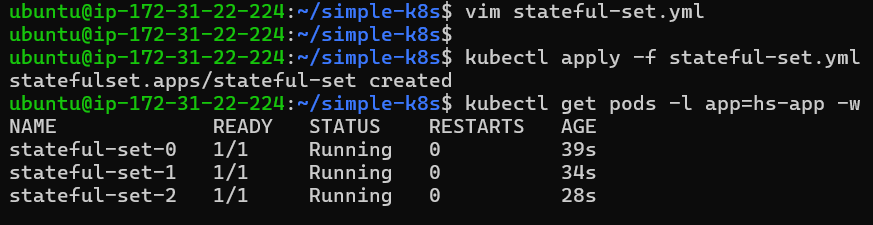
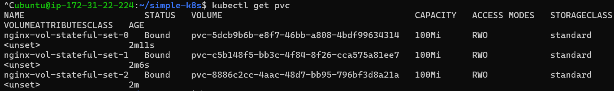
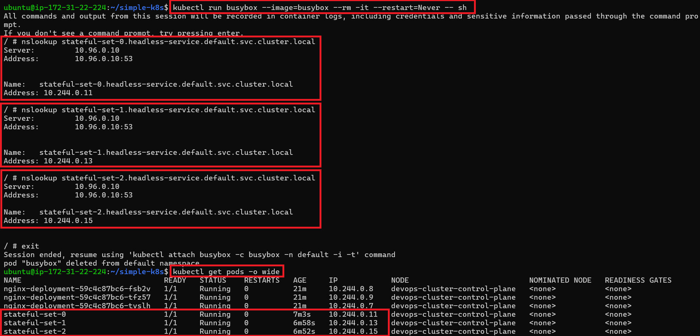
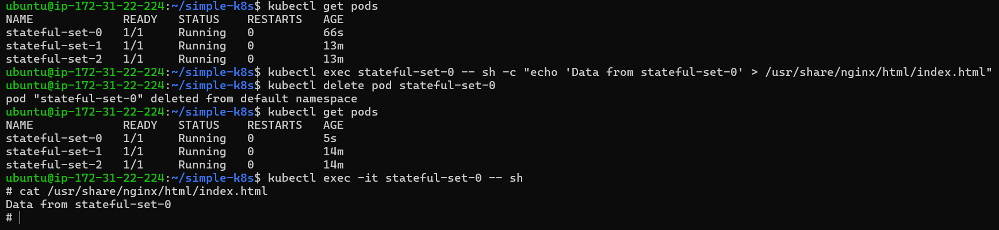
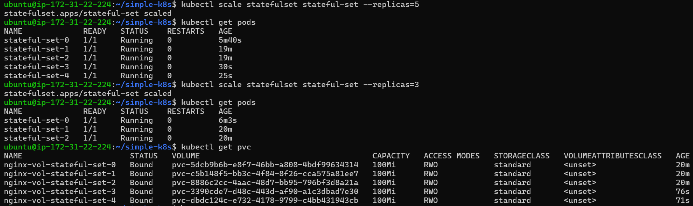
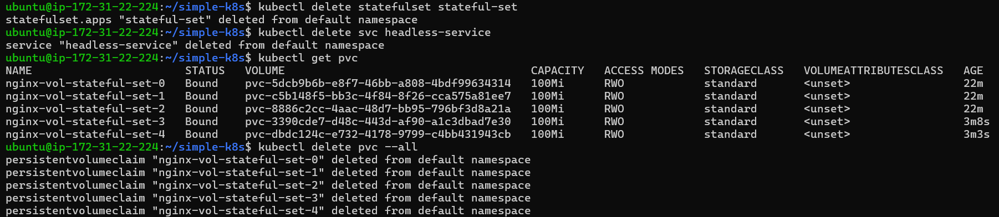

# Day 56 – Kubernetes StatefulSets

## What is a StatefulSet?

A StatefulSet is a Kubernetes workload for **stateful applications** such as MySQL, PostgreSQL and Kafka. Each replica gets:

- a **stable, ordered name** (`stateful-set-0`, `stateful-set-1`, ...)
- a **stable DNS name** that survives restarts
- its **own PersistentVolumeClaim**, which is re-attached when the pod is recreated
- **ordered** startup and shutdown

**Use a Deployment** for stateless apps (web servers, APIs) where any pod is interchangeable.
**Use a StatefulSet** when each replica has its own identity or data (databases, message brokers, clustered apps).

## Deployment vs StatefulSet

| Feature | Deployment | StatefulSet |
|---|---|---|
| Pod names | Random (`app-xyz-abc`) | Stable, ordered (`app-0`, `app-1`) |
| Startup order | All at once | Ordered: pod-0, then pod-1, then pod-2 |
| Storage | Shared PVC | Each pod gets its own PVC |
| Network identity | No stable hostname | Stable DNS per pod |

## How the pieces work together

- **Headless Service** (`clusterIP: None`): has no virtual IP and does no load balancing. DNS returns individual pod records instead. The StatefulSet's `serviceName` must point to it.
- **Stable DNS**: every pod gets `<pod-name>.<service-name>.<namespace>.svc.cluster.local`. The name stays the same even if the pod IP changes.
- **volumeClaimTemplates**: a PVC template. Kubernetes creates one PVC per pod named `<template-name>-<pod-name>` (e.g. `nginx-vol-stateful-set-0`). The pod always reconnects to its own PVC.

---

## Task 1: Understand the Problem

Created an nginx Deployment with 3 replicas. Pod names are random.



**Verify: Why would random pod names be a problem for a database cluster?**
- Databases need a fixed identity per node (e.g. "primary" vs "replica 1").
- Other nodes and clients must find a specific member by a name that never changes.
- A replacement pod with a new random name would look like a brand new, unknown node, and it would not be linked to the old node's data.

## Task 2: Headless Service

```bash
kubectl apply -f headless-service.yml
kubectl get svc headless-service
```



**Verify: What does the CLUSTER-IP column show?**
- It shows **`None`**, meaning the service is headless.

## Task 3: StatefulSet

```bash
kubectl apply -f stateful-set.yml
kubectl get pods -l app=hs-app -w
kubectl get pvc
```

Pods were created in order: `-0`, then `-1`, then `-2`.




**Verify: What are the exact pod names and PVC names?**
- Pods: `stateful-set-0`, `stateful-set-1`, `stateful-set-2`
- PVCs: `nginx-vol-stateful-set-0`, `nginx-vol-stateful-set-1`, `nginx-vol-stateful-set-2` (100Mi, RWO, `Bound`)

## Task 4: Stable Network Identity

```bash
kubectl run busybox --image=busybox --rm -it --restart=Never -- sh
nslookup stateful-set-0.headless-service.default.svc.cluster.local
nslookup stateful-set-1.headless-service.default.svc.cluster.local
nslookup stateful-set-2.headless-service.default.svc.cluster.local
kubectl get pods -o wide
```

| DNS name | Resolved IP | Pod IP (`get pods -o wide`) |
|---|---|---|
| stateful-set-0.headless-service.default.svc.cluster.local | 10.244.0.11 | 10.244.0.11 |
| stateful-set-1.headless-service.default.svc.cluster.local | 10.244.0.13 | 10.244.0.13 |
| stateful-set-2.headless-service.default.svc.cluster.local | 10.244.0.15 | 10.244.0.15 |



**Verify: Does the nslookup IP match the pod IP?**
- **Yes**, all three match exactly.

## Task 5: Stable Storage, Data Survives Pod Deletion

```bash
kubectl exec stateful-set-0 -- sh -c "echo 'Data from stateful-set-0' > /usr/share/nginx/html/index.html"
kubectl delete pod stateful-set-0
kubectl get pods
kubectl exec -it stateful-set-0 -- sh
cat /usr/share/nginx/html/index.html
```



**Verify: Is the data identical after pod recreation?**
- **Yes.** The recreated pod kept the same name and printed `Data from stateful-set-0`.
- It re-attached to the same PVC, so the data was preserved.

## Task 6: Ordered Scaling

```bash
kubectl scale statefulset stateful-set --replicas=5   # creates -3, then -4
kubectl scale statefulset stateful-set --replicas=3   # removes -4, then -3
kubectl get pvc
```



**Verify: After scaling down, how many PVCs exist?**
- **5 PVCs** (`-0` to `-4`). Kubernetes keeps PVCs on scale-down, so data is preserved if you scale back up.

## Task 7: Clean Up

```bash
kubectl delete statefulset stateful-set
kubectl delete svc headless-service
kubectl get pvc
kubectl delete pvc --all
```



**Verify: Were PVCs auto-deleted with the StatefulSet?**
- **No.** All 5 PVCs were still `Bound` after deleting the StatefulSet and service.
- This is a safety feature to protect data. PVCs must be deleted manually.

---

## Key Takeaways

- StatefulSets give pods **stable names, stable DNS and stable storage**.
- Pods are created in order (0, 1, 2) and terminated in reverse (2, 1, 0).
- A **headless service** is required for per-pod DNS.
- **PVCs outlive pods, scale-downs and the StatefulSet itself**, so clean them up manually.
