# Day 57 – Resource Requests, Limits, and Probes

### Task 1: Resource Requests and Limits
1. Write a Pod manifest with `resources.requests` (cpu: 100m, memory: 128Mi) and `resources.limits` (cpu: 250m, memory: 256Mi)
2. Apply and inspect with `kubectl describe pod` — look for the Requests, Limits, and QoS Class sections
3. Since requests and limits differ, the QoS class is `Burstable`. If equal, it would be `Guaranteed`. If missing, `BestEffort`.

CPU is in millicores: `100m` = 0.1 CPU. Memory is in mebibytes: `128Mi`.

**Requests** = guaranteed minimum (scheduler uses this for placement). **Limits** = maximum allowed (kubelet enforces at runtime).

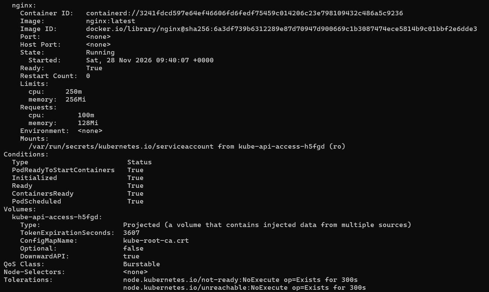

**Verify:** What QoS class does your Pod have?

> Pod has `Burstable` QoS class.

---

### Task 2: OOMKilled — Exceeding Memory Limits
1. Write a Pod manifest using the `polinux/stress` image with a memory limit of `100Mi`
2. Set the stress command to allocate 200M of memory: `command: ["stress"] args: ["--vm", "1", "--vm-bytes", "200M", "--vm-hang", "1"]`
3. Apply and watch — the container gets killed immediately

CPU is throttled when over limit. Memory is killed — no mercy.

Check `kubectl describe pod` for `Reason: OOMKilled` and `Exit Code: 137` (128 + SIGKILL).

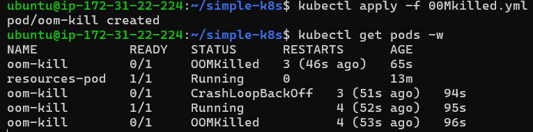

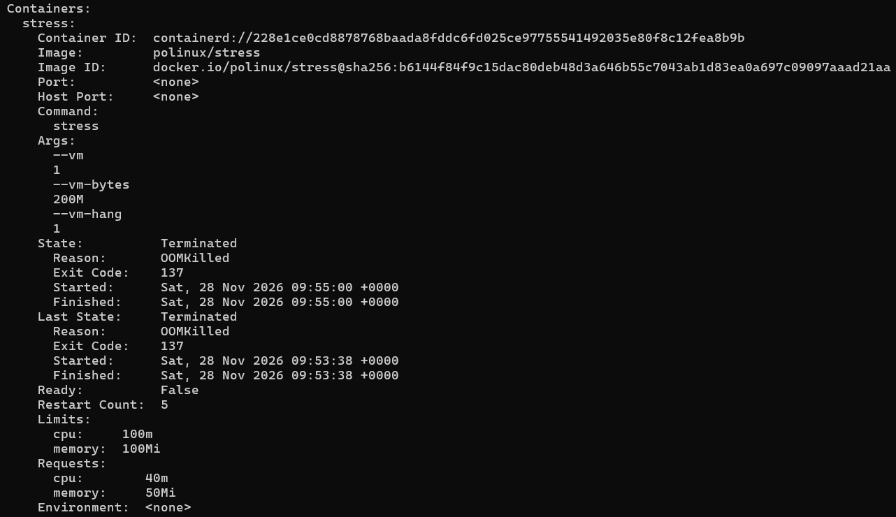

**Verify:** What exit code does an OOMKilled container have?

> It has `Exit Code 137`.

---

### Task 3: Pending Pod — Requesting Too Much
1. Write a Pod manifest requesting `cpu: 100` and `memory: 128Gi`
2. Apply and check — STATUS stays `Pending` forever
3. Run `kubectl describe pod` and read the Events — the scheduler says exactly why: insufficient resources

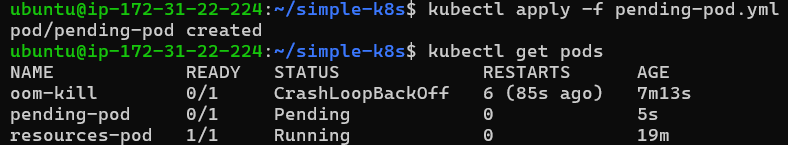

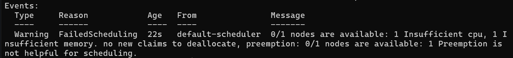

**Verify:** What event message does the scheduler produce?

> `FailedScheduling` - Due to insufficient CPU, Memory.

---

### Task 4: Liveness Probe
A liveness probe detects stuck containers. If it fails, Kubernetes restarts the container.

1. Write a Pod manifest with a busybox container that creates `/tmp/healthy` on startup, then deletes it after 30 seconds
2. Add a liveness probe using `exec` that runs `cat /tmp/healthy`, with `periodSeconds: 5` and `failureThreshold: 3`
3. After the file is deleted, 3 consecutive failures trigger a restart. Watch with `kubectl get pod -w`

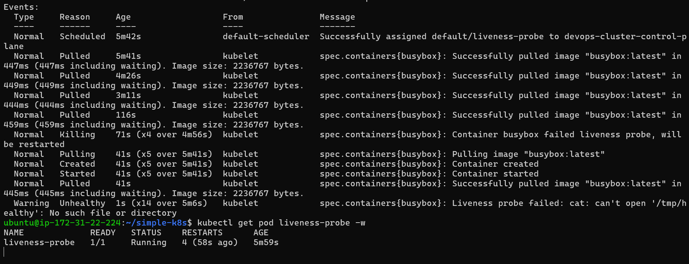

**Verify:** How many times has the container restarted?

> It restarted `4` times (see `RESTARTS 4` in `kubectl get pod -w`). The events show `Liveness probe failed: cat: can't open '/tmp/healthy'`, followed by `Killing` (container failed liveness probe, will be restarted). The cycle repeats, so the count keeps growing.

** Why Liveness probe?

- **Liveness probe**
  - Why: a container can be running but stuck (deadlock, hung app). Kubernetes cannot see this by itself, because the process is still alive.
  - Without it: the app stays broken forever and nobody fixes it.
  - With it: Kubernetes restarts the container, so it can recover on its own

---

### Task 5: Readiness Probe
A readiness probe controls traffic. Failure removes the Pod from Service endpoints but does NOT restart it.

1. Write a Pod manifest with nginx and a `readinessProbe` using `httpGet` on path `/` port `80`
2. Expose it as a Service: `kubectl expose pod <name> --port=80 --name=readiness-svc`
3. Check `kubectl get endpoints readiness-svc` — the Pod IP is listed
4. Break the probe: `kubectl exec <pod> -- rm /usr/share/nginx/html/index.html`
5. Wait 15 seconds — Pod shows `0/1` READY, endpoints are empty, but the container is NOT restarted

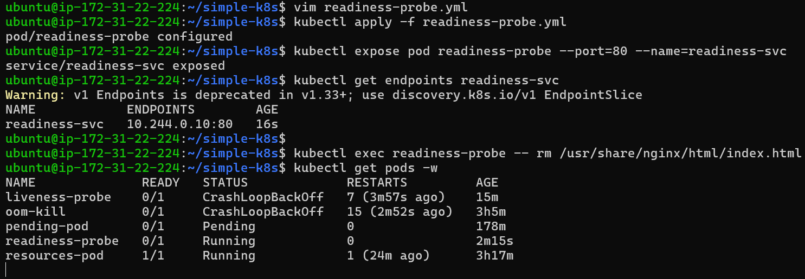

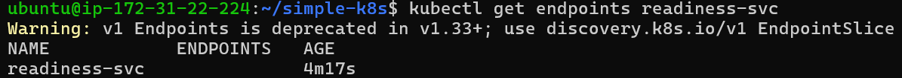

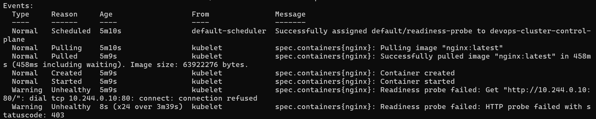

**Verify:** When readiness failed, was the container restarted?

> No. `RESTARTS` stayed `0`. After `index.html` was deleted, the probe failed with HTTP `403` and the endpoints became empty, so the Pod got no traffic. The container kept running.

** Why Readiness probe?

- **Readiness probe**
  - Why: a container can be running but not ready to serve (still warming up, loading data, or overloaded).
  - Without it: the Service sends users to a Pod that cannot answer, so they get errors.
  - With it: the Pod is taken out of the Service endpoints until it is ready. No restart is needed.

---

### Task 6: Startup Probe
A startup probe gives slow-starting containers extra time. While it runs, liveness and readiness probes are disabled.

1. Write a Pod manifest where the container takes 20 seconds to start (e.g., `sleep 20 && touch /tmp/started`)
2. Add a `startupProbe` checking for `/tmp/started` with `periodSeconds: 5` and `failureThreshold: 12` (60 second budget)
3. Add a `livenessProbe` that checks the same file — it only kicks in after startup succeeds

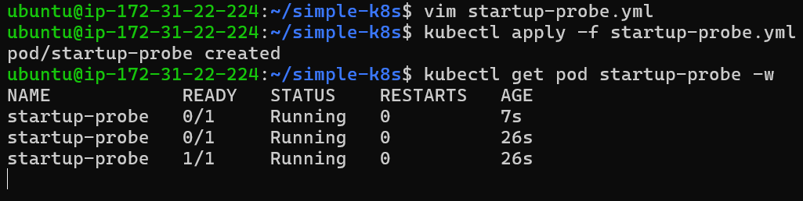

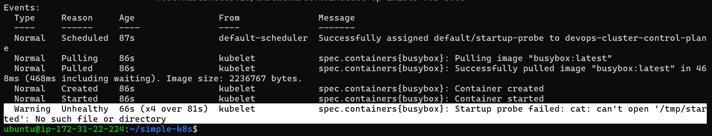

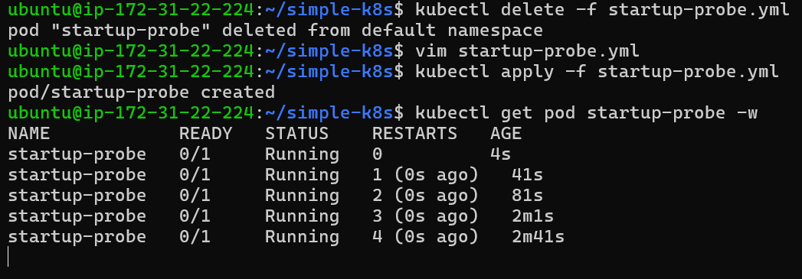

**Verify:** What would happen if `failureThreshold` were 2 instead of 12?

> The startup budget would be only `2 × 5 = 10` seconds, but the app needs 20 seconds. The startup probe fails, so Kubernetes kills and restarts the container again and again. In my test, READY stayed `0/1` and `RESTARTS` kept rising (1, 2, 3, 4). With `failureThreshold: 12`, the Pod became `1/1` Ready at about 26s with `0` restarts.

** Why Readiness probe?

- **Startup probe**
  - Why: slow apps need more time to start. A liveness probe may think they are dead and kill them too early.
  - Without it: a slow app can get stuck in a restart loop before it ever finishes starting.
  - With it: liveness and readiness probes wait until startup succeeds, so the app gets enough time.
---

### Task 7: Clean Up
Delete all pods and services you created.

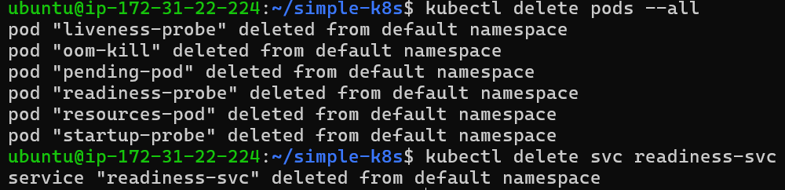

---

## Extra Notes

### Requests vs Limits (Scheduling vs Enforcement)

| | Requests | Limits |
|---|---|---|
| Meaning | Minimum the container needs | Maximum the container can use |
| Used by | Scheduler | Kubelet (at runtime) |
| When | Before the Pod is placed on a node | While the Pod is running |
| If too high | Pod stays `Pending` | Not an issue, it is only a cap |
| If too low | Pod may get throttled or evicted under pressure | Container may be throttled or killed |

- **Scheduling:** the scheduler adds up the *requests* on a node. It places the Pod only if enough space is left.
- **Enforcement:** the kubelet makes sure the container never goes over its *limits*.
- **QoS class:**
  - `Guaranteed` = requests equal limits
  - `Burstable` = requests are lower than limits
  - `BestEffort` = no requests or limits

### What Happens When Limits Are Exceeded

| | CPU limit exceeded | Memory limit exceeded |
|---|---|---|
| Type | Compressible | Not compressible |
| Result | Container is **throttled** (slowed down) | Container is **killed** (`OOMKilled`) |
| Restart? | No | Yes (based on `restartPolicy`) |
| Exit code | None | `137` |
| How to see it | Slow app, high latency | `kubectl describe pod` shows `Reason: OOMKilled` |

- CPU can be shared out, so Kubernetes just slows the container down.
- Memory cannot be taken back, so Kubernetes kills the container.
- Repeated OOM kills lead to `CrashLoopBackOff`.

### Liveness vs Readiness vs Startup Probes

| | Liveness | Readiness | Startup |
|---|---|---|---|
| Question | Is the container stuck? | Is it ready for traffic? | Has it finished starting? |
| On failure | Container is **restarted** | Pod is **removed from Service endpoints** | Container is **restarted** |
| Restarts container? | Yes | No | Yes |
| Runs | Throughout the life of the container | Throughout the life of the container | Only at startup |
| Use for | Deadlocks, hung apps | Warm-up, temporary overload | Slow-starting apps |

- Startup probe runs first. Liveness and readiness wait until it succeeds.
- Use readiness to stop traffic. Use liveness to fix a stuck app.
